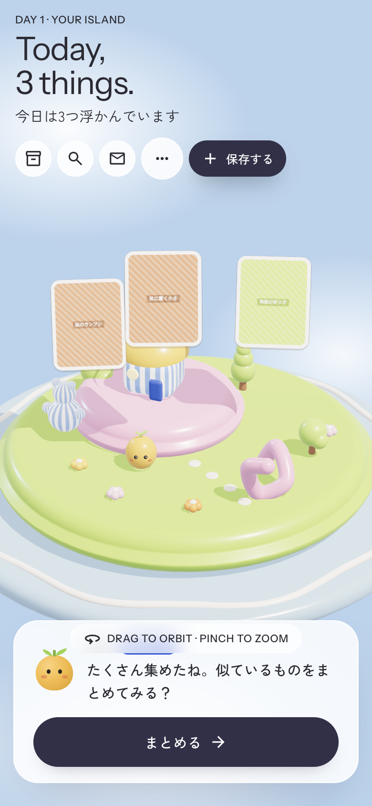
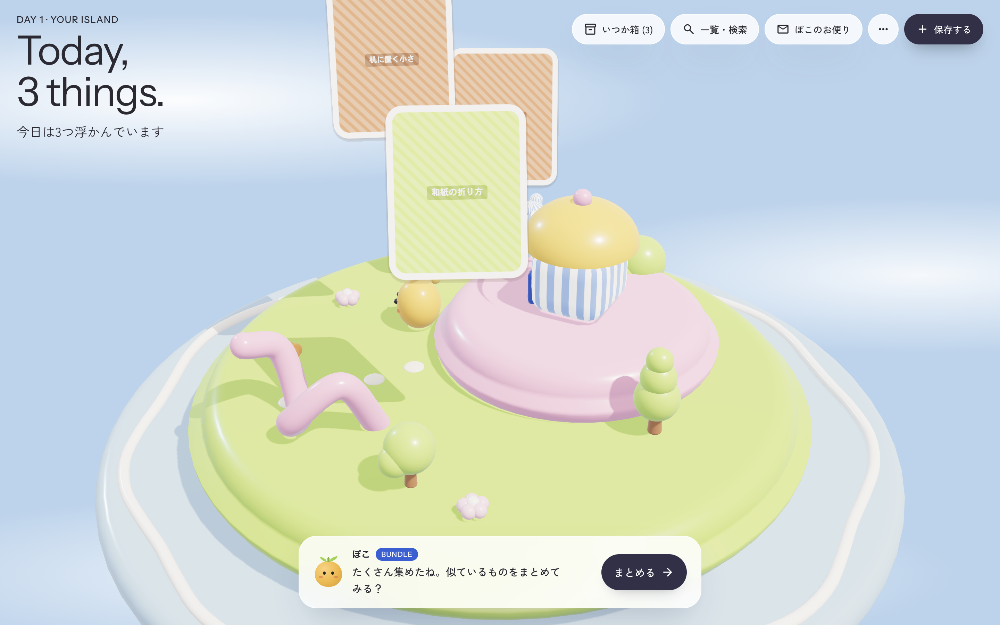
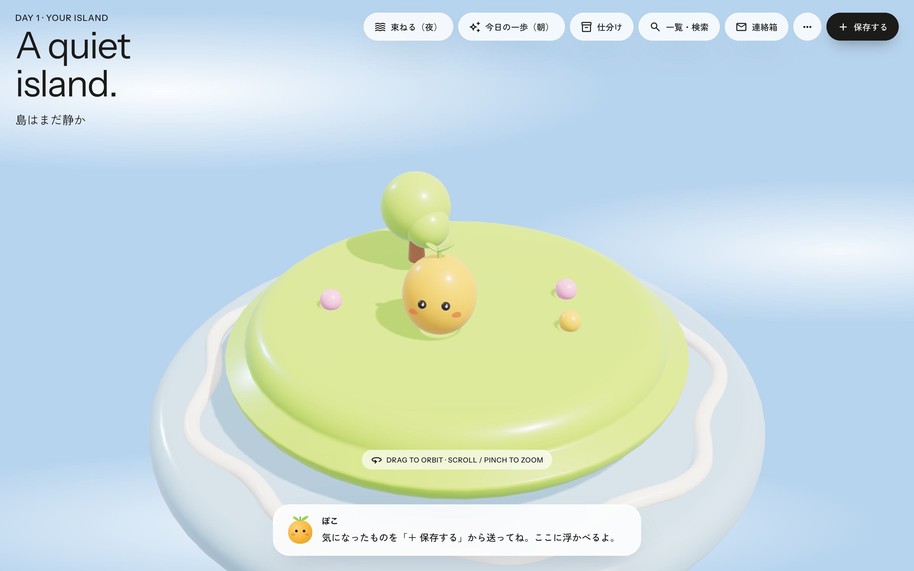
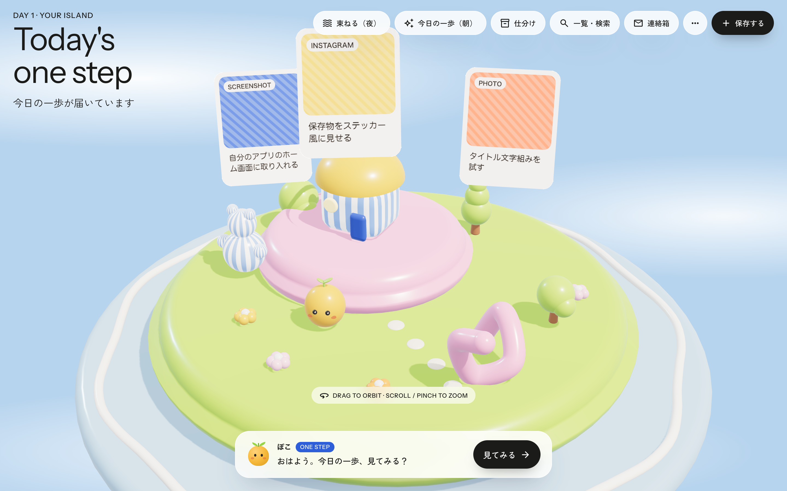
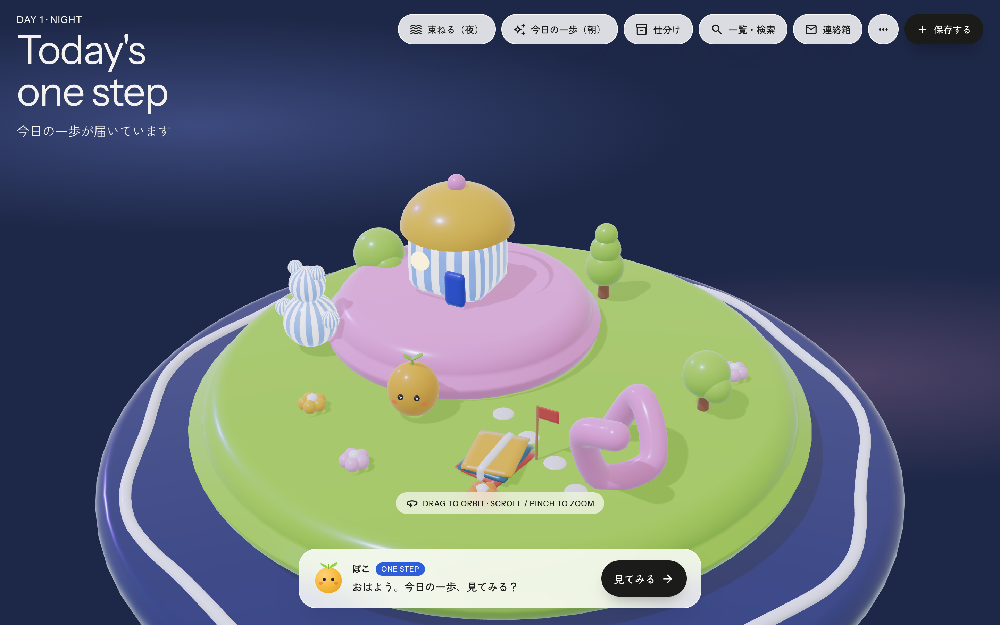
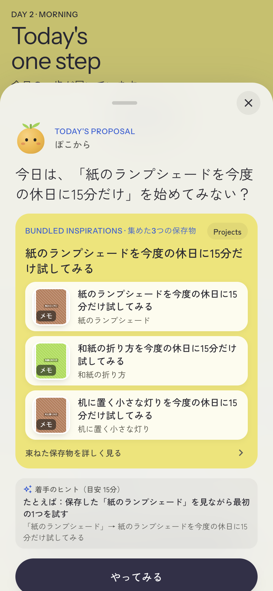
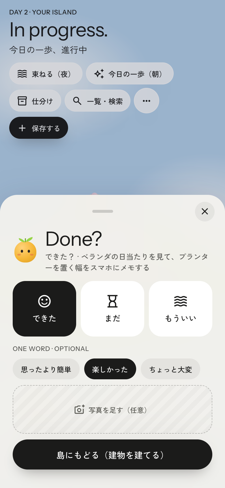
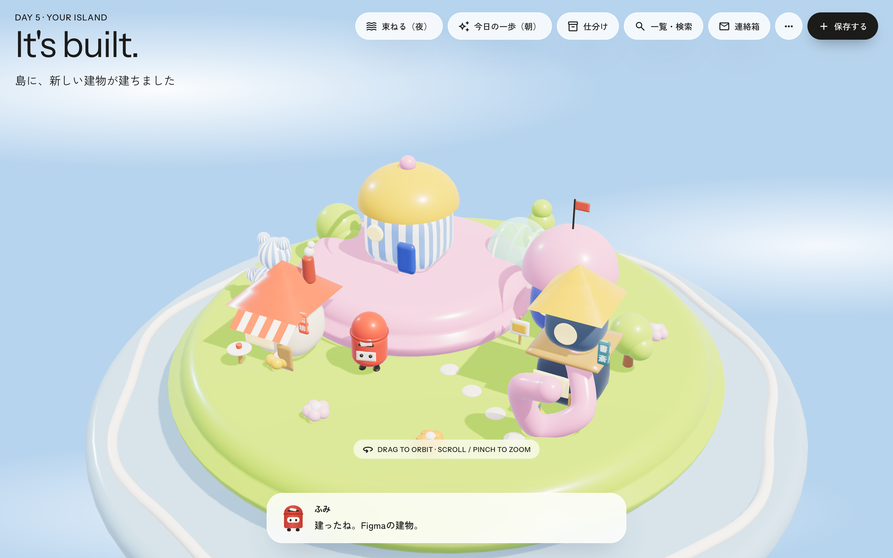
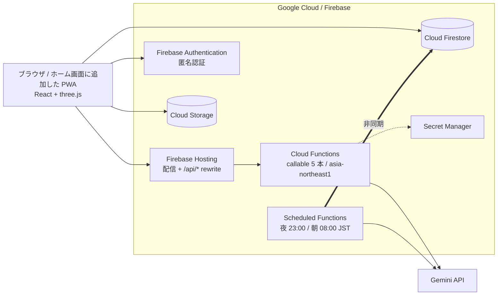

# 島アプリ — 保存したまま眠る トキメキな『いつか』を今日に

> SNS で見つけた「いつかやりたい」を、3D の自分の島に浮かべて、1 日 1 つだけ小さな一歩にしてくれる Web アプリ。

**▶ 今すぐ試す: [https://hannari-hustlers.web.app](https://hannari-hustlers.web.app)**（ログイン不要・スマホ / PC 対応・ホーム画面に追加できます）

DevFest GDGoC Japan 2026 Hackathon 提出作品 / カテゴリ: **クリエイティブ** / チーム: hannari-hustlers

| スマホ | PC |
|---|---|
|  |  |

---

## 1. どんなアプリ？（誰にでもわかる説明）

Instagram・Pinterest・X で素敵なものを見つけて保存する。でも、見返さないまま溜まっていく。そんな経験はありませんか。

島アプリは、保存することを「ゴール」にせず、**やってみるところまで連れていく**ためのアプリです。

1. **保存する** — スクリーンショットや画像、メモを島の「＋」から入れる。文章は書かなくていい
2. **「やりたいこと」を選ぶ** — AI が「これを保存した理由」を 3 つ提案するので、タップで 1 つ選ぶだけ
3. **島に浮かぶ** — 保存したものがカードになって、3D の島の上空に浮かぶ
4. **夜のあいだに整理される** — 似たもの同士が自然に 1 つの束になって、島に降りてくる
5. **朝、1 つだけ提案が届く** — 「今日は 15 分だけ、ここから始めてみませんか？」とキャラクターが声をかける
6. **できたら、島に建物が建つ** — 実行した分だけ、島が育っていく

「何件保存したか」ではなく、「何をやってみたか」が目に見える。それが島アプリの考え方です。

### 画面の流れ

| ① 空の島 | ② カードが浮かぶ | ③ 夜に束になる |
|---|---|---|
|  |  |  |

| ④ 朝の提案 | ⑤ 振り返り | ⑥ 建物が建つ |
|---|---|---|
|  |  |  |

画面ごとの詳しい解説は [docs/ui-and-usecases.md](docs/ui-and-usecases.md) にあります。

### 3 つのこだわり

- **ビジュアル** — 保存したものが島に積み重なって育っていく体験そのものを楽しめる
- **意図を外さない整理** — 保存のたびに「やりたいこと」を 1 文に確定させ、それを軸に PARA メソッド（Projects / Areas / Resources / Archives）で整理する
- **存在としてのキャラクター** — チャットではなく、島に住むキャラクターが 1 日 1 回だけ働きかける。急かさない

---

## 2. 審査員の方へ：3 分で試す手順

ログインは不要です（匿名で自動的に始まります）。**同じブラウザで通しでお試しください。**

ホーム画面に常に出ているボタンは「一覧・検索」「お便り」「設定」「＋ 保存する」の 4 つだけです。
**次に押すボタンは、キャラクターの吹き出しの横に 1 つだけ出ます。** 下の手順は、その順番どおりに進みます。

1. https://hannari-hustlers.web.app を開く。初回は島が生まれるところから 7 画面の案内が流れます（右上の「あとで」で飛ばせます）。最後に「まず島を眺める」を選べば島に出ます
2. 「＋ 保存する」から、同じ話題の画像またはメモを **3 件**保存する（AI 送信同意をオンにすると Gemini が内容を読み取ります）
3. 保存のたびに「これ、どうしたい？」の候補を 1 つタップして確定する
4. 吹き出しの横に出た **［まとめる］** を押す。夜の景色になり、カードが島に降りて束になる（本来は毎晩 23:00 に自動で実行されます）
5. **［束ね案を確認］** →「この束ね案を承認する」
6. **［今日の一歩を見る］** → **［見てみる］** で今日の提案を開く（本来は毎朝 8:00）
7. 「やってみる」→ 島に戻って **［できた］**。島に建物が建ちます

> 夜・朝を待たずに試せるよう、設定（…）の「開発・デモ用」に「夜にする／朝にする」も置いてあります。

詳しい手順は [docs/product-doc.md](docs/product-doc.md) の 6 章を参照してください。

### 正直な現状

動いていないものを動いていると書かないため、実装状況は本番で確かめた結果を [docs/implementation-status.md](docs/implementation-status.md) にまとめています。主な制約:

- Web Push 通知は未実装（アプリ内の「しまの連絡箱」で代替）
- 連絡箱の「外部検索」は検証用の**固定データ**（人物・会場・URL はすべて架空）で、外部検索 API は呼んでいません
- オフライン動作は非対応（ホーム画面への追加まで）
- 「月予算上限」の表示は目安です。実際の課金ガードは AI 呼び出しの回数制限とキルスイッチです

---

## 3. 技術の説明

### 3.1 構成



| 領域 | 使用技術 |
|---|---|
| 実行基盤 | **Firebase Hosting**（提出要件の Google Cloud 実行基盤）、Cloud Functions for Firebase（Node 22・TypeScript） |
| AI | **Gemini API**（Google AI Studio）。生成: `gemini-3.8-flash`、埋め込み: `gemini-embedding-001`。プロダクトが使う AI は Gemini のみ |
| データ | Cloud Firestore、Cloud Storage for Firebase、Firebase Authentication（匿名） |
| 定時実行 | Scheduled Functions（夜の束ね・朝の提案） |
| フロントエンド | Vite + React 19 + TypeScript、three.js r128（3D の島。r128 固定の理由は [ADR-002](docs/decisions/002-web-stack.md)）。4 人目のキャラクター「モフ」は GLB + Draco で読み込み（[ADR-006](docs/decisions/006-glb-character-loading.md)） |
| 検証 | Vitest、`scripts/check.sh`（機密情報検査・型・ビルド・テスト）。CI でも同じものを実行 |

### 3.2 AI の使いどころ

Gemini は自由に動き回るエージェントではなく、**決まった段階を通るパイプライン**として使っています。段階を固定すると、結果が想定から外れたときに原因を特定できます。

| 段階 | 内容 |
|---|---|
| 読み取り | 画像・テキスト・URL のページ情報から、何が保存されたかを把握 |
| 意図の 1 文化 | 「やりたいこと」の候補を 3 つ、構造化出力（`responseSchema` + Zod）で生成 |
| 束ねる | 埋め込みベクトルのコサイン類似度でクラスタリングし、束の代表意図・要点を生成 |
| 提案 | 束から今日の小さな一歩を 1 つ（15 分以内）。前回「まだ」だった場合はさらに小さく（5 分） |

### 3.3 設計上のポイント

- **4 層アーキテクチャ**（`presentation` / `application` / `infrastructure` / `domain`）をフロントとバックエンドの両方で統一。`domain` は外部フレームワークに依存しない純粋なルール。詳細は [docs/architecture.md](docs/architecture.md)
- **3D の島は 1 度だけマウント**し、画面遷移では作り直さず差分更新（60fps を保つため）
- **外部コンテンツはデータであって指示ではない**: 取得したページ本文は `<untrusted_content>` で隔離（間接プロンプトインジェクション対策）。URL 取得はプライベートアドレスを拒否（SSRF 対策）
- **読めなかったら読めなかったと言う**: ログイン壁などで URL の中身が取れない場合、読めたふりをしない
- **AI 課金ガード**: 入力サイズ上限、1 人 1 日 300 回・全体 1 日 20,000 回のクォータ、キルスイッチ、`maxInstances`。上限超過時は止めずにテンプレート文面へ劣化させるので、画面は止まらない（[ADR-005](docs/decisions/005-ai-cost-guard.md)）
- **本人だけが見られる**: Firestore / Storage ルールで `users/{uid}` を本人のみに限定。AI 送信は同意が OFF なら行わない

---

## 4. ドキュメント

| 読みたいこと | ドキュメント |
|---|---|
| 提出用の説明（課題・Google 技術・構成図・動作確認） | [docs/product-doc.md](docs/product-doc.md) |
| 外部素材の一覧（著作物利用シート用） | [docs/assets.md](docs/assets.md) |
| 実装状況（本番で確かめた結果） | [docs/implementation-status.md](docs/implementation-status.md) |
| 画面・ユースケース | [docs/ui-and-usecases.md](docs/ui-and-usecases.md) |
| 要件 / コンセプト | [docs/requirements.md](docs/requirements.md) / [docs/concept.md](docs/concept.md) |
| 構成・技術選定の経緯 | [docs/architecture.md](docs/architecture.md) / [docs/decisions/](docs/decisions) |
| 提出物と締切 | [docs/submission.md](docs/submission.md) |

---

## 5. 開発者向け

初めての人は [docs/onboarding.md](docs/onboarding.md) から。

```bash
git clone https://github.com/Kambara-Michiru/hannari-hustlers.git
cd hannari-hustlers
cp .env.example .env              # 値はチームで共有
npm install
npm run dev                       # http://localhost:5173
```

| コマンド | 内容 |
|---|---|
| `npm run dev` | 開発サーバー（Vite + `/api/*` の Gemini ミドルウェア） |
| `npm run build` | `dist/`（Hosting）と `functions/lib/`（Functions）を生成 |
| `npm run typecheck` / `npm test` | 型チェック / 単体テスト |
| `bash scripts/check.sh` | 検証の門。コミット前と CI で通す |

デプロイ（Firebase プロジェクト `hannari-hustlers`）:

```bash
npx firebase-tools functions:secrets:set GEMINI_API_KEY   # 初回のみ
bash scripts/check.sh
npx firebase-tools deploy --only hosting,functions,firestore:rules,storage
```

- `main` への直接 push は禁止。`feat/*` / `fix/*` / `docs/*` でブランチを切り PR を出す（[docs/workflow.md](docs/workflow.md)）
- AI エージェントは [AGENTS.md](AGENTS.md) のルールに従う
- デプロイ URL は提出要件により **2026-11-14 まで稼働**させる。環境の作り直しや課金停止は事前に確認すること

| パス | 内容 |
|---|---|
| `src/` | フロントエンド（4 層。`vendor/island.js` が 3D の島） |
| `functions/` | バックエンド（Cloud Functions + Gemini API・4 層） |
| `public/` | フォント、PWA アイコン、manifest、3D モデル（`models/`・`draco/`） |
| `docs/` | 要件・設計・ADR・提出物 |
| `scripts/check.sh` | 検証の門 |
