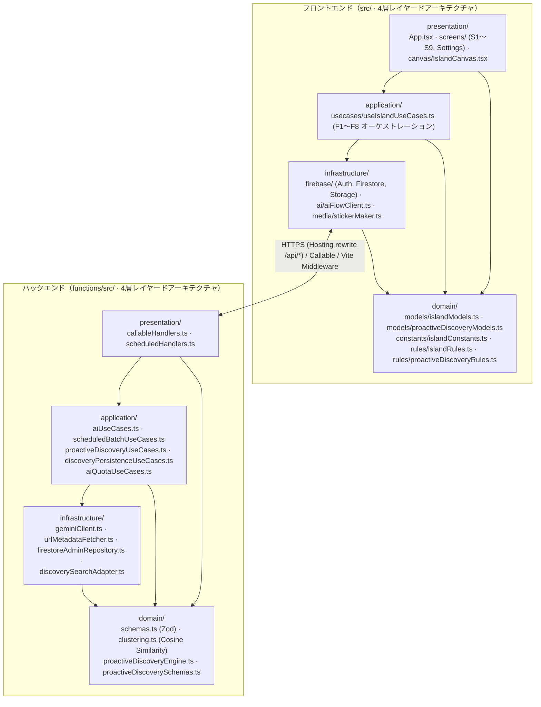

# アーキテクチャ

状態: 確定（2026-11-07）。技術スタック・バックエンド・実アプリ化仕様・Project/Area 初回アンケート＆即時紐づけ仕様は [`decisions/002-web-stack.md`](decisions/002-web-stack.md)、[`decisions/003-backend-and-data-model.md`](decisions/003-backend-and-data-model.md)、[`decisions/004-project-area-and-onboarding.md`](decisions/004-project-area-and-onboarding.md) で承認済み（[ADR-001](decisions/001-tech-stack.md) は廃止）。
要件は [`requirements.md`](requirements.md)、PC／スマホ両対応の画面遷移・ユースケース解説は [`ui-and-usecases.md`](ui-and-usecases.md) を参照。

> **このファイルは設計を書いている。設計どおりに動いていない箇所があるため、本番で何が動いていて何が動いていないかは [`implementation-status.md`](implementation-status.md) を正とすること。**

---

## 1. レイヤードアーキテクチャ全体構成（フロントエンド & バックエンド統一 4 層）

フロントエンド（[`src/`](../src)）とバックエンド（[`functions/src/`](../functions/src)）の双方を、責務が明確に分離された **4 層レイヤードアーキテクチャ（`presentation` / `application` / `infrastructure` / `domain`）** で構成している。

### 依存方向の原則（単方向ルール）

- **`presentation`**（UI 描画 / エンドポイント受付）→ `application`, `domain` にのみ依存（**`infrastructure` への直接依存を禁止**）
- **`application`**（ユースケース / オーケストレーション）→ `domain`, `infrastructure` に依存
- **`infrastructure`**（Firebase / Gemini / Storage / Canvas 切り抜き等の外部技術アダプタ）→ `domain` にのみ依存
- **`domain`**（エンティティ型・スキーマ・純粋ビジネスルール・クラスタリング数理）→ **外部フレームワーク（React / Firebase / Three.js 等）への依存ゼロ**



---

## 2. ディレクトリ構造

リポジトリルート（`hannari-hustlers/`）直下に設定ファイル・フロントエンド（`src/`）・バックエンド（`functions/`）・ドキュメント（`docs/`）を配置している。

```text
hannari-hustlers/
├── index.html                        # PWA メタデータ・フォント読込・マウントルート (#root)
├── package.json                      # フロントエンド依存関係・スクリプト (three は 0.128.0 固定)
├── vite.config.ts                    # Vite 設定 + ローカル開発用 /api/* AI パイプラインミドルウェア
├── firebase.json                     # Firebase Hosting / Firestore / Storage / Functions 設定
├── firestore.rules                   # Firestore セキュリティルール (users/{uid} 本人のみ読み書き可)
├── storage.rules                     # Cloud Storage セキュリティルール (users/{uid} 本人のみ読み書き可)
├── public/                           # 静的配信アセット
│   ├── fonts/                        # セルフホストフォント (Instrument Sans / Zen Kaku Gothic New / JetBrains Mono / Material Symbols)
│   ├── icons/                        # PWA アイコン (192px / 512px)
│   ├── manifest.webmanifest          # PWA マニフェスト
│   └── sw.js                         # Service Worker（未使用。オフライン対応は入れない方針 → implementation-status.md 2.4）
├── src/                              # フロントエンド (Vite + React + TypeScript · 4層アーキテクチャ)
│   ├── main.tsx                      # エントリポイント (React ルートマウント)
│   ├── domain/                       # 【Domain 層】外部フレームワーク非依存の型・定数・純粋ビジネスルール
│   │   ├── models/
│   │   │   ├── islandModels.ts       # エンティティ定義 (SavedItem, Bundle, Proposal, ParaCategory 等)
│   │   │   └── proactiveDiscoveryModels.ts # 能動発見のエンティティ (ConfirmedSubject, ResearchReport, DiscoveryQuestion 等)
│   │   ├── constants/
│   │   │   └── islandConstants.ts    # キャラクター定義・PARA タブ定義・時間帯テーマ配色
│   │   └── rules/
│   │       ├── islandRules.ts        # 純粋ドメインルール (見出し・吹き出し算出、夜の整理対象抽出、束の所属判定、フォールバック生成)
│   │       └── proactiveDiscoveryRules.ts # 能動発見の純粋ルール (同名判定、検索語プレビュー、初期値の組み立て)
│   ├── application/                  # 【Application 層】ユースケースのオーケストレーション
│   │   └── usecases/
│   │       └── useIslandUseCases.ts  # F1〜F8 のユースケース制御・状態遷移・Infrastructure 呼び出し統合
│   ├── infrastructure/               # 【Infrastructure 層】外部 API・DB・ブラウザ API アダプタ
│   │   ├── firebase/
│   │   │   ├── firebaseClient.ts     # Firebase SDK 初期化・匿名認証 (signInAnonymously)
│   │   │   ├── firestoreRepository.ts# Firestore (items / bundles / proposals) & localStorage 永続化アダプタ
│   │   │   └── storageClient.ts      # Cloud Storage ステッカー画像アップロード
│   │   ├── ai/
│   │   │   └── aiFlowClient.ts       # /api/* (Hosting rewrite) → httpsCallable → ローカル engine の 3 段フォールバック
│   │   └── media/
│   │       └── stickerMaker.ts       # 画像リサイズ・window.Island.makeSticker による切り抜きステッカー生成
│   ├── presentation/                 # 【Presentation 層】UI 描画・画面・3D キャンバスブリッジ
│   │   ├── App.tsx                   # フルスクリーン UI シェル・レイヤー配置・ドロワー/シート分岐
│   │   ├── types/
│   │   │   └── uiTypes.ts            # 画面遷移・シート種別・3D エンジンマウント契約型
│   │   ├── canvas/
│   │   │   └── IslandCanvas.tsx      # 3D 島キャンバスのマウント・ctrl.set() 差分更新・WebGL 非対応時フォールバック
│   │   ├── common/
│   │   │   └── UiParts.tsx           # 共通 UI 部品 (Icon, Avatar, SayBubble)
│   │   ├── screens/                  # 全 9 画面 (S1〜S9) + 設定シート
│   │   │   ├── S1Welcome.tsx         # S1: はじめて（初回ウェルカム）
│   │   │   ├── S2Home.tsx            # S2: 島（ホーム・上部アクションピル・下部キャラクタードック・通知バナー）
│   │   │   ├── S3SaveSheet.tsx       # S3: 保存シート（Step1: 画像/URL/メモ入力 → Step2: AI 意図 3 候補の確定）
│   │   │   ├── S4ProposalSheet.tsx   # S4: 今日の 1 提案（ドロワー/シート版 & 全画面手紙版）
│   │   │   ├── S5BundleSheet.tsx     # S5: 束の詳細（代表意図・AI 要点 3 つ・元保存物リスト・手放す）
│   │   │   ├── S6ReflectSheet.tsx    # S6: 振り返り（できた / まだ / もういい + ひとこと・写真記録）
│   │   │   ├── S7SortView.tsx        # S7: 週 1 の仕分け（Someday/Maybe のスワイプ仕分け）
│   │   │   ├── S8SearchSheet.tsx     # S8: 一覧・検索（PARA 5 タブ + キーワード横断検索）
│   │   │   ├── S9ItemSheet.tsx       # S9: 保存物の詳細（意図の編集・PARA 変更・元リンク遷移）
│   │   │   ├── SettingsSheet.tsx     # 設定（キャラクター・3D 質感・提案表示形式・あんしん設定・データ初期化）
│   │   │   ├── IslandSettingsSection.tsx # お便りのあんしん設定（Project/Area 選択・同意・月予算上限）
│   │   │   └── DiscoveryInboxSheet.tsx # しまの連絡箱（お便り・しつもんカード・「好き」帳・調べ方の記録）
│   │   └── styles/
│   │       └── styles.css            # デザイントークン & PC 右ドロワー / スマホボトムシートのレスポンシブ CSS
│   ├── vendor/
│   │   ├── island.js                 # 3D 島・キャラクター・カードの描画エンジン（ADR-002 により不変）
│   │   └── island.d.ts               # モジュール宣言
│   └── __tests__/
│       └── aiCore.test.ts            # Domain ルール・AI ユースケース・コサイン類似度束ねの単体テスト
└── functions/                        # バックエンド (Cloud Functions for Firebase + Gemini API · 4層アーキテクチャ)
    ├── package.json
    ├── tsconfig.json
    └── src/
        ├── index.ts                  # エントリポイント（Presentation 層のハンドラを再エクスポート）
        ├── domain/                   # 【Domain 層】スキーマとクラスタリング数理ロジック
        │   ├── schemas.ts            # 入出力 Zod スキーマ定義 (AnalyzeItem, ConfirmIntent, NightOrganize, MorningPropose)
        │   ├── clustering.ts         # コサイン類似度・決定論的フォールバックベクトル・貪欲クラスタリング
        │   ├── proactiveDiscoveryEngine.ts   # 能動発見の判定ロジック（同意確認・公式照合・質問生成・抑制）
        │   └── proactiveDiscoverySchemas.ts  # 能動発見の Zod スキーマ
        ├── application/              # 【Application 層】AI ユースケースと定時バッチオーケストレーション
        │   ├── aiUseCases.ts         # F2/F3 解析・意図確定 Embedding・F5 夜の束ね・F6 朝の提案ユースケース
        │   ├── scheduledBatchUseCases.ts # 全ユーザーの夜整理・朝提案バッチ処理ユースケース
        │   ├── proactiveDiscoveryUseCases.ts # 能動発見サイクル（同意確認 → 検索 → 公式照合 → カード/質問生成）
        │   ├── discoveryPersistenceUseCases.ts # 能動発見の結果を Firestore に残す層（冪等・同意再確認・通知キュー）
        │   └── aiQuotaUseCases.ts         # AI 呼び出しの日次クォータとキルスイッチ（不特定多数の課金対策 / ADR-005）
        ├── infrastructure/           # 【Infrastructure 層】外部通信・LLM・Firestore Admin アダプタ
        │   ├── urlMetadataFetcher.ts # SSRF 対策付き URL 取得 & <untrusted_content> 隔離
        │   ├── geminiClient.ts       # Gemini REST 呼び出し（JSON 生成・埋め込み）・モデルフォールバック・タイムアウト
        │   ├── firestoreAdminRepository.ts # Firebase Admin Firestore 読み書きリポジトリ（夜/朝バッチ + 能動発見の保存）
        │   └── discoverySearchAdapter.ts   # 外部検索アダプタ。現状は固定の参照データのみ（実際の検索 API は呼ばない）
        └── presentation/             # 【Presentation 層】Cloud Functions トリガー受付・認証・バリデーション
            ├── callableHandlers.ts   # onCall ハンドラ（認証必須。Genkit Flow 定義は残骸。実行経路外・使わない方針）
            └── scheduledHandlers.ts  # Cloud Scheduler 定時トリガー (23:00 JST / 08:00 JST)
```

---

## 3. 画面の構造と PC 版・スマホ版のレスポンシブ UI アーキテクチャ

**9 画面（S1〜S9）は 9 つの別ページではない。3D の島が背景に常駐し、その上にドロワー／ボトムシートやモーダルが重なる構造をとる。**

- 3D の島（[`IslandCanvas`](../src/presentation/canvas/IslandCanvas.tsx)）は初回に `window.Island.mount()` で **1 度だけマウントし、以降はアンマウントせず `ctrl.set()` で差分更新**する。
- 画面遷移ごとに 3D シーンを作り直さないことで、[`requirements.md`](requirements.md) の非機能要件である **60fps の描画性能** を維持する。
- [`requirements.md`](requirements.md) の画面一覧（S1〜S9）と遷移表は UX の単位としてそのまま対応し、実装上の単位は以下のレイヤー構造にマッピングされる。

| 項目 | スマホ版（`< 768px`） | PC 版（`>= 768px`） |
|---|---|---|
| **3D 島キャンバス（常駐背景）** | 全画面（`100vw × 100dvh`）。ピンチでズーム、ドラッグで回転 | 全画面（`100vw × 100dvh`）。ホイールでズーム、ドラッグで回転、画像ファイルの画面 D&D で即保存 |
| **ベース画面レイヤー** | S1（はじめて）、S2（島＝ホーム・上部ヘッダー＋下部キャラクタードック＋通知バナー） | S1（はじめて）、S2（島＝ホーム・左上タイポグラフィ見出し＋右上ラベル付きアクションピル＋下部中央ガラスドック） |
| **シート／ドロワー（S3 / S4 / S5 / S6 / S8 / S9 / 設定）** | **下からスライドアップするボトムシート**（高さ最大 `88dvh`、角丸 `28px 28px 0 0`） | **右端にフロートするすりガラス風サイドドロワー**（幅 `440px`、上下マージン `16px`、角丸 `28px`）。左側の 3D 島を見渡しながら並行操作できる |
| **モーダルシート（S4 手紙形式 / S7 週 1 仕分け）** | 全画面モーダルシート | 中央フロートモーダルカード（最大幅 `480px`、背景ブラー） |

---

## 4. 処理フローとバックエンド API

### A. 初回アンケートと保存時パイプライン（F01, F1〜F4・同期）

0. **初回アンケート（F01: `S1Welcome`）**:
   - カード型 4 問（Q1: 今進めていること Project、Q2: 日々大切にしたいこと Area、Q3: よく保存するもの、Q4: しまに期待すること）を任意入力（全スキップ可）で受け付け、`ProjectEntity` / `AreaEntity` と対応する初期 `Bundle`、および `UserSurveyProfile` を作成する。後から設定シート（`SettingsSheet`）や一覧シート（`S8SearchSheet`）でも Project / Area の追加・編集が可能。
1. **入力（S3 Step 1）**:
   - ユーザーが「＋ 保存する」ボタン（または PC 画面への画像ドラッグ＆ドロップ）から画像（PNG / JPEG / WebP、10MB 以下）・URL・テキストメモを入力する。
   - AI 送信同意トグル（`aiConsentGranted`）を備え、同意 OFF の場合は AI へ送信せず手動入力・手動分類で保存を完結できる（R02）。
2. **ステッカー切り抜き**: 画像がある場合は Application 層経由で [`stickerMaker.ts`](../src/infrastructure/media/stickerMaker.ts) が `window.Island.makeSticker` を呼び、3D カード用の切り抜きステッカー（DataURL）を生成する。
3. **AI 解析と意図 3 候補生成（F2 / F3: `analyzeItem`）**:
   - URL が含まれる場合、[`urlMetadataFetcher.ts`](../functions/src/infrastructure/urlMetadataFetcher.ts) が IPv4 / IPv6 プライベートアドレスを拒否（SSRF 対策）した上で OGP・本文テキストを取得し、`<untrusted_content>` タグで隔離して [`geminiClient.ts`](../functions/src/infrastructure/geminiClient.ts) (モデル指定は `geminiClient.ts` 参照) に渡す。Instagram 等のログイン壁や取得失敗時は `urlFetched: false` を返し、読めたふりをせず UI で誠実に案内する（R04）。
   - Gemini が Zod スキーマ（[`AnalyzeItemOutputSchema`](../functions/src/domain/schemas.ts)）に従い、タイトル・種別・要約メモ・**「やりたいことの 1 文」候補 3 つ**を返す。
4. **意図の確定・即時 Project/Area 紐づけ・Embedding 計算（F3 / F4: `confirmItemIntent`）**:
   - ユーザーは 3 候補から 1 つをタップ、自由編集、**「見るだけ・参考（Resources）」**、または **「あとで（Someday ？カード）」** を選べる。
   - 保存先チップで Project / Area を明示選択できるほか、「AI にまかせる」場合は `confirmItemIntent` が `targets`（登録済み Project / Area 一覧）と照合し、`confidence === 'clear'` のとき即時紐づけを行う（曖昧な場合は Someday に保留）。
   - Gemini の埋め込み API で埋め込みベクトルを計算し、[`firestoreRepository.ts`](../src/infrastructure/firebase/firestoreRepository.ts) が Firestore (`users/{uid}/items/{itemId}`) および `localStorage` に保存する。
   - 3D の島の上空にカードが浮かび上がる（`anim: 'addCard'`）。

### B. 夜の整理パイプライン（提案・承認型 F5: `nightOrganize`）

- **起動契機**: 定時ジョブ（`scheduledNightOrganize`: 毎日 23:00 JST）またはヘッダーの **「束ねる（夜）」** ボタン。
- **処理**:
  1. [`clustering.ts`](../functions/src/domain/clustering.ts) が意図確定済み（`intentConfirmed: true`、かつ `intentMode !== 'reference'`）の未整理保存物同士の Embedding コサイン類似度を計算し、クラスタリングする。
  2. クラスタごとに [`aiUseCases.ts`](../functions/src/application/aiUseCases.ts) がユーザーの登録済み Project / Area（`targets`）および Gemini (モデル指定は `geminiClient.ts` 参照) を用いて **束の代表意図・AI 要点 3 つ・関連ツール名・PARA カテゴリ** を生成し、`approvalStatus: 'pending'`（提案状態）として保存する。
  3. 島が夜のライティング（`phase: 'night'`）に切り替わり、空に浮かんでいたカードが島の地面へ降りて **束のスポット** になる（`anim: 'settle'`）。ユーザーは束の詳細シート（`S5BundleSheet`）で 1 タップ承認（または別 Project / Area への変更）を行える。

### C. 今日の一歩パイプライン（F6 / F05: `morningPropose`）

- **起動契機**:
  1. **ホーム表示時の自動生成（オンデマンド・1 日 1 件）**: ホーム（`S2Home`）を開いた際、ユーザーの現地タイムゾーン日付（`localDate: YYYY-MM-DD`、初期値 `Asia/Tokyo`）に対する提案がまだ無ければ、自動的に最大 1 件の提案を生成する。
  2. **デモ・手動トリガー**: ヘッダーの **「今日の一歩（朝）」** ボタン、または定時ジョブ（`scheduledMorningPropose`: 毎日 08:00 JST）。
- **処理**:
  1. [`selectTargetBundleForToday`](../src/domain/rules/islandRules.ts) がアクティブな Project（優先）または Area のうち、実行可能な意図確定済みアイテムを持つ束を 1 つ選び、Gemini で **15 分以内で終わる具体的な最初の一歩**（前回「まだ」だった場合は **5 分で終わるさらに小さな一歩**）を生成する。提案対象がない日は無理に生成しない（提案ゼロを許容）。
  2. 上部に通知バナー・下部ドックに「見てみる」ボタンが表示される。

### D. 振り返りと島の成長・アーカイブ復元・完全削除（F7 / F8 / R03）

- 提案で「やってみる」を選んだあと、下部ドックの **「できた？」** から振り返りシート（[`S6ReflectSheet`](../src/presentation/screens/S6ReflectSheet.tsx)）を開く。
- **「できた」** を選んで「島にもどる（建物を建てる）」を押すと、[`reflectOnProposal`](../src/application/usecases/useIslandUseCases.ts) が冪等（同一提案での二重加算防止）に `buildingLevel` を +1 し、束のスポットが **完成した建物（ドームアトリエ・温室・灯台・時計塔など）** に建て替わる（`anim: 'build'`）。
- **アーカイブと削除の区別**: `Archives` に入った束や保存物は `S5BundleSheet` / `S9ItemSheet` から **1 タップで元の置き場へ復元** できる。また、`S9ItemSheet` の「保存物を削除する」から Firestore ドキュメントと Cloud Storage 画像の双方を完全削除できる。

---

## 5. バックエンド API 一覧（Cloud Functions）

> Genkit の `defineFlow` による Flow 定義は [`callableHandlers.ts`](../functions/src/presentation/callableHandlers.ts) に存在するが、
> callable ハンドラは Flow を経由せずユースケース関数を直接呼んでいるため、**Flow は実行経路に入っていない**
> （[`implementation-status.md`](implementation-status.md) 2.3）。

| Flow / 関数名 | 種別 | 定義ファイル | 入出力（Zod スキーマ） |
|---|---|---|---|
| `analyzeItem` | Callable / HTTP (`/api/analyzeItem`) | [`callableHandlers.ts`](../functions/src/presentation/callableHandlers.ts) / [`aiUseCases.ts`](../functions/src/application/aiUseCases.ts) | In: `{ url?, rawText?, imageDataUrl?, fileName? }`<br>Out: `{ kind, title, source, note, color, c2, intents: [string, string, string], urlFetched?: boolean }` |
| `confirmItemIntent` | Callable / HTTP (`/api/confirmItemIntent`) | [`callableHandlers.ts`](../functions/src/presentation/callableHandlers.ts) / [`aiUseCases.ts`](../functions/src/application/aiUseCases.ts) | In: `{ title, intent, note?, targets? }`<br>Out: `{ embedding: number[], placementMatch?: { targetId, targetCategory, confidence, reason } }` |
| `nightOrganize` | Callable / HTTP + `onSchedule` (`23:00 JST`) | [`callableHandlers.ts`](../functions/src/presentation/callableHandlers.ts) / [`scheduledHandlers.ts`](../functions/src/presentation/scheduledHandlers.ts) | In: `{ items: SavedItem[], targets? }`<br>Out: `{ bundles: BundleDraft[] }` |
| `morningPropose` | Callable / HTTP + `onSchedule` (`08:00 JST`) | [`callableHandlers.ts`](../functions/src/presentation/callableHandlers.ts) / [`scheduledHandlers.ts`](../functions/src/presentation/scheduledHandlers.ts) | In: `{ bundle, previousStatus?, characterName }`<br>Out: `{ ask, title, detail, minutes }` |
| `runDiscoveryCycle` | Callable / HTTP (`/api/runDiscoveryCycle`) | [`callableHandlers.ts`](../functions/src/presentation/callableHandlers.ts) / [`discoveryPersistenceUseCases.ts`](../functions/src/application/discoveryPersistenceUseCases.ts) | In: `{ localDate, currentHour, settings, projects, areas?, confirmedSubjects, curatedSources, previousFeedbacks, alreadyNotifiedDedupeKeys }`<br>Out: `{ report, job, externalSearchCalls, rejectedCandidates }` |

**認証**: 上記 5 つの callable はすべて `request.auth` を必須にしている（未認証は `unauthenticated`）。
Hosting リライト経由の `/api/*` も [`aiFlowClient.ts`](../src/infrastructure/ai/aiFlowClient.ts) が
`Authorization: Bearer <IDトークン>` を付けて呼ぶため、`onCall` が本人の uid を解決できる。
`runDiscoveryCycle` の `uid` はクライアント申告ではなく検証済みトークンの uid を使う。

**課金ガード**: 匿名 uid はタダで無限に作れるため、認証だけでは Gemini の課金を縛れない。
[`aiQuotaUseCases.ts`](../functions/src/application/aiQuotaUseCases.ts) が入力検証のあとに
per-uid（既定 300 / 日）と全体（既定 20,000 / 日）の日次カウンタを進め、超過した呼び出しは
`resource-exhausted` で弾く。カウンタは `users/{uid}/aiUsage/{日付}` と `aiUsageDaily/{日付}`、
キルスイッチと上限の上書きは `config/aiGuard`（いずれもクライアントからは書けない）。
弾かれたクライアントはローカルエンジンにフォールバックするため画面は止まらない。
カウンタの読み書きに失敗したときは通す（フェイルオープン）。判断の経緯は
[ADR-005](decisions/005-ai-cost-guard.md)、実測状況は
[`implementation-status.md`](implementation-status.md) 2.9。
あわせて入力スキーマに件数・文字数の上限を置き、`onCall` / `onSchedule` に `maxInstances` を明示している。

**能動発見の保存**: `runDiscoveryCycle` は結果を返すだけでなく、
[`discoveryPersistenceUseCases.ts`](../functions/src/application/discoveryPersistenceUseCases.ts) が
`users/{uid}/researchJobs`・`researchReports`（doc id は安定 ID なので再実行で上書き = 冪等）と、
通知を出すと判定したときだけ `notificationOutbox` に書く。
同意・一時停止・静音時間は Firestore 保存値を正とし、外部検索の直後・公開の直前にもう一度確認する。
**Web Push の送信者は実装していない**。`notificationOutbox` は「送ると決めた記録」までで、
ユーザーが実際に読む場所は連絡箱（`researchReports`）。
