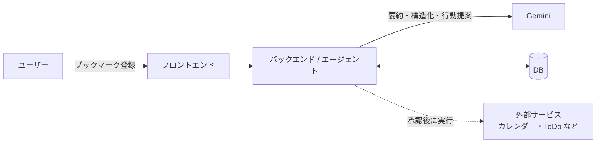

# アーキテクチャ

状態: 暫定。技術スタック確定後に `docs/decisions/001-tech-stack.md` に合わせて更新する。

## 全体構成

## 処理フロー

1. ユーザーが URL を登録する
2. エージェントがページ内容を取得し、要約・タグ付け・構造化する
3. 次にとるべきアクションを提案する
4. ユーザーの承認後、アクションの準備・実行を行う

## 構成要素と担当

| 構成要素 | 技術 | 担当 |
|---|---|---|
| フロントエンド | 未定 | |
| バックエンド / エージェント | 未定 | |
| DB | 未定 | |
