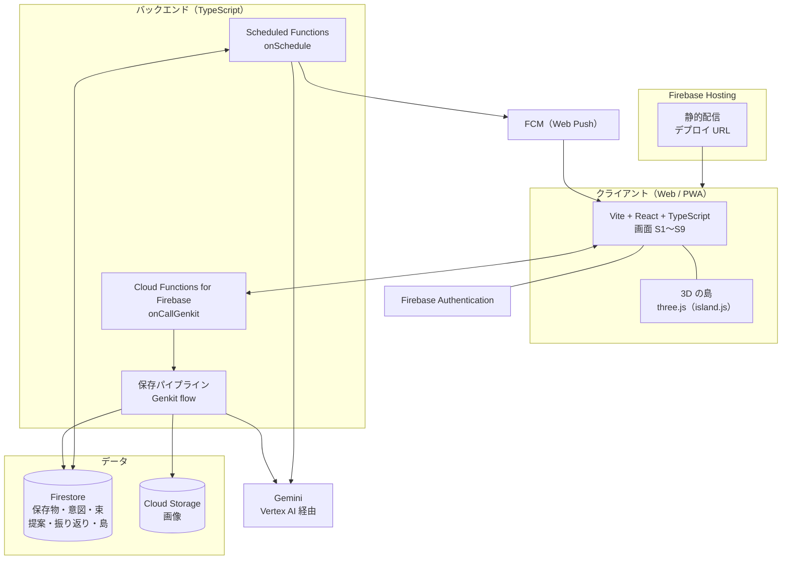

# アーキテクチャ

状態: 確定（2026-11-06）。技術は [`decisions/002-web-stack.md`](decisions/002-web-stack.md) で承認済み（[ADR-001](decisions/001-tech-stack.md) は廃止）。
要件は [`requirements.md`](requirements.md)。構成を変える場合は ADR を先に起こす。

## 全体構成

**Firebase Hosting がアプリの実行基盤**になる（提出要件 1 をここで満たす）。デプロイ URL はそのまま提出物になる。

起動契機は 2 つしかない。**保存時（同期）** と **定時ジョブ（非同期）**。
ユーザーが待つのは前者だけで、能動性の実体は後者にある。

言語は TypeScript に統一する。アプリと Genkit の flow が同じ言語になる。

## 処理フロー

### A. 保存時（同期・通知しない）

1. 島の「＋」から受け取る（URL の貼り付け / 画像・スクショのアップロード / テキストの貼り付け）
2. 読み取り — 画像認識、文字認識、ページ情報の取得（F2）
3. 意図の 1 文の候補を 2〜3 個生成する（F3）。Genkit の Zod スキーマで構造化出力を受け、自信度を添える
4. ユーザーがタップで確定 → Someday/Maybe に入れ、埋め込みベクトルを計算して Firestore に保存
5. 島に浮かぶカードとして追加する（F4）

「あとで」を選んだ場合は意図が未確定のまま保存し、島に「？」付きで浮かべる（UC10）。

iOS Safari は Web Share Target に対応しないため、**共有シートからの保存は実装しない**（[ADR-002](decisions/002-web-stack.md)）。
Android の PWA では manifest の `share_target` で対応できるが、MVP には入れない。

### B. 定時ジョブ（非同期・`onSchedule`）

| ジョブ | 時刻 | やること | 出力 |
|---|---|---|---|
| 夜の整理 | 夜 | ベクトルの近さで束ねる（F5）。束の要約を作る | 翌日最初に開いたときに再生する演出データ |
| 朝の提案 | 朝 8 時 | 提案できる状態の束から 1 つ選び、今日の一歩を生成する（F6） | 通知 + S4 |
| 振り返り | 提案の後 | 「できた？」を聞く（F8） | 通知のボタンで完結 |
| 週 1 の仕分け | 週 1 | いつか箱の中身を提示する（F7） | 通知 + S7 |

1 日の提案は必ず 1 つ。「今日はやめる」でもその日は追加しない（`requirements.md`「決めておくルール」）。
束が提案の対象になるのは、保存 2 件以上 かつ 全件の意図が確定しているとき。

**iOS の PWA は Web Push の条件が厳しい**（ホーム画面に追加した場合のみ）。通知が届かなくても体験が成立するよう、島を開いたときに同じ内容を再生できる形にする。

### 束ね（F5）の実装方針

Firestore のベクトル検索（`find_nearest`）は**サーバー SDK からしか呼べない**。束ねは定時ジョブでしか走らないので問題にならない。
MVP の件数（数十件）なら関数内で総当たりの余弦類似度を計算しても足り、**ベクトルインデックスは後から足せる**。

## 実装時に決めること

| 論点 | 内容 |
|---|---|
| `island.js` の載せ方 | React から `useEffect` でマウントする。既存の `island-app/app.js` が参考になる。**3D のコードには手を入れない** |
| 画面の状態管理 | 9 画面ぶんの遷移。`island-app/app.js` の `SCREENS` 配列の考え方を引き継ぐか、ルーターを入れるか |
| 埋め込みモデル | Gemini の埋め込みを使うか、次元数をいくつにするか |
| 島の状態の持ち方 | 区画・建物・カード配置を Firestore にどう持つか。描画負荷の制約（1 日分だけ浮かべる）に合わせる |
| 画像のアクセス制御 | スクショは個人情報を含みうる。Storage のルールで本人のみに限る |
| 認証の入口 | 匿名認証で始めてデモの導線を短くするか、最初からログインを置くか |

## 構成要素と担当

| 構成要素 | 技術 | 担当 |
|---|---|---|
| アプリ（画面） | Vite + React + TypeScript | |
| 3D の島 | three.js（`island.js` を流用） | |
| 配信 | Firebase Hosting | |
| バックエンド / パイプライン | Cloud Functions for Firebase + Genkit (TypeScript) | |
| 定時ジョブ | Scheduled Functions（`onSchedule`） | |
| モデル | Gemini（Vertex AI 経由） | |
| データストア | Firestore / Cloud Storage for Firebase | |
| 認証 | Firebase Authentication | |
| 通知 | FCM（Web Push） | |
