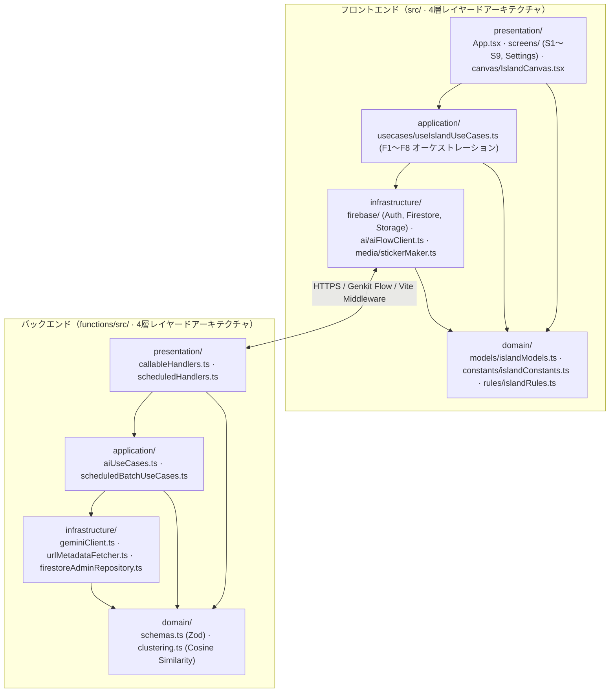

# アーキテクチャ

状態: 確定（2026-11-07）。技術スタック・バックエンド・実アプリ化仕様は [`decisions/002-web-stack.md`](decisions/002-web-stack.md) および [`decisions/003-backend-and-data-model.md`](decisions/003-backend-and-data-model.md) で承認済み（[ADR-001](decisions/001-tech-stack.md) は廃止）。
要件は [`requirements.md`](requirements.md)、PC／スマホ両対応の画面遷移・ユースケース解説は [`ui-and-usecases.md`](ui-and-usecases.md) を参照。

---

## 1. レイヤードアーキテクチャ全体構成（フロントエンド & バックエンド統一 4 層）

フロントエンド（[`src/`](../src)）とバックエンド（[`functions/src/`](../functions/src)）の双方を、責務が明確に分離された **4 層レイヤードアーキテクチャ（`presentation` / `application` / `infrastructure` / `domain`）** で構成している。

### 依存方向の原則（単方向ルール）

- **`presentation`**（UI 描画 / エンドポイント受付）→ `application`, `domain` にのみ依存（**`infrastructure` への直接依存を禁止**）
- **`application`**（ユースケース / オーケストレーション）→ `domain`, `infrastructure` に依存
- **`infrastructure`**（Firebase / Gemini / Storage / Canvas 切り抜き等の外部技術アダプタ）→ `domain` にのみ依存
- **`domain`**（エンティティ型・スキーマ・純粋ビジネスルール・クラスタリング数理）→ **外部フレームワーク（React / Firebase / Three.js 等）への依存ゼロ**



---

## 2. ディレクトリ構造

リポジトリルート（`hannari-hustlers/`）直下に設定ファイル・フロントエンド（`src/`）・バックエンド（`functions/`）・ドキュメント（`docs/`）を配置している。

```text
hannari-hustlers/
├── index.html                        # PWA メタデータ・フォント読込・マウントルート (#root)
├── package.json                      # フロントエンド依存関係・スクリプト (three は 0.128.0 固定)
├── vite.config.ts                    # Vite 設定 + ローカル開発用 /api/* AI パイプラインミドルウェア
├── firebase.json                     # Firebase Hosting / Firestore / Storage / Functions 設定
├── firestore.rules                   # Firestore セキュリティルール (users/{uid} 本人のみ読み書き可)
├── storage.rules                     # Cloud Storage セキュリティルール (users/{uid} 本人のみ読み書き可)
├── public/                           # 静的配信アセット
│   ├── fonts/                        # セルフホストフォント (Instrument Sans / Zen Kaku Gothic New / JetBrains Mono / Material Symbols)
│   ├── icons/                        # PWA アイコン (192px / 512px)
│   ├── manifest.webmanifest          # PWA マニフェスト
│   └── sw.js                         # Service Worker
├── src/                              # フロントエンド (Vite + React + TypeScript · 4層アーキテクチャ)
│   ├── main.tsx                      # エントリポイント (React ルートマウント)
│   ├── domain/                       # 【Domain 層】外部フレームワーク非依存の型・定数・純粋ビジネスルール
│   │   ├── models/
│   │   │   └── islandModels.ts       # エンティティ定義 (SavedItem, Bundle, Proposal, ParaCategory 等)
│   │   ├── constants/
│   │   │   └── islandConstants.ts    # キャラクター定義・PARA タブ定義・時間帯テーマ配色
│   │   └── rules/
│   │       └── islandRules.ts        # 純粋ドメインルール (見出し・吹き出し算出、夜の整理対象抽出、フォールバック生成)
│   ├── application/                  # 【Application 層】ユースケースのオーケストレーション
│   │   └── usecases/
│   │       └── useIslandUseCases.ts  # F1〜F8 のユースケース制御・状態遷移・Infrastructure 呼び出し統合
│   ├── infrastructure/               # 【Infrastructure 層】外部 API・DB・ブラウザ API アダプタ
│   │   ├── firebase/
│   │   │   ├── firebaseClient.ts     # Firebase SDK 初期化・匿名認証 (signInAnonymously)
│   │   │   ├── firestoreRepository.ts# Firestore (items / bundles / proposals) & localStorage 永続化アダプタ
│   │   │   └── storageClient.ts      # Cloud Storage ステッカー画像アップロード
│   │   ├── ai/
│   │   │   └── aiFlowClient.ts       # Genkit Callable Functions / ローカル AI エンドポイント呼び出し
│   │   └── media/
│   │       └── stickerMaker.ts       # 画像リサイズ・window.Island.makeSticker による切り抜きステッカー生成
│   ├── presentation/                 # 【Presentation 層】UI 描画・画面・3D キャンバスブリッジ
│   │   ├── App.tsx                   # フルスクリーン UI シェル・レイヤー配置・ドロワー/シート分岐
│   │   ├── types/
│   │   │   └── uiTypes.ts            # 画面遷移・シート種別・3D エンジンマウント契約型
│   │   ├── canvas/
│   │   │   └── IslandCanvas.tsx      # 3D 島キャンバスのマウント・ctrl.set() 差分更新・WebGL 非対応時フォールバック
│   │   ├── common/
│   │   │   └── UiParts.tsx           # 共通 UI 部品 (Icon, Avatar, SayBubble)
│   │   ├── screens/                  # 全 9 画面 (S1〜S9) + 設定シート
│   │   │   ├── S1Welcome.tsx         # S1: はじめて（初回ウェルカム）
│   │   │   ├── S2Home.tsx            # S2: 島（ホーム・上部アクションピル・下部キャラクタードック・通知バナー）
│   │   │   ├── S3SaveSheet.tsx       # S3: 保存シート（Step1: 画像/URL/メモ入力 → Step2: AI 意図 3 候補の確定）
│   │   │   ├── S4ProposalSheet.tsx   # S4: 今日の 1 提案（ドロワー/シート版 & 全画面手紙版）
│   │   │   ├── S5BundleSheet.tsx     # S5: 束の詳細（代表意図・AI 要点 3 つ・元保存物リスト・手放す）
│   │   │   ├── S6ReflectSheet.tsx    # S6: 振り返り（できた / まだ / もういい + ひとこと・写真記録）
│   │   │   ├── S7SortView.tsx        # S7: 週 1 の仕分け（Someday/Maybe のスワイプ仕分け）
│   │   │   ├── S8SearchSheet.tsx     # S8: 一覧・検索（PARA 5 タブ + キーワード横断検索）
│   │   │   ├── S9ItemSheet.tsx       # S9: 保存物の詳細（意図の編集・PARA 変更・元リンク遷移）
│   │   │   └── SettingsSheet.tsx     # 設定（キャラクター・3D 質感・提案表示形式・データ初期化）
│   │   └── styles/
│   │       └── styles.css            # デザイントークン & PC 右ドロワー / スマホボトムシートのレスポンシブ CSS
│   ├── vendor/
│   │   ├── island.js                 # 3D 島・キャラクター・カードの描画エンジン（ADR-002 により不変）
│   │   └── island.d.ts               # モジュール宣言
│   └── __tests__/
│       └── aiCore.test.ts            # Domain ルール・AI ユースケース・コサイン類似度束ねの単体テスト
└── functions/                        # バックエンド (Cloud Functions for Firebase + Genkit · 4層アーキテクチャ)
    ├── package.json
    ├── tsconfig.json
    └── src/
        ├── index.ts                  # エントリポイント（Presentation 層のハンドラを再エクスポート）
        ├── domain/                   # 【Domain 層】スキーマとクラスタリング数理ロジック
        │   ├── schemas.ts            # 入出力 Zod スキーマ定義 (AnalyzeItem, ConfirmIntent, NightOrganize, MorningPropose)
        │   └── clustering.ts         # コサイン類似度・決定論的フォールバックベクトル・貪欲クラスタリング
        ├── application/              # 【Application 層】AI ユースケースと定時バッチオーケストレーション
        │   ├── aiUseCases.ts         # F2/F3 解析・意図確定 Embedding・F5 夜の束ね・F6 朝の提案ユースケース
        │   └── scheduledBatchUseCases.ts # 全ユーザーの夜整理・朝提案バッチ処理ユースケース
        ├── infrastructure/           # 【Infrastructure 層】外部通信・LLM・Firestore Admin アダプタ
        │   ├── urlMetadataFetcher.ts # SSRF 対策付き URL 取得 & <untrusted_content> 隔離
        │   ├── geminiClient.ts       # Gemini 2.5 Flash JSON 生成 & text-embedding-004 呼び出し
        │   └── firestoreAdminRepository.ts # Firebase Admin Firestore 読み書きリポジトリ
        └── presentation/             # 【Presentation 層】Cloud Functions トリガー受付・バリデーション
            ├── callableHandlers.ts   # Genkit Flow 定義 & onCall HTTPS ハンドラ
            └── scheduledHandlers.ts  # Cloud Scheduler 定時トリガー (23:00 JST / 08:00 JST)
```

---

## 3. 画面の構造と PC 版・スマホ版のレスポンシブ UI アーキテクチャ

**9 画面（S1〜S9）は 9 つの別ページではない。3D の島が背景に常駐し、その上にドロワー／ボトムシートやモーダルが重なる構造をとる。**

- 3D の島（[`IslandCanvas`](../src/presentation/canvas/IslandCanvas.tsx)）は初回に `window.Island.mount()` で **1 度だけマウントし、以降はアンマウントせず `ctrl.set()` で差分更新**する。
- 画面遷移ごとに 3D シーンを作り直さないことで、[`requirements.md`](requirements.md) の非機能要件である **60fps の描画性能** を維持する。
- [`requirements.md`](requirements.md) の画面一覧（S1〜S9）と遷移表は UX の単位としてそのまま対応し、実装上の単位は以下のレイヤー構造にマッピングされる。

| 項目 | スマホ版（`< 768px`） | PC 版（`>= 768px`） |
|---|---|---|
| **3D 島キャンバス（常駐背景）** | 全画面（`100vw × 100dvh`）。ピンチでズーム、ドラッグで回転 | 全画面（`100vw × 100dvh`）。ホイールでズーム、ドラッグで回転、画像ファイルの画面 D&D で即保存 |
| **ベース画面レイヤー** | S1（はじめて）、S2（島＝ホーム・上部ヘッダー＋下部キャラクタードック＋通知バナー） | S1（はじめて）、S2（島＝ホーム・左上タイポグラフィ見出し＋右上ラベル付きアクションピル＋下部中央ガラスドック） |
| **シート／ドロワー（S3 / S4 / S5 / S6 / S8 / S9 / 設定）** | **下からスライドアップするボトムシート**（高さ最大 `88dvh`、角丸 `28px 28px 0 0`） | **右端にフロートするすりガラス風サイドドロワー**（幅 `440px`、上下マージン `16px`、角丸 `28px`）。左側の 3D 島を見渡しながら並行操作できる |
| **モーダルシート（S4 手紙形式 / S7 週 1 仕分け）** | 全画面モーダルシート | 中央フロートモーダルカード（最大幅 `480px`、背景ブラー） |

---

## 4. 処理フローとバックエンド API

### A. 保存時パイプライン（F1〜F4・同期）

1. **入力（S3 Step 1）**: ユーザーが「＋ 保存する」ボタン（または PC 画面への画像ドラッグ＆ドロップ）から画像・URL・テキストメモを入力する。
2. **ステッカー切り抜き**: 画像がある場合は Application 層経由で [`stickerMaker.ts`](../src/infrastructure/media/stickerMaker.ts) が `window.Island.makeSticker` を呼び、3D カード用の切り抜きステッカー（DataURL）を生成する。
3. **AI 解析と意図 3 候補生成（F2 / F3: `analyzeItem`）**:
   - URL が含まれる場合、[`urlMetadataFetcher.ts`](../functions/src/infrastructure/urlMetadataFetcher.ts) がプライベート IP を拒否（SSRF 対策）した上で OGP・本文テキストを取得し、`<untrusted_content>` タグで隔離して [`geminiClient.ts`](../functions/src/infrastructure/geminiClient.ts) (`gemini-2.5-flash`) に渡す。
   - Gemini が Zod スキーマ（[`AnalyzeItemOutputSchema`](../functions/src/domain/schemas.ts)）に従い、タイトル・種別・要約メモ・**「やりたいことの 1 文」候補 3 つ**を返す。
4. **意図の確定と Embedding 計算（F3 / F4: `confirmItemIntent`）**:
   - ユーザーが 3 候補から 1 つをタップ（または自由編集）すると、`text-embedding-004` で 768 次元の埋め込みベクトルを計算し、[`firestoreRepository.ts`](../src/infrastructure/firebase/firestoreRepository.ts) が Firestore (`users/{uid}/items/{itemId}`) および `localStorage` に保存する。
   - 3D の島の上空にカードが浮かび上がる（`anim: 'addCard'`）。
   - 「あとで」を選んだ場合は `intentConfirmed: false` として「？」付きカードを島に浮かべ、後からタップして確定できる（UC10）。

### B. 夜の整理パイプライン（F5: `nightOrganize`）

- **起動契機**: 定時ジョブ（`scheduledNightOrganize`: 毎日 23:00 JST）またはヘッダーの **「束ねる（夜）」** ボタン。
- **処理**:
  1. [`clustering.ts`](../functions/src/domain/clustering.ts) が意図確定済み（`intentConfirmed: true`）の保存物同士の Embedding コサイン類似度を計算し、類似する保存物をクラスタリングする。
  2. クラスタごとに [`aiUseCases.ts`](../functions/src/application/aiUseCases.ts) が Gemini (`gemini-2.5-flash`) で **束の代表意図・AI 要点 3 つ・関連ツール名・PARA カテゴリ** を生成する。
  3. 島が夜のライティング（`phase: 'night'`）に切り替わり、空に浮かんでいたカードが島の地面へ降りて **束のスポット（テント・木箱・ピンボード）** になる（`anim: 'settle'`）。

### C. 朝の 1 提案パイプライン（F6: `morningPropose`）

- **起動契機**: 定時ジョブ（`scheduledMorningPropose`: 毎日 08:00 JST）またはヘッダーの **「今日の一歩（朝）」** ボタン。
- **処理**:
  1. 提案可能な束（保存 2 件以上・意図確定済み・Archives 以外）から 1 つを選び、Gemini で **15 分以内で終わる具体的な最初の一歩**（前回「まだ」だった場合は **5 分で終わるさらに小さな一歩**）を生成する。
  2. 島が朝の光（`phase: 'morning'`）になり、上部に通知バナー・下部ドックに「見てみる」ボタンが表示される。

### D. 振り返りと島の成長（F8）

- 提案で「やってみる」を選んだあと、下部ドックの **「できた？」** から振り返りシート（[`S6ReflectSheet`](../src/presentation/screens/S6ReflectSheet.tsx)）を開く。
- **「できた」** を選んで「島にもどる（建物を建てる）」を押すと、束のスポットが **完成した建物（ドームアトリエ・温室・灯台・時計塔など）** に建て替わる（`anim: 'build'`）。

---

## 5. バックエンド API 一覧（Cloud Functions + Genkit Flows）

| Flow / 関数名 | 種別 | 定義ファイル | 入出力（Zod スキーマ） |
|---|---|---|---|
| `analyzeItem` | Callable / HTTP (`/api/analyzeItem`) | [`callableHandlers.ts`](../functions/src/presentation/callableHandlers.ts) / [`aiUseCases.ts`](../functions/src/application/aiUseCases.ts) | In: `{ url?, rawText?, imageDataUrl?, fileName? }`<br>Out: `{ kind, title, source, note, color, c2, intents: [string, string, string] }` |
| `confirmItemIntent` | Callable / HTTP (`/api/confirmItemIntent`) | [`callableHandlers.ts`](../functions/src/presentation/callableHandlers.ts) / [`aiUseCases.ts`](../functions/src/application/aiUseCases.ts) | In: `{ title, intent, note? }`<br>Out: `{ embedding: number[] }` |
| `nightOrganize` | Callable / HTTP + `onSchedule` (`23:00 JST`) | [`callableHandlers.ts`](../functions/src/presentation/callableHandlers.ts) / [`scheduledHandlers.ts`](../functions/src/presentation/scheduledHandlers.ts) | In: `{ items: SavedItem[] }`<br>Out: `{ bundles: BundleDraft[] }` |
| `morningPropose` | Callable / HTTP + `onSchedule` (`08:00 JST`) | [`callableHandlers.ts`](../functions/src/presentation/callableHandlers.ts) / [`scheduledHandlers.ts`](../functions/src/presentation/scheduledHandlers.ts) | In: `{ bundle, previousStatus?, characterName }`<br>Out: `{ ask, title, detail, minutes }` |
