# 「しま」が育つ物語ドキュメント（6種の3D建物ライブラリ ＆ やさしい連絡箱）

このドキュメントでは、保存したインスピレーションが夜に束ねられ、毎朝の小さな一歩を達成するたびに**テーマに合った建物が島に建ち並び、静かな島が少しずつにぎやかな自分の島へと育っていく物語**を、実機スクリーンショットとともにたどります。

---

## 第1章：はじまりは、まだ何もない静かな島（Day 1・昼）

最初の島には、まだ建物は何も建っていません。
真ん中の丘の上で、相棒のキャラクター「ぽこ」があなたの最初の「気になるもの」を待っています。

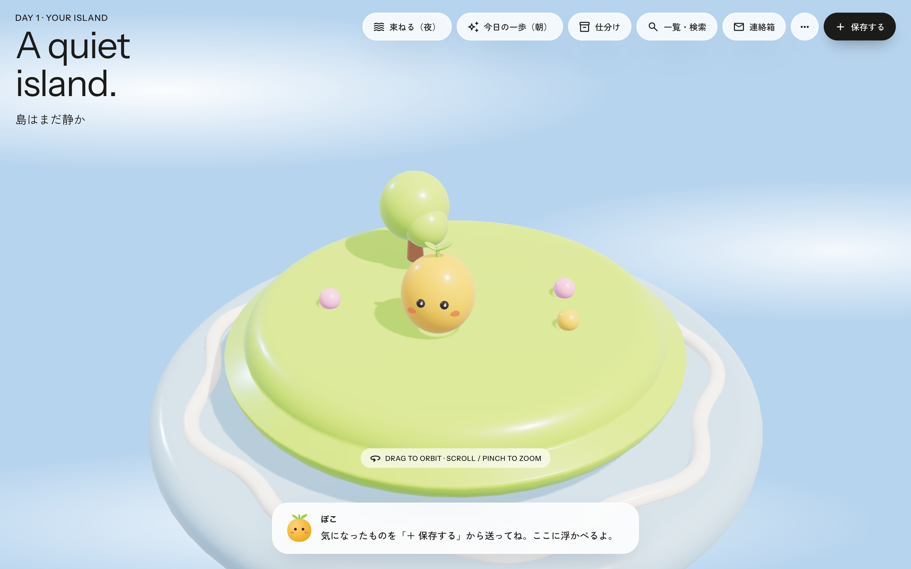

---

## 第2章：日常で見つけた「好き」が、ステッカーになって島に浮かぶ（Day 1・昼）

Instagramで見かけた「丸みのあるカードUI」、Pinterestで集めた「雑誌の表紙タイポグラフィ」、気になる「ぷっくり3Dステッカーの作例」。
「＋ 保存する」から島へ送ると、白フチの立体ステッカーになって島の空中にぷかぷかと浮かびます。

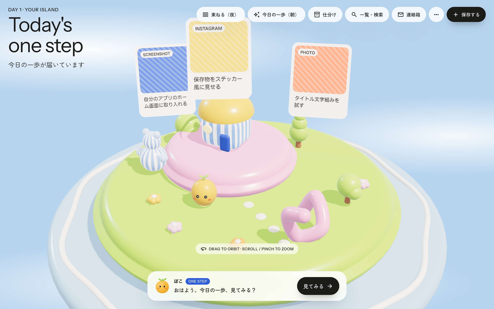

---

## 第3章：夜、似た意図のカードがリボンの「束（Bundle）」にまとまる（Day 1・夜）

夜になると、島に浮かんでいたカードたちがすーっと集まり、あなたの「やりたい意図（かわいいUIと文字組みを取り入れてホーム画面を作る）」ごとに、ピンクのリボンがかかった1つの束（Bundle）へとまとまります。

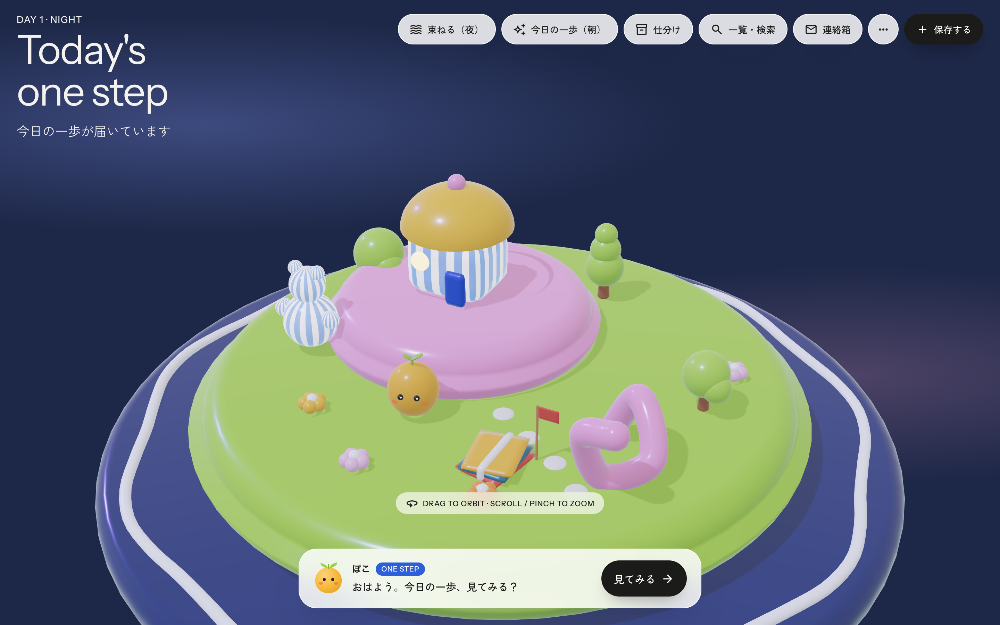

---

## 第4章：最初の一歩を達成！1棟目「B1 制作アトリエ」が建つ（Stage 1・1棟）

翌朝、束ねられたカードを見比べながら「自分の画面のタイトルとカードを並べてみよう」という小さな一歩に着手し、「できた！」と振り返ると――
島の中央に、パステルドーム屋根と大きな丸窓・看板（「制作」）を備えた **1棟目「B1 制作アトリエ」** が完成します。

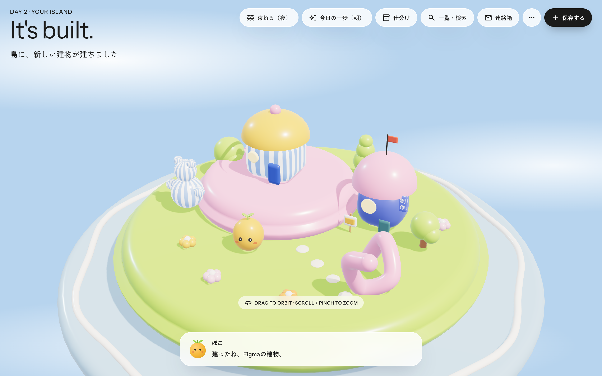

---

## 第5章：料理の束からも一歩達成！2棟目「B2 小さなベーカリー＆キッチン」が仲間に（Stage 2・2棟）

続いて、普段の料理レシピの束から一歩を達成すると、アトリエのとなりに赤白ストライプのひさし（オーニング）と煙突、カフェテーブルがついた **2棟目「B2 小さなベーカリー＆キッチン（看板：珈琲）」** が建ちます。

---

## 第6章：暮らし・ベランダ栽培の一歩で、3棟目「B4 ガラスの温室」が建つ（Stage 3・3棟）

さらに、机まわりの模様替えやベランダのバジル栽培の束から一歩を進めると、島の右奥にミントグリーンの半透明ドーム屋根と双葉プランターが並ぶ **3棟目「B4 ガラスの温室＆プランター（看板：温室）」** が加わります。

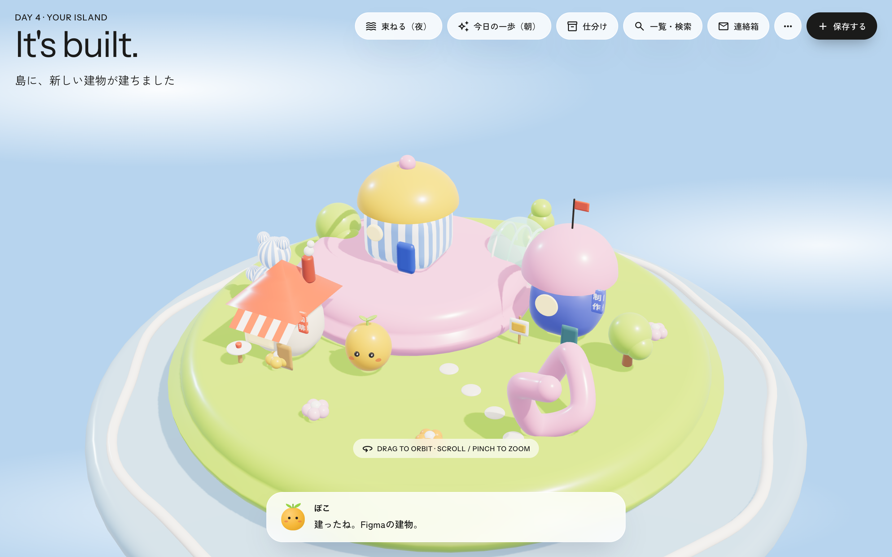

---

## 第7章：学びの束も達成！4棟目「B3 知恵の書斎タワー」が加わり、にぎやかな島へ（Stage 4・4棟）

Obsidianやノート整理（Second Brain）の束からも一歩を達成すると、ネイビーと木目の2段タワーに本が積まれた **4棟目「B3 知恵の書斎タワー（看板：書斎）」** が完成します。
最初は空っぽだった島が、あなたが実際に手を動かしたテーマの建物でいっぱいの、世界にひとつだけの島へと育ちました。

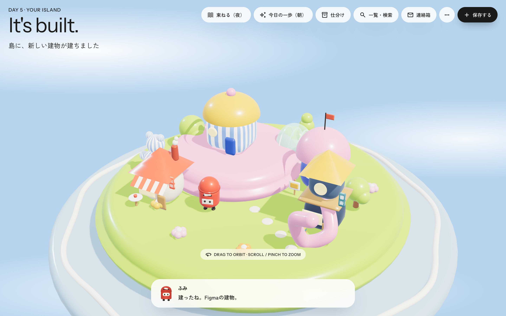

### スマホ画面で見る「4棟が建ち並ぶ島」と、夜の窓明かり

夜になると、島に建った4棟それぞれの窓やガラスドームに、あたたかい明かりが灯ります。

| 夜に4棟すべての窓明かりが灯る島（PC） | スマホ版・4棟が建ち並ぶ島（Mobile） |
|---|---|
| 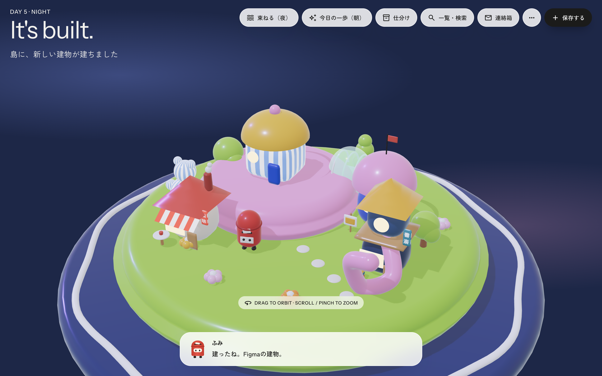 | 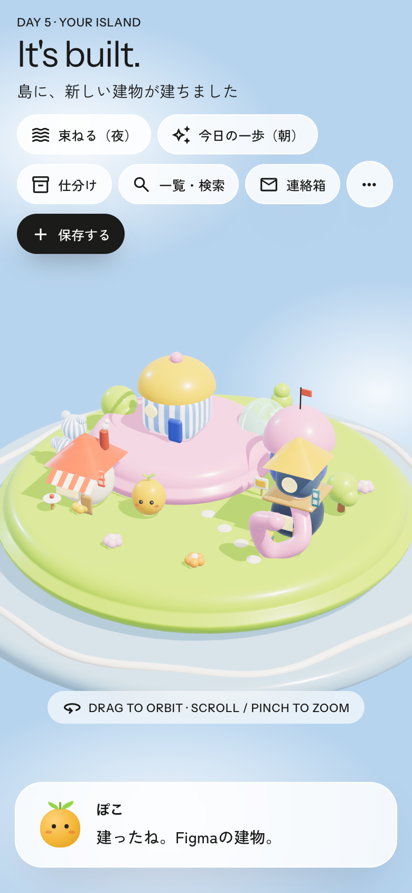 |

---

## 完成した全6種類の3D建物ライブラリ（`B1〜B6`）一覧

束（Bundle）の意図やキーワードから自動で選ばれるほか、右上の「設定（…）」パネルからいつでもワンタップで全6種類の建物と成長ステージ（1棟〜4棟）を切り替え・プレビューできます。

| コード | 建物名・看板 | 対応するユースケース分野 | 完成3Dスクリーンショット |
|---|---|---|---|
| **B1** | **制作アトリエ** （看板：`制作`） | **デザイン・UI・ものづくり（#1〜#10）** パステルドーム屋根と大きな天窓・画架のあるアトリエ |  |
| **B2** | **小さなベーカリー＆キッチン** （看板：`珈琲`） | **料理・食べもの・カフェ（#11〜#16）** 赤白ストライプのオーニングと煙突・丸テーブルのあるキッチンハウス | 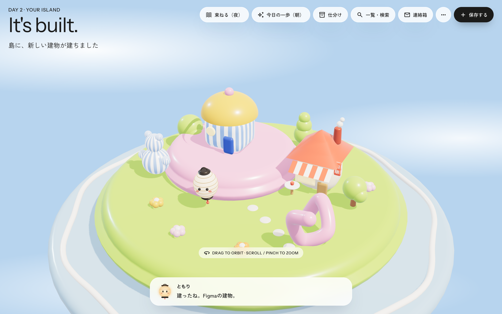 |
| **B3** | **知恵の書斎タワー** （看板：`書斎`） | **ツール・学び・仕事・Second Brain（#23〜#32）** 2段重ねのネイビー＆ウッド調タワーと積み重なった本のモチーフ | 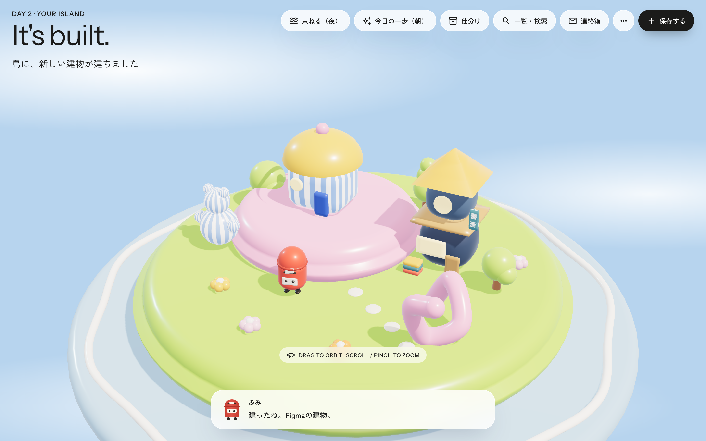 |
| **B4** | **ガラスの温室＆プランター** （看板：`温室`） | **日常・暮らし・植物・インテリア（#33〜#38）** 半透明ミントのかまぼこ型ドーム屋根と3色プランター | 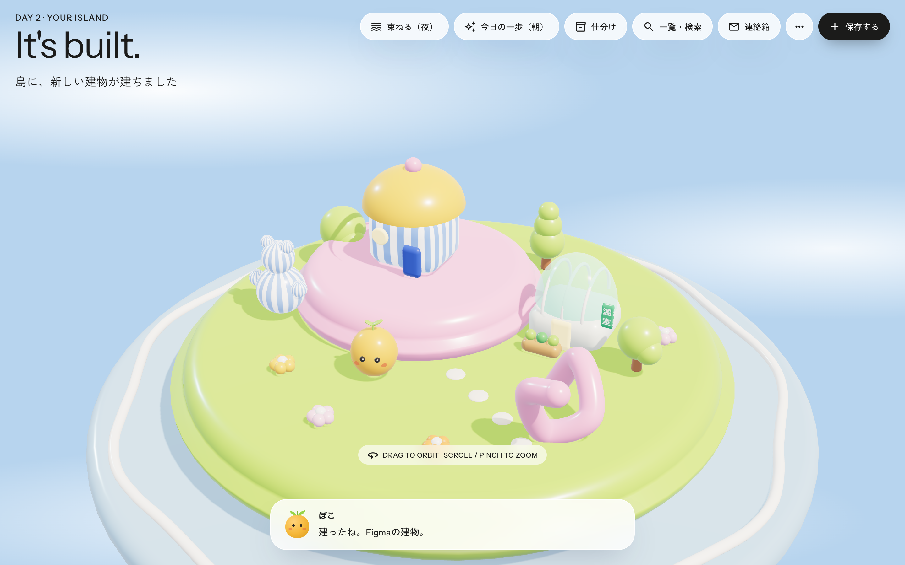 |
| **B5** | **ドレッサー・ブティック** （看板：`装い`） | **ファッション・美容・ネイル（#17〜#22）** ラベンダー壁とピーチドーム屋根、頂上のリボン飾りと姿見ミラー | 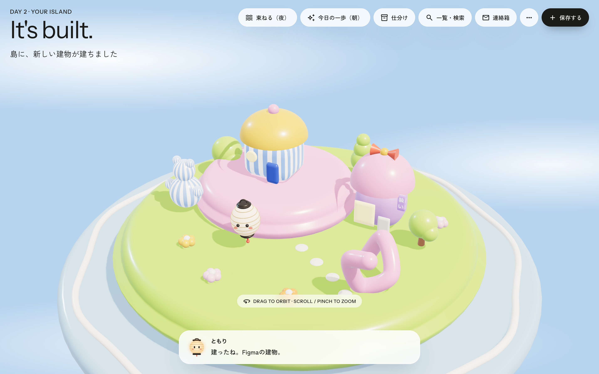 |
| **B6** | **カルチャー＆フォトテント** （看板：`写真`） | **趣味・写真・音楽ライブ・お出かけ（#39〜#48）** 多角錐のサーカステント屋根とフラッグ、カメラレンズ風丸窓 | 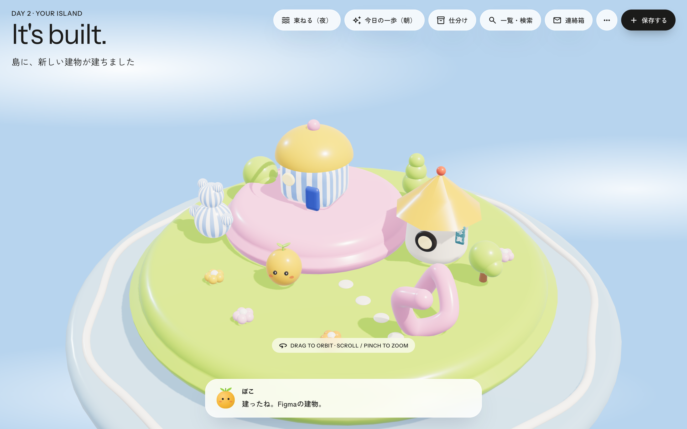 |

### ジオラマ（Diorama）質感での複数棟表示 ＆ 設定パネルの建物ライブラリ切替

| ジオラマ質感（Diorama）での4棟の島 | 設定シート内の「6種の建物ライブラリ＆成長ステージ切替」 |
|---|---|
| 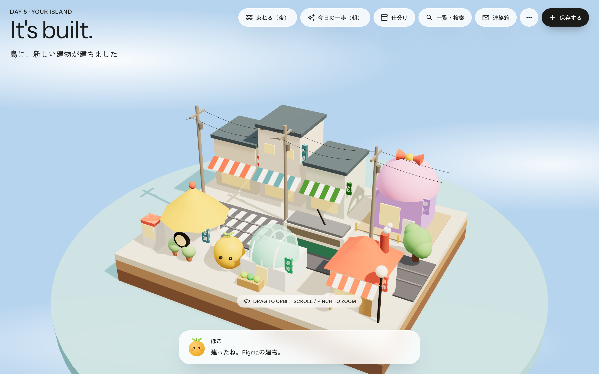 | 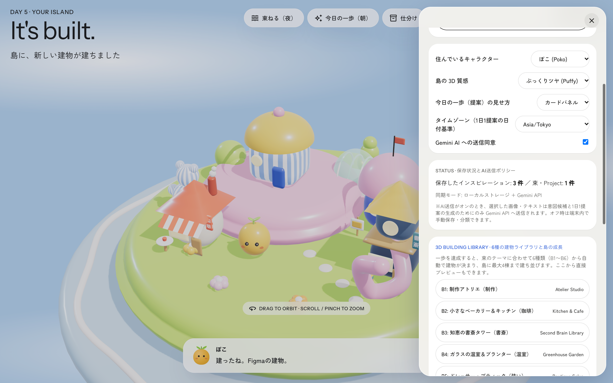 |

---

## 番外編：やさしい言葉になった「しまの連絡箱」（Project・Area両対応 ＆ 月3ドル上限）

タスクや一歩だけでなく、あなたの好きなアーティストや信頼する編集部の記事から「気になるライブや展示のお便り」が届く **「しまの連絡箱」** も、専門用語のないユーザー目線のやさしい言葉に生まれ変わりました。

- **わかりやすい言葉への改善**:
  - 「能動発見（PoC縦切り）」「公式照合済み・発見カード1件」「外部検索OFF（呼び出し0回）」といった業務的な表現を廃止し、**「ぽこからのお便り」「公式サイトで確認できたお便りが届いています」「あなたの『好き』帳」「お便りのあんしん設定」** といった親しみやすい表現に統一しました。
  - リアクションボタンも **［公式ページを見る］［♡ 好き・気になる］［× イメージと違う］［🕒 今はパス］［そっと閉じる］** になり、眺めるだけで気軽に閉じられます。
- **Project と Area の両方に対応**:
  - 「お便りを探してほしいテーマ」として、短期の取り組み（**Project**）だけでなく、日々楽しみたい分野（**Area**：音楽・カルチャー、日々の料理など）もワンタップで選べるようになりました。
- **月の検索コスト上限（デフォルト \$3 / 約450円）**:
  - 外でイベントを探す際のコスト上限を **\$1 / \$3（おすすめ） / \$5** から選べるようにしました。**現在この上限は表示と目安で、金額での自動停止は実装していません**（実際の課金ガードは AI 呼び出しの回数制限とキルスイッチです。[`implementation-status.md`](implementation-status.md) 2.9）。

| ① 最初は外への検索オフ＆ちょっとした質問（PC） | ② 公式サイトで確認できたお便り＆5つのリアクション（PC） | ③ ProjectとArea両対応＆月3ドルのコスト上限設定（PC） |
|---|---|---|
| 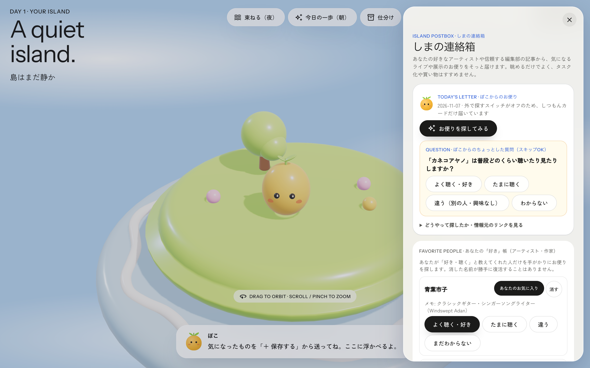 | 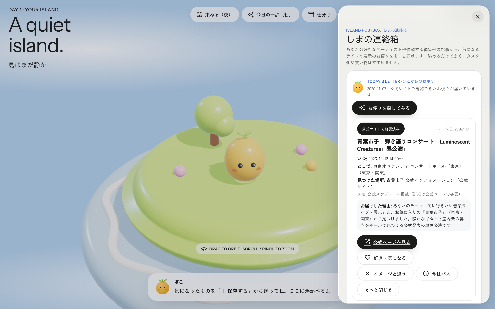 | 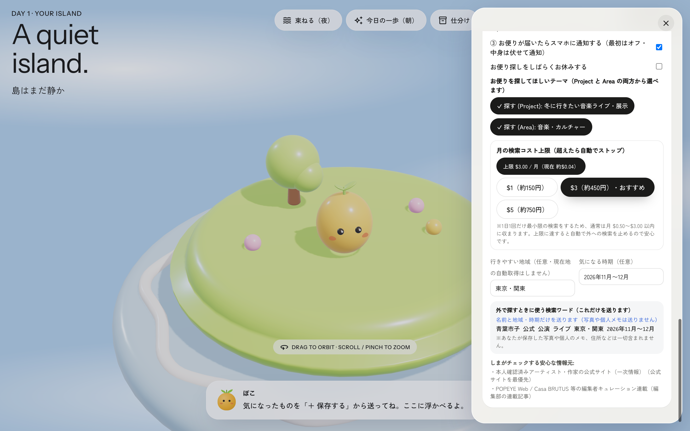 |
