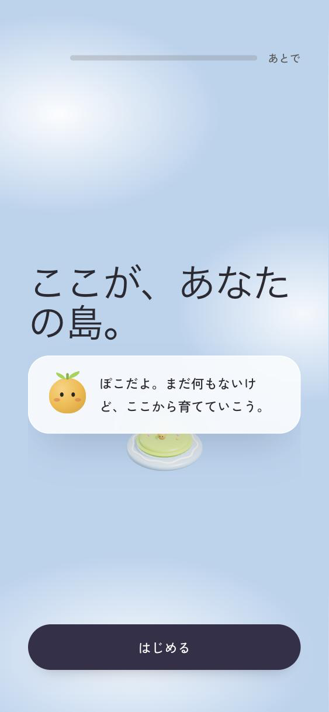
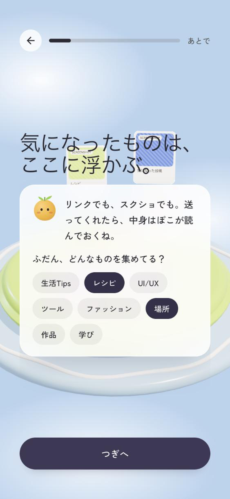
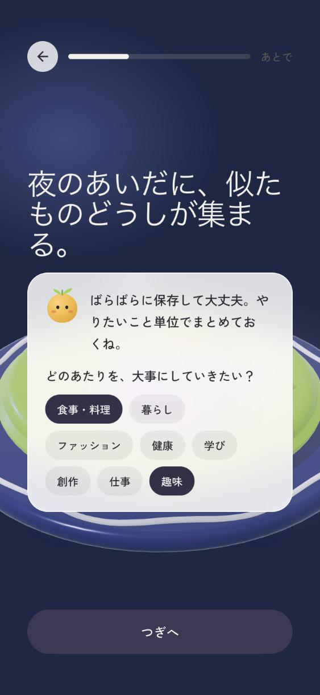
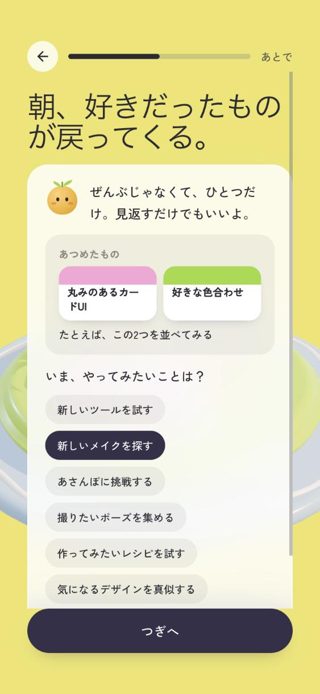
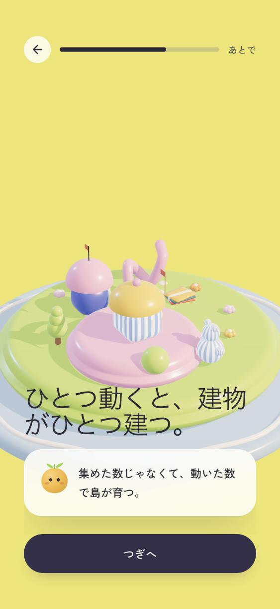
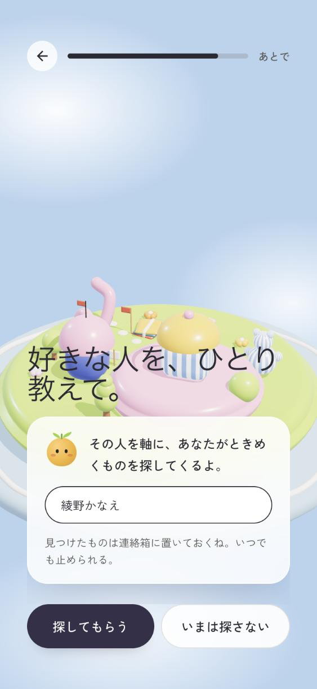
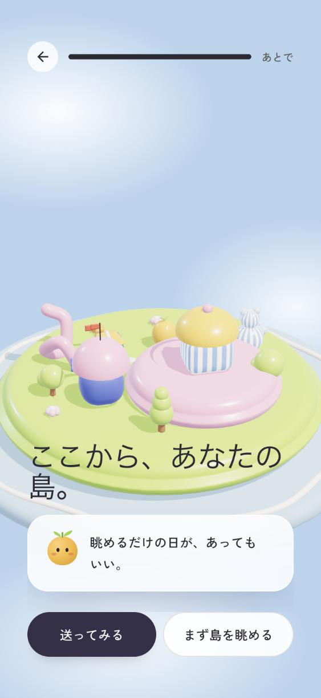

# 初回体験（ストーリーボード）

アプリを初めて開いたときの7画面。実機（スマホ幅）のスクリーンショットでたどる。

対応するイシューは [#40](https://github.com/Kambara-Michiru/hannari-hustlers/issues/40)、要件は [`requirements.md`](requirements.md) の F01。
画面の実装は [`src/presentation/screens/S1Welcome.tsx`](../src/presentation/screens/S1Welcome.tsx)、
文言と島の進行は [`src/domain/rules/onboardingRules.ts`](../src/domain/rules/onboardingRules.ts) にまとまっている。

---

## 何を変えたか

前は、4問のアンケートが「今の取り組みを設定」ボタンの中に畳まれていた。既定では誰も開かず、開いても**質問するだけ**で、このアプリで何ができるのかは最後まで分からなかった。

いまは **島が実演してから、ぽこが名前をつける**。

> **原則: 言葉より先に、島が見せる。ぽこは、見えたものに名前をつけるだけ。**

使っているアニメーション（`birth` / `addCard` / `settle` / `build`）は、すべて本番の島が実際に使っているもの。初回体験のために新しい 3D は作っていない。

---

## 第1章：何もない島が生まれる

海から島がせり上がる（`birth`）。まだ建物はひとつもなく、丘の上にぽこがいるだけ。

---

## 第2章：気になったものが、島に浮かぶ

カードが空にふわっと現れる（`addCard`）。ここで「ふだん何を集めてる？」と聞く。

**選んだ関心が、そのまま島に浮かぶカードの題になる。** 答えても何も返らないアンケートにしないための仕掛け（[`concept.md`](concept.md) の先行事例の分解 (c)）。

---

## 第3章：夜のあいだに、似たものどうしが集まる

島が夜になり、浮かんでいたカードが集まって束になる（`settle`）。区画ができるところを見せてから、「どのあたりを大事にしたい？」と聞く。

**第2章で「レシピ」「場所」を選んだので、「食事・料理」「趣味」が先に選ばれた状態で出る。** 答えが次の画面を変えることで、アンケートではなく対話になる。

---

## 第4章：朝、好きだったものが戻ってくる

島が朝になり、提案がどう届くかを見本で見せる。

ここは **ToDo の通知にしない**。本番の提案画面（[`S4ProposalSheet`](../src/presentation/screens/S4ProposalSheet.tsx)）と同じ順序で、**主役は「あつめたもの」**、一歩はその下に小さく添えるヒントにしている。所要時間は出さない（作業の見積もりに見えるため）。

選択肢も、達成目標ではなく「やってみたいこと」で並べる。

選択肢の言葉は、そのまま島に建つ建物を決めている（[`inferBuildingKindFromBundle`](../src/domain/rules/islandRules.ts)）。6つの選択肢が、6種の建物にそれぞれ対応している。

| 選択肢 | 建つ建物 |
|---|---|
| 新しいツールを試す | B3 知恵の書斎タワー |
| 新しいメイクを探す | B5 ドレッサー・ブティック |
| あさんぽに挑戦する | B4 ガラスの温室 |
| 撮りたいポーズを集める | B6 カルチャー＆フォトテント |
| 作ってみたいレシピを試す | B2 小さなベーカリー＆キッチン |
| 気になるデザインを真似する | B1 制作アトリエ |

建物の見た目は [`island-growth-story.md`](island-growth-story.md) にある。

---

## 第5章：ひとつ動くと、建物がひとつ建つ

建物が建つ（`build`）。質問のない、この体験だけの画面。

ここで **誇るべきなのは保存数ではなく実行数** だと言い切る。「集めた数じゃなくて、動いた数で島が育つ」。

---

## 第6章：ぽこが、島の外から持って帰ってくる

「しまの連絡箱」（[`island-growth-story.md`](island-growth-story.md) の番外編）への入口。好きな人をひとり教えてもらう。

この画面には、守っている決まりが3つある。

1. **ボタンそのものが同意。** ［探してもらう］を押すことが外への検索の許可で、トグルは押させない。既定はオフのまま
2. **名前を教えていなければ、同意はオンにならない。** 探す手がかりがないのに許可だけ取らない（`resolveSearchConsent`）
3. **止め方を先に伝える。** 「いつでも止められる」を、同意を求める場所に置く

名前が空のときは［いまは決めない］の1つだけが出て、そのまま先に進める。

---

## 第7章：ここから、あなたの島

育った島の全景。最後に、保存するか、ただ眺めるかを選ぶ。

**2つのボタンは同じ大きさにしてある。** 「眺めるだけでもいい」を嘘にしないため。

---

## 先行事例とどう変えたか

[`concept.md`](concept.md) が分解した先行事例（Raqun）のオンボーディングに対して、意識的に変えた点。

| 先行事例 | このアプリ |
|---|---|
| 「3ヶ月後、約150件の保存」と将来の数字を約束する | **数字の約束をしない。** 根拠のない件数・成果の保証は書かない |
| 「ため込むためじゃなく、やるために保存する」と**ユーザーに宣言させる** | **しま側が約束する。** 4つの約束を、それぞれ意味の通る画面に分けて置いた |
| 「普段どこで見つけますか？」と、答えても何も返らない質問をする | **答えが必ず何かを変える質問だけ。** 関心は島のカードになり、次の画面の初期選択を変える |
| 週次ゴールを選ばせて行動を迫る | **「眺めるだけの日が、あってもいい」** を最後に置く |

「しまの約束」という1枚の画面は作っていない。約束をまとめて宣言しても、まだ何も保存していない人には意味が着地しないため、次のように分けた。

| 約束 | 置いた場所 |
|---|---|
| お願いするのは、1日にひとつだけ | 第4章（提案を見せる画面） |
| ためこんでも、責めない | 第5章（「動いた数で島が育つ」） |
| 探してほしくなくなったら、いつでも止められる | 第6章（連絡箱） |
| 眺めるだけの日が、あってもいい | 第7章（締め） |

---

## 決めごと

- **人称は「あなた」。** 連絡箱の既存コピーが「あなた」で統一されているのに合わせた
- **全画面スキップできる。** 右上の「あとで」でいつでもホームへ。戻る矢印も2画面目から出る
- **文章を書かせない。** 入力は第6章の名前だけ。取り組みの名前は選んだ言葉がそのまま入り、設定と一覧からあとで編集できる（[ADR-004](decisions/004-project-area-and-onboarding.md)）
- **島に浮かぶ見本のカードは表示専用。** 保存データには入らないので、終わったあとのホームは「島はまだ静か」から始まる

## 書いていないこと

実装状況（[`implementation-status.md`](implementation-status.md)）と照らして、意図的に避けた表現がある。テストでも禁止している。

| 書かない | 理由 |
|---|---|
| 「通知が届く」 | Web Push は未実装。連絡箱で代替しているため「朝の連絡箱に置いておく」と書く |
| 「毎日ネットを探しに行く」 | 能動発見の外部検索は固定データで、実際の外部 API は呼んでいない |
| 月あたりの金額 | 画面に出ている上限額はサーバーで積算していない |
