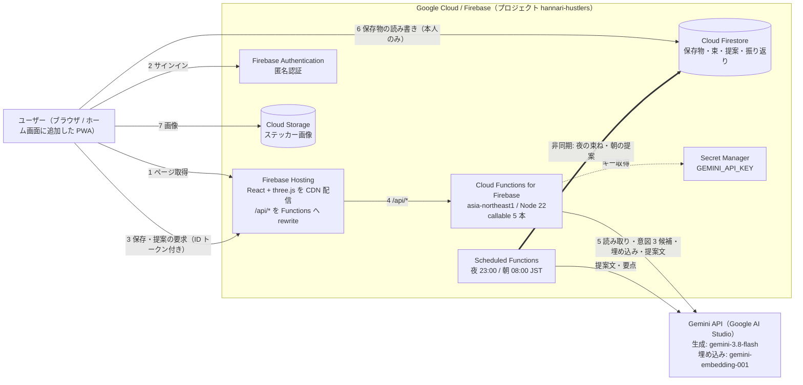

# プロダクト説明ドキュメント（下書き）

提出物は主催者の指定テンプレート（Google Docs）に記入したもの。名前は『プロダクト説明ドキュメント_hannari-hustlers』。本ファイルはその下書きで、確定した文面をテンプレートへ転記する。
章立ては公式フォーマットに合わせてあり、**変更しない**。記入例: [references/df26-submission-sample.pdf](references/df26-submission-sample.pdf)

- 1〜5 は**必須項目**。欠けると審査対象外
- 6〜7 は任意項目
- 8〜9 は採点外項目
- 未確定箇所は `TODO:` を残す。提出前に `TODO:` が 0 件であることを確認する

出典: [requirements.md](requirements.md) / [decisions/002-web-stack.md](decisions/002-web-stack.md) / [concept.md](concept.md)

---

## 表紙

| 項目 | 内容 |
|---|---|
| 会場 | 大阪（現地会場）。提出物は 5 点（プレゼンスライドを含む） |
| チーム名 | hannari-hustlers |
| メンバー | TODO: |
| アプリケーション名 | 島アプリ（`public/manifest.webmanifest` の表記。副題「集めるを、動くに。」）。TODO: 正式名称を変える場合のみ更新 |
| カテゴリ | クリエイティブ |
| GitHub リポジトリ URL | https://github.com/Devfest-Hackathon-2026/df-2026-t118 |

カテゴリの選択肢は 医療・福祉 / 観光 / 教育 / エンターテインメント / クリエイティブ の 5 つ。
**カテゴリ外は審査対象外。** 以降の全記述を「クリエイティブ」に接地させる。

提出用リポジトリ（df-2026-t118）は Public。審査はこのリポジトリの内容で行われる。開発用リポジトリ（Kambara-Michiru/hannari-hustlers）は private のままでよい。

---

# 【必須項目】

## 1. プロジェクト概要

SNS で流れてくるインスピレーションを保存すると、3D の「自分の島」に浮かび、AI が PARA メソッドで整理して、1 日 1 つだけ小さな実行を提案する Web アプリケーションです。

既存の保存アプリは、保存と構造化で体験が止まり、行動につながりません。構造化の精度も低く、ユーザーの意図とずれた整理になりがちです。本アプリは次の 3 点で差別化します。

- **ビジュアル** — 保存したものが自分の島に積み重なっていく体験そのものを楽しめる
- **意図を外さない整理** — 保存のたびに「やりたいこと」を 1 文に確定させ、それを軸に PARA で整理する
- **存在としてのキャラクター** — チャットではなく、島に住むキャラクターが 1 日 1 回だけ働きかける

コンセプトは「**集めるを、動くに。**」です。

## 2. 解決する課題

### 2.1 対象ユーザー

- インスピレーションを求めていて、可愛いもの・おしゃれなものが好きな学生
- Instagram / Pinterest / X で気になるものを保存するが、見返していない人
- 「いつかやりたい」が大量に溜まり、どれから手をつけるか決められない人

### 2.2 課題と根拠

集めたものが行動につながらない、という課題を次の 3 点から設定しました。

**(a) 既存サービスの指標が、保存を成果として扱っている**

保存系サービスは保存件数を増やす方向に設計されていますが、ユーザーが実際に困っているのは「保存したものを実行に移せないこと」です。保存が増えるほど未消化の負債になり、罪悪感が蓄積します。誇るべき数字は保存数ではなく消化数であるべきです。

**(b) 構造化の粒度が、意思決定の粒度と合っていない**

既存サービスの構造化は「やると決めた後」に必要な情報（手順・材料など）を出します。しかしユーザーが止まっているのは決定の手前であり、そこで必要なのは所要時間・足りないもの・いつ着手できるかです。AI は実行の情報を出しているのに、ユーザーは決定で止まっている。この食い違いが「それで何？」の正体です。

**(c) 1 件ずつでは、保存の意図が読めない**

1 件の保存は意図として読めませんが、「2 週間で Obsidian 関連を 5 件」のような群になると読めます。群で見なければ意図は取り出せません。

### 2.3 既存手法との違い

| 観点 | 従来の保存・あとで読む系サービス | 本アプリ |
|---|---|---|
| 構造化の目的 | 保存物の整理・分類 | 着手するかを決めるための判断材料の提示 |
| 読み取りの単位 | 1 件ずつ | 保存の群（束）からの意図推定 |
| ユーザーへの質問 | 設定時のアンケート | 保存のたびに、答えれば必ず何かが準備される 1 問だけ |
| 入力の形 | 文章の入力、チャット | タップのみ。文章を書かせない |
| 情報の出し方 | 一覧・グリッド・件数 | 提案は 1 日 1 つだけ |
| ホーム画面 | コレクションのグリッド（未消化の山） | 3D の島（積み重ねが育っていく様子） |
| 成果指標 | 保存件数 | 実行した件数 |

> 上表は [`implementation-status.md`](implementation-status.md)（2026-11-10 時点）と照合済み。「ホーム画面」の島、タップ中心の入力、1 日 1 提案、束からの意図推定はいずれも本番で動作する。ただし「保存のたびの 1 問」は、保存時の意図候補の選択（3 択）として実装している。

## 3. Google 技術の活用

### 3.1 使用した Google 技術（少なくとも一つ選択）

実行基盤。1 つ以上にチェックが入らないと審査対象外。

- [ ] App Engine
- [ ] Compute Engine
- [ ] Google Kubernetes Engine (GKE)
- [ ] Cloud Run
- [ ] Firebase App Hosting
- [x] **Firebase Hosting**

### 3.2 Google 技術の活用例

| 使用技術 | 使用箇所 | 選定理由・メリット | デメリット |
|---|---|---|---|
| Firebase Hosting | Web アプリの配信 | `firebase deploy` だけで HTTPS の URL が出る。CDN 配信で 3D アセットの初回読み込みが速い。manifest とアイコンを置いてホーム画面に追加できるようにしている | 静的配信のみで、サーバー側の処理は別サービスが要る |
| Gemini API（Google AI Studio） | 保存物の読み取り、やりたいことの 1 文化、提案文の生成、埋め込みの生成 | 画像・テキストを同じモデルで扱える。構造化出力（`responseSchema`）で候補を決まった形で受け取れる | 応答時間と利用料金が保存のたびに乗る。生成結果の品質に体験が左右される |
| Cloud Functions for Firebase | 読み取りから提案までのパイプライン | TypeScript でフロントと言語を統一できる。Zod スキーマで生成処理の入出力を型で扱える | コールドスタートで初回の応答が遅れる |
| Scheduled Functions (`onSchedule`) | 夜の整理、朝 8 時の提案、週 1 回の仕分け | 「アプリを開いていない時に考えている」という能動性を、定時ジョブとして素直に実装できる | 実行時刻の検証に実時間がかかり、デモでは時間を進める仕掛けが要る |
| Cloud Firestore | 保存物・意図・束・提案・振り返りの保存 | サーバーレスで運用の手間がない。クライアントから直接読める | 読み書き回数に応じて課金される。ベクトル検索はサーバー SDK 専用 |
| Cloud Storage for Firebase | スクリーンショット・画像の保存 | Firestore と同じ認証で、ユーザーごとにアクセスを制限できる | 画像サイズが大きいと転送量が増える |
| Firebase Authentication | ユーザーの識別（匿名認証から開始） | 登録なしで使い始められ、デモの導線が短い | 匿名のままだと端末を変えるとデータを引き継げない |
| Secret Manager | `GEMINI_API_KEY` の保管（Cloud Functions が `defineSecret` で読む） | API キーをコードにもクライアントにも置かずに済む | 初回に CLI でシークレットを登録する手間がある |

この表は、実際にデプロイして動作を確認したサービスだけを載せている。実装と説明のズレは [`implementation-status.md`](implementation-status.md) に一覧がある。

> **注記**: Web Push 通知（Firebase Cloud Messaging）は実装していないため、この表から除いている。通知相当の体験はアプリ内の「連絡箱」で代替している。

### 3.3 Google 技術を選定した理由

限られた期間（実質 3 日）で、提出要件を満たしたうえで差別化の柱である 3D を成立させる必要がありました。

当初は React Native (Expo) によるネイティブアプリを選定していましたが（ADR-001）、提出要件を精査した結果、**Google Cloud の実行基盤を使っていないと審査対象外**であり、かつ提出物に「デプロイした URL」が必須であることが判明しました。ネイティブアプリはこのどちらも満たせません。そこで Web アプリに切り替え、**Firebase Hosting で配信する構成に差し替えました**（ADR-002）。ホーム画面に追加できるよう manifest とアイコンは用意していますが、オフライン動作は今回の範囲外としています。

この判断には副次的な利点がありました。差別化の柱である 3D の島は three.js で検証済みのプロトタイプがあり、Web なら**質感を作り直さずにそのまま運べます**。新しいフレームワークの学習に時間を取られず、残りの日数を 3D の質とデモに充てられます。

バックエンドを Firebase と Gemini API に寄せたのは、認証・データベース・ファイル保存・定時実行・生成 AI が 1 つのプロジェクトにまとまり、インフラ構築の時間をほぼゼロにできるためです。言語も TypeScript に統一し、フロントとバックエンドでレビューのコストを分散させないようにしました。

判断の記録は [`docs/decisions/002-web-stack.md`](decisions/002-web-stack.md) にあります。

## 4. アーキテクチャ図

- **同期の起動契機**: 保存・「まとめる」（夜の整理）・「今日の一歩を見る」（朝の提案）の操作（図の 3〜5）
- **非同期の起動契機**: Cloud Scheduler 由来の定時ジョブ（`scheduledNightOrganize` / `scheduledMorningPropose`）。アプリを開いていない間も島が育つ
- 図に載せた Google サービスは 3.2 の表と一致している。能動発見（連絡箱）の外部検索は固定の参照データで、外部 API は呼んでいないため図に含めない
- 指定テンプレート（Google Docs）へ転記するときは、この図を画像として書き出して貼る

## 5. プロジェクトをデプロイした URL

| 項目 | 内容 |
|---|---|
| アプリケーション URL | https://hannari-hustlers.web.app （2026-11-10 に HTTP 200 を確認） |

Regional Day（2026-11-14）まで稼働させる。締切後に停止しない。

---

# 【任意項目】

## 6. 動作確認の方法

### 6.1 テストアカウント情報

Firebase Authentication の**匿名認証**を使うため、ログイン操作は不要。URL を開くだけで動作確認できる。

| 項目 | 内容 |
|---|---|
| ログイン URL | 不要（アプリケーション URL をそのまま開く） |
| メールアドレス | 不要 |
| パスワード | 不要 |

現在は匿名認証のみでログイン機能は無い。ログインを設ける構成に変えた場合は、審査用の専用アカウントを作って記入する（個人アカウントや本物の認証情報は書かない）。

> 注意: 匿名認証のため、別の端末・ブラウザで開くと別ユーザー（空の島）になる。審査は 1 つのブラウザで通しで行うこと。

### 6.2 動作確認手順

デモシナリオ（UC1 → UC2 → UC4 → UC5 → UC6）に沿った手順。画面名は [`architecture.md`](architecture.md) と [`ui-and-usecases.md`](ui-and-usecases.md)（スクリーンショット付き）に対応する。

ホーム（S2）は**常に出すボタンを「一覧・検索」「○○のお便り」「設定」「＋ 保存する」の 4 つに絞っている**。
「まとめる」「今日の一歩を見る」は常時ボタンではなく、**意味がある日だけキャラクターの吹き出しの横（ドック）に 1 つだけ出る**。
下の手順では、押すべきボタンがドックに出てくる順に進む。

1. アプリケーション URL を開く。初回は**島が生まれるところから 7 画面のストーリーボード**が流れる（S1）。各画面に質問が 1 問あり、右上の「あとで」でいつでも飛ばせる。最後の画面で「まず島を眺める」（または「送ってみる」）を押すと島に出る
2. 島の「＋ 保存する」を押す（S2 → S3）
3. 同じ話題の画像（またはテキストメモ・URL）を入力し、「次へ（やりたいことの候補を出す）」を押す。AI 送信同意をオンにすると Gemini が読み取る
4. 「これ、どうしたい？」に候補が 3 つ出るので、1 つをタップして確定する（「決めずに保存: 見るだけ / あとで」も選べるが、この 2 つは束ねる対象にならない）
5. 島に戻り、保存したものがカードとして浮かんでいることを確認する（S2）
6. 同じ話題で、あと 2 件を保存する。島に 3 枚のカードが浮かび、**ドックのボタンが［まとめる］に変わる**
7. ［まとめる］を押す。夜の景色に変わり、カードが島に降りて 1 つの束になる。毎晩 23:00 の定時ジョブと同じ処理を手動で起動する操作
8. ドックが［束ね案を確認］に変わるので押し、束の詳細（S5）で内容を確認して「この束ね案を承認する」を押す
9. ドックが［今日の一歩を見る］に変わる。押すと今日の提案が作られ（毎朝 8:00 の定時ジョブと同じ処理）、続いて出る［見てみる］で提案（S4）が開く。束のまとめと 15 分以内の最初の一歩が入っている
10. 「やってみる」を押して島に戻る。吹き出しの横に［まだ］［できた］が出る
11. ［できた］を押すと、束のスポットに**新しい建物が建つ**

補足:
- 時間を待たずに夜・朝を試したい場合は、設定（…）の「開発・デモ用」に「夜にする／朝にする」がある
- 提案が出る条件は「**やりたいことを確定した保存物が 2 件以上**」。手順 6 までで満たす。「見るだけ」「あとで」で保存したものは数に入らない
- 画像は PNG / JPEG / WebP の 10MB 以下。PC では画面へのドラッグ＆ドロップでも保存できる
- Instagram などログインが必要な URL は中身を取得できない。その場合は「リンク先の本文は読めなかったので、URL だけ記録するね」と画面に出る（読めたふりはしない）
- AI 呼び出しには利用上限がある。超えた場合は AI の文面がテンプレートに替わるが、画面は止まらない

### 6.3 サンプルデータ

**群から意図を読む機能は、履歴がないと成立しない。** 審査員が開いた時点で束が成立している状態を用意する。

審査用のシードデータの事前投入は行っていない。審査員は上の 6.2 の手順 2〜6 で 3 件を保存すれば、束が成立する状態を数分で作れる。束が提案の対象になるのは**保存 2 件以上 かつ 全件の意図が確定**しているときで、手順はこれを満たす。

TODO: 時間をかけずに全機能を見せたい場合は、審査用のシードデータ投入を別途検討する（未対応）。

サンプルデータに実在の個人・団体は使っていない。しまの連絡箱に出てくるアーティスト名・会場名・情報元・URL はすべて架空で、URL は `example.com` 配下に統一している。

## 7. アプリの詳細や機能に関する自由記述

### 7.1 主な機能

以下は 2026-11-10 時点で本番に実装済みの機能のみ。未実装・未対応の事項は 7.2 と末尾の「既知の制約」に書く。

| # | 機能 | 内容 |
|---|---|---|
| 1 | 保存 | 島の「＋」から URL・スクリーンショット・画像・テキストを受け取る |
| 2 | 読み取り | 画像認識・文字認識・ページ情報の取得で、保存したものの中身を把握する |
| 3 | 意図の 1 文化 | AI が「やりたいこと」の候補を 2〜3 個出し、ユーザーはタップで確定する。文章は書かせない |
| 4 | 島への表示 | 今日保存したものが、3D の島の上にカードとして浮かぶ。指で回せる、拡大できる |
| 5 | 束ねる | 似たインスピレーションを自動でグループ化する |
| 6 | 1 日 1 提案 | 育った束から、今日の小さな一歩を 1 つだけ提案する。所要時間を添える |
| 7 | 仕分け（いつか箱） | いつか箱の中身を「作る／作らない」で PARA の各区分に振り分ける。ホームの「いつか箱」は中身があるときだけ出る |
| 8 | 振り返り | できた／まだ／もういい の 3 択で記録し、島に建物が建つ |
| 9 | しまの連絡箱（画面では「○○のお便り」） | 登録した「好き」帳をもとに、ライブや展示のお便りを 1 日 1 通だけ届ける。検索・AI 送信・通知は個別同意で初期 OFF |

島に住むキャラクターは 4 人（ぽこ／ともり／ふみ／モフ）。ぽこ・ともり・ふみは three.js の手続き的生成、
4 人目の**モフは外部ツールで作った 3D モデル（GLB）**で、glTF-Transform で Draco 圧縮とテクスチャの WebP 化を行い
23MB → 1.35MB にして同梱している（[ADR-006](decisions/006-glb-character-loading.md)）。出所は [`assets.md`](assets.md) の台帳 12〜14。

> **連絡箱の情報源について（重要）**
> 機能 9 が参照しているのは、**検証用に用意した固定データだけ**です。Google Search Grounding などの外部検索サービスには接続していません
> （`discoverySearchAdapter.ts` の `adapterMode: 'curated_reference_fixture'`）。
> データに登場する人物・会場・情報元・URL は**すべて架空**で、実在のものとは関係ありません。URL はすべて `example.com` 配下にしてあります。
> 画面上にも「検証用の参照データ（架空）」と表示しています。
> 本番の外部検索に差し替える場合の課金・規約・クエリ数は未実測です。

### 7.1.1 既知の制約

- **Web Push 通知は未実装。** 通知相当はアプリ内の連絡箱で代替している
- **連絡箱の外部検索は固定データ。** 上の注記のとおり
- **定時ジョブは夜（23:00 JST）と朝（08:00 JST）の 2 つ。** 振り返りの催促と週 1 の仕分けはユーザーの操作のみ
- **「月予算上限」の表示は目安で、金額を積算して止める機能ではない。** 実際の課金ガードは AI 呼び出しの回数（1 人 1 日 300 回、全体 1 日 20,000 回の既定値）とキルスイッチ
- **App Check は未適用。** 匿名ユーザーの大量作成は塞げていない（提出後に対応予定）
- **オフライン動作は非対応。** ホーム画面への追加まで

### 7.1.2 品質の担保

`bash scripts/check.sh`（機密情報検査・型・ビルド・単体テスト）を CI とプッシュ前フックの両方で通している。Cloud Functions の入出力は Zod スキーマで検証し、取得した外部ページの本文は `<untrusted_content>` で隔離して指示として扱わない（間接プロンプトインジェクション対策）。URL 取得にはプライベートアドレスの拒否（SSRF 対策）を入れている。

### 7.2 今後の展望

- **好みの学習** — 実行と手放しの履歴から、提案の精度と時間帯を調整する
- **外部連携** — Google カレンダー、Obsidian などへの書き出し（ユーザーの承認後に実行）
- **共有シートからの保存** — Android は manifest の `share_target` で共有シートに出せる。iOS Safari は Web Share Target に非対応のため、今回は島の「＋」からの保存に限定した
- **オフライン動作** — Service Worker でのキャッシュは「デプロイしたのに古い画面が出る」事故を生みやすく、残り時間に見合わないと判断して入れなかった
- **島の作り込み** — 区画、建物の種類、季節や時間帯による変化

---

# 【採点外項目】

## 8. AI をどの場面でどう使用したか、なぜその場面で使用したか

**サービス機能としての利用**

プロダクトが使う AI は Gemini に統一しています。使用箇所は 3 点です。

1. **保存物の読み取り** — スクリーンショットや画像から、何が写っているかを把握する。画像とテキストを同じモデルで扱えるため、入力の種類ごとに処理を分けずに済む
2. **やりたいことの 1 文化** — 読み取った内容から「実行したいこと」の候補を 2〜3 個生成する。構造化出力で決まった形で受け取り、そのまま選択肢として提示する。このアプリはユーザーに文章を書かせない設計なので、**候補の質がそのまま体験の質になる**
3. **提案文の生成** — 束のまとめと、今日の小さな一歩を生成する。キャラクターの口調（1〜2 文、急かさない、質問の形）を保つ必要があり、定型文では成立しない

自律的に動き回るエージェントではなく、**決まった段階を通るパイプラインと、時間で動くジョブ**として組んでいます。段階を固定することで、生成結果が想定から外れたときに原因を特定できます。

**開発段階での利用**

開発では次の生成 AI ツールを補助に使いました（出所は [`assets.md`](assets.md) の台帳 6〜8 と同じ）。

| 用途 | 内容 |
|---|---|
| 3D の島・UI のデザインプロトタイプ | デザインツールで生成した案を、three.js / React の実装のもとにした。島とキャラクターの模様は外部画像を使わず、すべてコードで生成している |
| コード・ドキュメントの作成補助 | コーディングエージェント（Claude Code、Gemini CLI など）で、実装・レビュー対応・ドキュメントの下書きを行った |
| アプリアイコン | 外部素材を使わず、スクリプトで直接生成した |

生成物はそのまま採用せず、`scripts/check.sh`（型・ビルド・テスト）と、本番での実機確認を通している。実装と説明のズレは [`implementation-status.md`](implementation-status.md) で洗い出し、動いていないものを動いているとは書かない方針にした。判断が必要な技術選定は ADR（`docs/decisions/`）に人が決定して残している。

**プロダクトが使う AI は Gemini のみ**で、画面・動画には他社 AI の名称やロゴを出していない。

## 9. 自分たちが開発を通して何を得て、どれくらい成長できたのか

TODO: メンバーそれぞれが書く。具体的に書けること:

- 新しく触れた技術（three.js、Firebase、Cloud Functions、Gemini API など）
- 判断を誤って学んだこと（例: 提出要件を精査する前に技術スタックを決めてしまい、ADR-001 を 1 日で廃止して ADR-002 に差し替えることになった。要件の確認を実装判断より先に置くべきだった）
- チーム開発の進め方で得たもの（ADR で判断を残す、1 コマンドの検証（`scripts/check.sh`）に完了の定義を寄せる、など）
