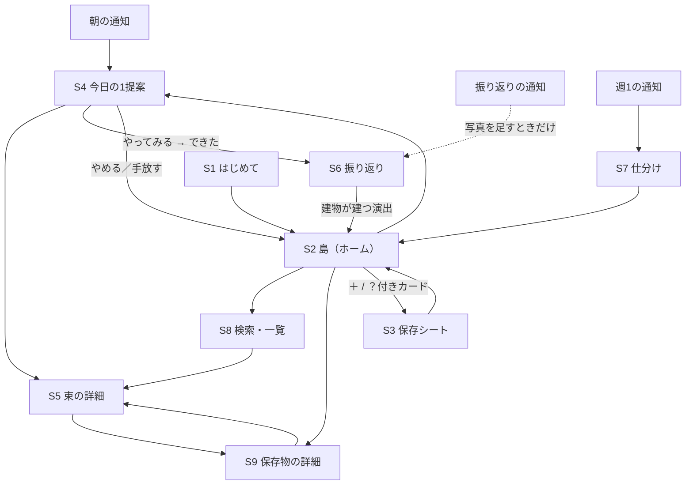

# 要件定義

状態: 確定（2026-11-06 版）。デザインの方向性が確定したのに合わせて全面改訂した。
確定した内容のみ記載し、未確定は「未決定事項」に残す。
このファイルが機能実装とスコープ判断の参照先（`AGENTS.md`）。立て方の背景は [`concept.md`](concept.md)。

## 概要

SNS で流れてくるインスピレーションを保存すると、3D の「自分の島」に浮かび、AI が PARA で整理して、1 日 1 つだけ小さな実行を提案するアプリ。

既存の保存アプリは、保存と構造化で体験が止まり、行動につながらない。構造化の精度も低く、ユーザーの意図とずれた整理になりがち。本アプリは次の 3 点で差別化する。

1. **ビジュアル** — 保存したものが自分の島に積み重なっていく体験そのものを楽しめる
2. **意図を外さない整理** — 保存のたびに「やりたいこと」を 1 文に確定させ、それを軸に PARA で整理する
3. **存在としてのキャラクター** — チャットではなく、島に住むキャラクターが 1 日 1 回だけ働きかける

一言: **集めるを、動くに。**（[`demo-video.md`](demo-video.md)）

**提出カテゴリ: クリエイティブ（確定）**
選択肢は 医療・福祉 / 観光 / 教育 / エンターテインメント / クリエイティブ の 5 つ。カテゴリ外は審査対象外になる。**インスピレーションを集めて形にする体験そのものがクリエイティブ**にあたるため、題材の差し替えはしない。

## 対象ユーザーと課題

- **想定ユーザー**: 最初は自分たち自身。そこから、インスピレーションを求めていて、可愛いもの・おしゃれなものが好きな学生に広げる
- **課題**: 集めても行動に移せない。保存は増えるが見返さない
- **現在の代替手段**: Instagram / Pinterest の保存、スクリーンショット、メモアプリ。いずれも保存で止まる

### 典型的な行動

- Instagram や Pinterest、X で気になるものを見つけるとスクショや保存をするが、見返さない
- 「いつかやりたい」が大量に溜まり、どれから手をつけるか決められない
- 情報が多すぎると、それだけでやる気がなくなる

### 保存するもの

| 種類 | 例 |
|---|---|
| SNS のビジュアル | Instagram、Pinterest の画像、カルーセル投稿 |
| スクリーンショット | タイムラインやアプリの画面 |
| URL | 記事、ショート動画、SNS 投稿のリンク |
| 長文テキスト | メモ、コピーした文章 |
| 画像 | カメラロールの写真 |

## やること／やらないこと

判断に迷ったら、この表に戻る。

| 区分 | 内容 | 設計への落とし込み |
|---|---|---|
| やる | ビジュアルにこだわる（差別化の柱） | 保存体験の中心を 3D の島にする |
| やる | 情報の整理を助ける | ユーザーの意図を正確に捉え、見当違いの整理や提案をしない |
| やる | 存在・キャラクターにこだわる | あたたかみ、やさしさ、ととのい、アーティスティックさを持つキャラクター |
| やらない | 情報を出しすぎる | 提案は 1 日 1 つまで。一覧や件数で圧をかけない |
| やらない | アプリ内で AI とチャットさせる | AI とのやりとりはカードとタップの選択肢だけで完結させる |

チャットをしない分、AI はユーザーに文章を書かせずに意図を確定させる必要がある。**選択肢の質が、このアプリの体験の質を決める。**

## エージェントの自律レベル

| レベル | 範囲 | このアプリでの該当 | 扱い |
|---|---|---|---|
| 1 | 整理 | 読み取り、意図の 1 文化、束ね、PARA 分類 | MVP |
| 2 | 提案 | 1 日 1 提案 | MVP |
| 3 | 準備 | 今日の小さな一歩を具体物にして提示する（所要時間つき） | MVP |
| 4 | 実行 | カレンダー・Obsidian への書き込み | F10（MVP 外） |

- **目標レベル: 3（準備）**
- 外部サービスへの書き込みは、実行前に必ずユーザーの承認を取る
- レベル 4 を MVP から外したことで、[`demo-video.md`](demo-video.md) の S5（承認 → カレンダー登録）と差分が出ている。→ 未決定事項 2

## 機能要件

保存したものは、すべて「やりたいことの 1 文」に変換してから、PARA で整理する。

### 情報の流れ

1. **保存** — 島の「＋」から URL・スクショ・画像・テキストを受け取る
2. **読み取り** — 画像認識、文字認識、ページ情報の取得で中身を把握する
3. **意図の 1 文化** — 「Obsidian で second brain を作ってみる」のように、実行したいことを 1 文にする。AI が候補を出し、ユーザーはタップで確定する
4. **いつか箱に入る** — 確定した 1 文は、まず Someday/Maybe に入る
5. **束ねる** — 似たインスピレーションを自動でまとめる（例: Obsidian の投稿、second brain の記事、ノートアプリの画面）
6. **仕分け** — 束が育ったら「作る／作らない」を選ぶ。作る → Projects、作らない → Resources か Archives
7. **1 日 1 提案** — P と A について、今日の小さな一歩を 1 つだけ提案する
8. **振り返り** — 実行の結果を記録し、次の提案に活かす

### PARA の使い方

| 区分 | 意味 | このアプリでの扱い |
|---|---|---|
| Projects | ゴールと期限がある | 「作る」と決めた束。1 日 1 提案の主な対象 |
| Areas | 継続的な関心ごと | 料理、ファッションなど。習慣的な小さな実行を提案 |
| Resources | 参考資料 | 「作らない」けど残したいもの。提案はしない |
| Archives | 完了・手放した | 実行済み、または手放したもの |
| Someday/Maybe | いつかやる | 保存直後の置き場。仕分けを待つ |

Someday/Maybe は PARA の 5 番目の区分ではなく、**仕分け（F7）を待つ受け皿**として扱う。ここに入っている間は提案の対象にしない。

### 機能一覧

| ID | 機能 | 内容 | 段階 |
|---|---|---|---|
| F1 | 保存 | 島の「＋」から URL・スクショ・画像・テキストを受け取る（[ADR-002](decisions/002-web-stack.md)） | MVP |
| F2 | 読み取り | 画像と文字の認識、ページ情報の取得 | MVP |
| F3 | 意図の 1 文化 | AI が候補を 2〜3 個出し、タップで確定 | MVP |
| F4 | 島への表示 | 今日保存したものが島に浮かぶ | MVP |
| F5 | 束ねる | 似たインスピレーションを自動でグループ化 | MVP |
| F6 | 1 日 1 提案 | 育った束から今日の一歩を 1 つ提案 | MVP |
| F7 | 仕分け | 作る／作らないをスワイプで選ぶ | MVP |
| F8 | 振り返り | できた／まだ／もういい の 3 択 | MVP |
| F9 | 好みの学習 | 実行と手放しの履歴から提案を調整 | 後 |
| F10 | 外部連携 | カレンダー、Obsidian などへの書き出し | 後 |

## ビジュアル要件: 3D の島

ホーム画面は一覧ではなく、自分の島。保存が増えるほど島が育つ様子そのものを、使い続ける理由にする。

### デザインの方向性（確定）

**ぷっくりツヤの 3D × 細い見出し × モダンなパネル。**

| 要素 | 決めたこと |
|---|---|
| 地の色 | 画面ごとに変える。Sky（空色）/ Butter（黄）/ Bubble（ピンク）/ Paper（白）/ Ink（黒）の 5 色 |
| 3D のツヤ | ピンク・ライム・コバルト・チャコールの 4 色 |
| 見出し | Instrument Sans Light + Zen Kaku Gothic New Light。大きく、細く |
| ラベル | Instrument Sans Medium 11px。英字の見出しだけ大きさを上げる |
| 本文・ボタン | Zen Kaku Gothic New Medium |
| UI | 白いガラスパネルと濃いピル。パネルは半透明の白で背景をうっすら透かす |
| アクセント | 主なアクションは濃いピル（Ink）。アクセントのコバルトは小さなラベルにだけ使う |

**ツヤの 3D を主役にする。** パネルも文字も、3D の邪魔をしない。

### 目指す質感

- 参考は、日本の街角を再現したミニチュアのジオラマ。看板、電線、招き猫、路面電車まで作り込まれた、手で触れそうな密度
- 写実ではなく、上記のとおり**ぷっくりツヤのスタイライズ**で作る。あたたかい色と柔らかい光
- 指で回せる、拡大できる。ジオラマを手のひらで眺める感覚

### 島で起きること

| 状態 | 島での表現 |
|---|---|
| 今日保存したもの | 島の上に浮かぶカード。保存した画像がそのまま見える |
| 1 日 1 回の整理 | 浮かんでいたものが、島の区画に降りて定着する演出。**翌日、最初にアプリを開いたときに再生する**（時刻には縛られない） |
| Projects | 建設中の建物。実行するたびに完成に近づく |
| Areas | 島の街区（料理通り、ファッション通りなど） |
| Resources | 図書館や倉庫 |
| Archives | 海に流れる、または記念碑になる |

### 制約

- スマホで 60fps を保つ。浮かべるカードは 1 日分に限り、古いものは建物や区画にまとめて描画負荷を抑える
- 3D の読み込みが遅い場合に備え、平面の簡易表示を用意する

### 既存のプロトタイプ

`island-app/`（three.js）に S2・S3・S4・S6 の動くプロトタイプがある。島の生成、カード、キャラクターの描画はここで検証済み。[ADR-002](decisions/002-web-stack.md) で、この資産をそのまま使うことに決めた。

## キャラクター要件

キャラクターは AI の「顔と声」。チャットをしない代わりに、島に住む存在として 1 日 1 回だけ話しかける。デザイン案での名前は **Poko**。

### 性格の軸

- **あたたかみ** — 保存したものを否定しない。「たくさん集めたね」から入る
- **やさしさ** — 急かさない、責めない。やらなかった日も受け止める
- **ととのい** — 散らかった情報を整えてくれる安心感。話す量は少なく、一言で伝える
- **アーティスティック** — 見た目も言葉選びも、おしゃれで可愛い。ユーザーが人に見せたくなる

### 振る舞いのルール

- 1 回に話すのは 1〜2 文まで
- 提案は質問の形にする（「今日は Obsidian で second brain を作ってみない？」）
- 知らないことを言い切らない。推測は質問にする
- 島の上で暮らしていて、保存や実行に合わせて動きが変わる（保存すると拾いに行く、実行すると建物を建てるなど）

### デザイン上の注意

- 既存アプリ（Raqun のアライグマなど）と似せない。動物かどうかも含めて、ゼロから検討する
- 島のジオラマの質感と、同じ世界の住人に見えること

## AI が働きかけるタイミングとユーザーの選択肢

AI が自分から働きかけるのは 5 つの場面だけ。どの場面も、ユーザーはタップで答えられ、文章を書く必要はない。

| タイミング | AI がやること | ユーザーの選択肢 |
|---|---|---|
| 保存した直後 | 「やりたいこと」の 1 文の候補を 2〜3 個出す | 候補を選ぶ／自分で書き直す／あとで |
| 1 日 1 回（夜） | 今日浮かんだものを島に定着させ、束にまとめる | 見るだけ（選択なし） |
| 1 日 1 回（朝 8 時） | 育った束から、今日の小さな一歩を 1 つ提案する。集めたものの要点も添える | やる／今日はやめる／手放す |
| 提案した一歩の後 | 「できた？」と聞く | できた／まだ／もういい |
| 週 1 回 | いつか箱の中身を見せて仕分けを促す | 作る／作らない（スワイプ） |

### 決めておくルール

- 1 日の提案は必ず 1 つ。「今日はやめる」を選んでも、その日は追加の提案をしない
- 「まだ」が 2 回続いたら、もっと小さな一歩に分けるか、手放すかを聞く
- 通知を 2 回続けて無視されたら、個別の確認をやめて週 1 回の仕分けに回す
- 自信のない提案は出さない。意図の 1 文が確定していない束は、提案の対象にしない
- 束が提案の対象になるのは、**保存が 2 件以上 かつ 全件の意図が確定している**とき
- 提案は毎朝 8 時に出す。時刻のユーザー設定は MVP に入れない

## 画面一覧

MVP は 9 画面。ホームは島で、一覧画面は検索用の脇役に置く。

| No | 画面 | 目的 | 主な要素 | デモ |
|---|---|---|---|---|
| S1 | はじめて | キャラクターと出会い、自分の島が生まれる | 島の誕生アニメーション、キャラクターのあいさつ | ○ |
| S2 | 島（ホーム） | 保存の積み重ねを眺める | 3D の島、浮かぶカード、キャラクター、今日の提案への入口 | ○ |
| S3 | 保存シート | 保存し、意図を確定する | 保存物のプレビュー、意図の 1 文の候補 2〜3 個 | ○ |
| S4 | 今日の 1 提案 | 今日の一歩を 1 つだけ示す | キャラクターの一言、束のまとめ、最初の一歩、3 択 | ○ |
| S5 | 束の詳細 | 集めたインスピレーションの整理を見る | 要点のまとめ、元の保存物、関連ツール | ○ |
| S6 | 振り返り | 実行の結果を記録する | できた／まだ／もういい、任意で写真と一言 | ○ |
| S7 | 仕分け | いつか箱を作る／作らないに分ける | スワイプのカード | — |
| S8 | 検索・一覧 | PARA ごとに探す | 検索、区分ごとの一覧 | — |
| S9 | 保存物の詳細 | 束になる前の 1 件を見る | 元の投稿、意図の 1 文、所属する束へのリンク | — |

## ユースケース

UC2〜UC5 が毎日のループ。デモは UC1 → UC2 → UC4 → UC5 → UC6 の順に見せる。

| ID | ユースケース | きっかけ | 画面の流れ | 終わりの状態 |
|---|---|---|---|---|
| UC1 | はじめて使う | アプリを初めて開く | S1 → S2 | 何もない小さな島がある |
| UC2 | SNS から保存する | SNS で見つけたものをスクショするか URL をコピーし、島の「＋」を押す | S2 →（＋）→ S3 → S2 | 意図の 1 文が確定し、島にカードが浮かぶ |
| UC3 | 島を眺める | アプリを開く | S2 → カードをタップ → S9 | 今日保存したものを見返せる |
| UC4 | 夜の整理を見る | 翌日、最初にアプリを開く | S2 で演出を再生 | 浮かんでいたカードが島に降り、束になっている |
| UC5 | 今日の 1 提案に答える | 朝の通知、または島の「今日の一歩」 | S4 → やってみる／今日はやめる／手放す | 今日の行動が決まる（または見送る） |
| UC6 | 振り返る | 提案の後の通知、または S4 の「できた」 | 通知のボタンで完結、写真を足すときだけ S6 | 次にアプリを開くと島に建物が建つ |
| UC7 | 束を確かめて直す | S4 の「集めたもの」、または島のカード | S5 → 束から外す／意図を書き直す／手放す | 整理のずれが直る |
| UC8 | いつか箱を仕分ける | 週 1 の通知 | S7 → 作る／作らない | 作る束は Projects へ、作らない束は Resources か Archives へ |
| UC9 | 保存したものを探す | 島の虫めがね | S8 → S5 または S9 | 目当ての保存物が見つかる |
| UC10 | あとで意図を決める | 保存時に「あとで」を選んだ | S2 の「？」付きカード → S3 | 意図が確定する |

## 画面遷移

島（S2）を中心に、すべての入口と画面がつながる。通知からは島を経由せず、行動の画面（S4・S6・S7）に直接入る。

毎日のループは、「＋」→ S3 → 島 → 朝の通知 → S4 → S6 → 島に建物が建つ、の一周。

### 遷移の一覧

| 遷移元 | 操作 | 遷移先 | 補足 |
|---|---|---|---|
| 朝の通知 | タップ | S4 | 提案がある日だけ届く |
| 振り返りの通知 | できた／まだ／もういい | 通知の中で完結 | 写真や一言を足すときだけ S6 |
| 週 1 の通知 | タップ | S7 | |
| S1 | はじめる | S2 | |
| S2 | 浮かぶカードをタップ | S9 | 束に入った後は S5 |
| S2 | 「？」付きのカードをタップ | S3 | 意図が未確定のもの |
| S2 | 今日の一歩の「見てみる」 | S4 | 提案がある日だけ表示 |
| S2 | 虫めがね | S8 | |
| S2 | ＋ | S3 | アプリ内からの保存 |
| S3 | 候補を選ぶ／あとで | S2 | 島にカードが浮かぶ |
| S4 | 集めたもの | S5 | |
| S4 | やってみる → できた | S6 | |
| S4 | 今日はやめておく／手放す | S2 | その日は新しい提案を出さない |
| S5 | 保存物をタップ | S9 | |
| S6 | 島にもどる | S2 | 建物が建つ演出を再生 |
| S7 | 仕分けが終わる | S2 | |
| S8 | 束／保存物を選ぶ | S5／S9 | |

## デモシナリオ

約 3 分。「保存 → 島に浮かぶ → 翌朝の 1 提案 → 実行で島が育つ」を一続きで見せる。見せ場は 3 つ。

1. **はじめて（S1）** — キャラクターがあいさつし、何もない小さな島が生まれる
2. **保存（S3）** — Instagram で見つけた Obsidian の投稿のスクショを、島の「＋」から保存する。AI が「Obsidian で second brain を作ってみる」など意図の候補を出し、タップで確定
3. **見せ場 1 / 島に浮かぶ（S2）** — 保存した画像が、カードとして島の上にふわっと浮かぶ。続けて second brain の記事、ノートアプリのスクショも保存し、3 枚が浮かんだ状態に
4. **夜の整理** — 時間を進める。浮かんでいた 3 枚が島に降り、1 つの束になる
5. **見せ場 2 / 翌朝の 1 提案（S4）** — キャラクターが「今日は Obsidian で second brain を作ってみない？」と話しかける。集めた 3 つの要点と、最初の一歩（PARA の 4 つでフォルダを作る、15 分）が添えられている
6. **やる → 振り返り（S6）** — 一歩を実行して「できた」をタップ
7. **見せ場 3 / 島が育つ** — 島に新しい建物が建つ。保存が行動に変わったことが、目で見てわかる

デモで伝えること: 情報を見せすぎない（提案は 1 つだけ）／チャットしない（すべてタップ）／意図を外さない（保存時に 1 文で確定している）。

## 提出要件からの制約

[`submission.md`](submission.md) で判明した制約。**違反すると審査対象外**になるため、要件より優先する。

| 制約 | 要件への影響 |
|---|---|
| アプリの実行に App Engine / Compute Engine / GKE / Cloud Run / Firebase App Hosting / Firebase Hosting のいずれかを使う | **Firebase Hosting で配信して満たす**（[ADR-002](decisions/002-web-stack.md)） |
| 提出物に「デプロイした URL」が要る。2026-11-14 まで稼働させる | Web アプリなので URL がそのまま出る |
| プロダクトが使う AI は Gemini に統一 | 読み取り・意図の 1 文化・提案文はすべて Gemini |
| カテゴリ「クリエイティブ」から外れない | インスピレーションを集めて形にする体験がクリエイティブにあたる。題材の差し替えはしない |
| 外部素材を足したら `docs/assets.md` に追記 | 3D のテクスチャ、フォント、デモ用の画像が対象 |

スケジュール上、**11/7（土）の完了条件が「実行基盤上の URL が外から開く」**。ADR-002 はこれに合わせて決めた。

## 技術構成の前提

技術の決定は [`tech-selection.md`](tech-selection.md) と [`decisions/`](decisions) で行う。ここでは要件側から課す前提だけ書く。

- AI の部分は自律的なエージェントではなく、**決まった段階を通るパイプライン + 時間で動くジョブ**で組む。エージェント用の重いフレームワークは MVP では使わない
- 起動契機は 2 つ。保存時（同期・通知しない）と定時ジョブ（夜の整理、朝の提案、振り返り、週 1 の仕分け）
- 束ねには埋め込みベクトルを使う。意図の 1 文化・提案文は構造化出力で受け取る
- **取り込みの制約**: Instagram や TikTok は投稿の中身を取得する API を基本的に提供していない。ユーザーが貼り付けた URL、公開されているページ情報、ユーザーのスクショを読み取る方法を軸にし、規約に反する取得はしない

### 主なデータ

| データ | 主な項目 |
|---|---|
| 保存物 | 元の URL や画像、読み取った内容、保存日時 |
| 意図 | やりたいことの 1 文、確定したかどうか、AI の自信度 |
| 束 | 含まれる保存物、まとめ、PARA の区分、提案できる状態か |
| 提案 | 日付、対象の束、最初の一歩、ユーザーの返答 |
| 振り返り | 結果（できた／まだ／もういい）、写真、一言 |
| 島 | 区画、建物、浮かんでいるカードの配置 |

## 非機能要件

- 3D の島はスマホで 60fps を保ち、電池を大きく消費しない
- 保存から意図の候補が出るまで、数秒以内を目標にする
- スクショには個人情報が写り込むことがあるため、保存データは本人だけが見られるようにする

## 成功指標

| 指標 | 見ること |
|---|---|
| 1 日 1 提案の実行率 | 提案のうち「できた」になった割合。**最重要** |
| 意図の候補の採用率 | AI の 1 文の候補がそのまま選ばれた割合。整理の精度の目安 |
| 手放し率 | 手放しが前向きな選択として使われているか |
| 7 日後の継続率 | 島を開き続けているか |

## 未決定事項

推奨案を添えてある。決めたらこの節から本文へ移す。

| # | 論点 | 推奨 | 理由 |
|---|---|---|---|
| 1 | キャラクターのモチーフとデザイン | 名前は **Poko**。デザイン案の造形を基準に詰める | ブランドシートで方向は出ている。細部の確定が残る |
| 2 | デモ動画 S5 の扱い | **島の演出に差し替える**。カレンダー登録は自律レベル 4 で MVP 外のため | [`demo-video.md`](demo-video.md) の構成変更が要る。尺と差し替え範囲を決める |

### 確定済み（2026-11-06）

| 論点 | 決定 |
|---|---|
| アプリの実装技術 | **Web (PWA) + three.js を Firebase Hosting で配信**（[ADR-002](decisions/002-web-stack.md)）。`island-app/` の 3D をそのまま使う |
| 保存の入口 | 共有シートは使わない（iOS Safari が Web Share Target 非対応）。島の「＋」から URL 貼り付け・画像アップロードで保存する |
| 提出カテゴリへの接地 | インスピレーションを集めて形にする体験がクリエイティブにあたる。デモ題材の差し替えはしない |
| 島の「1 日に一回」が指すもの | 夜の整理の演出。翌日、最初にアプリを開いたときに再生する |
| 束が「提案できる状態」になる条件 | 保存 2 件以上 かつ 全件の意図が確定 |
| Someday/Maybe と PARA の関係 | Someday/Maybe は PARA の 5 番目ではなく、仕分け前の受け皿 |
| 1 日 1 提案を出す時間帯 | 朝 8 時固定。ユーザー設定は MVP 外 |
| 島の質感 | ぷっくりツヤのスタイライズ（写実ではない） |
