# 画面遷移・ユーザーフロー解説（PC版 / スマホ版・ADR-004 反映版）

本書では、F01〜F05（初回アンケートによる Project / Area 把握、保存直後の即時紐づけ、誠実な URL 判定と AI 送信同意、提案・承認型の夜の束ね、現地日付 1 日 1 件の今日の一歩、アーカイブ復元・保存物完全削除）を反映した **PC 画面（デスクトップ `1440×900`）** と **スマホ画面（モバイル `390×844`）** のレスポンシブ UI 構造、画面遷移図、および主要ユースケースのスクリーンショットを解説する。

- 関連ドキュメント:
  - 要件定義: [`requirements.md`](requirements.md)
  - アーキテクチャ・ディレクトリ構成: [`architecture.md`](architecture.md)
  - 技術判断記録: [`decisions/002-web-stack.md`](decisions/002-web-stack.md) / [`decisions/003-backend-and-data-model.md`](decisions/003-backend-and-data-model.md) / [`decisions/004-project-area-and-onboarding.md`](decisions/004-project-area-and-onboarding.md)

---

## 1. PC 版とスマホ版のレスポンシブ UI 原則

「9 つの画面（S1〜S9）は 9 つの別ページではなく、**常に全画面（`100vw × 100dvh`）の背景に自分の 3D の島が存在し、その上にガラスパネルが重なる**」という設計原則を採っている。

| 要素 | PC 画面（`>= 768px`） | スマホ画面（`< 768px`） |
|---|---|---|
| **3D の島 (`IslandCanvas`)** | 画面全体（`100vw × 100dvh`）に広がる。マウスドラッグで回転、ホイールでズーム、**画像ファイルを画面へ直接ドラッグ＆ドロップして即座に保存可能** | 画面全体（`100vw × 100dvh`）に広がる。指のドラッグで回転、ピンチでズーム |
| **上部ヘッダー (`S2Home`)** | 左上に現在の `DAY` と英語・日本語見出し、右上に `束ねる（夜）` `今日の一歩（朝）` `仕分け` `一覧・検索` `設定` `＋ 保存する` のピルボタンを横並び配置 | 左上に `DAY` と見出し、その下に折り返しピルボタンをコンパクトに配置 |
| **下部キャラクタードック (`S2Home`)** | 画面下部中央（最大幅 `560px`）にすりガラス風ドックとしてフロート配置 | 画面下部に横幅いっぱいのガラスドックとして配置 |
| **各操作画面（S3 / S4 / S5 / S6 / S8 / S9 / 設定）** | **右端にフロートするすりガラス風サイドドロワー（幅 `440px`）** として開く。左側の 3D の島を眺めたまま作業できる | **下からスライドアップするボトムシート（最大高さ `88dvh`）** として開く。片手親指で操作しやすい |
| **フルモーダル（S4 手紙版 / S7 週 1 仕分け）** | 画面中央のモーダルカード（最大幅 `480px`、背景ブラー） | 全画面モーダル |

---

## 2. 画面遷移図（F01〜F05 対応ステートマシン）

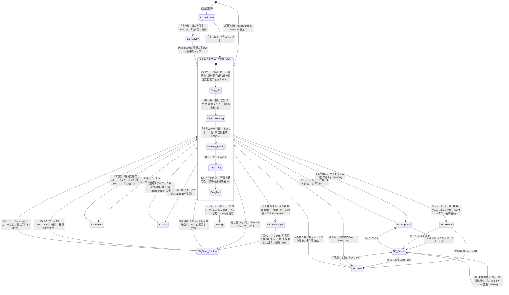

---

## 3. ユースケース別の画面推移とスクリーンショット（F01〜F05）

以下、**「アプリのデモ完成やベランダでのバジル栽培を進めたいユーザー」** の具体的なユーザーフローに沿って、PC 画面（`1440×900`）とスマホ画面（`390×844`）の推移を示す。

---

### UC0: 初回アンケート（F01）からホーム（島）への着陸（`S1` → `S2`）

#### Step 1: `S1` はじめて（ウェルカム画面）
アプリを初めて開くと、海からぷっくりした 3D の島と案内役キャラクター「ぽこ」が現れる。
- **「今の取り組みを設定」**: カード型 4 問の初回アンケート（F01）へ進む。
- **「はじめる」**: アンケートをすべてスキップし、空の島からすぐ始めることもできる（後から設定画面でいつでも登録可能）。

| PC 画面 (`1440×900`) | スマホ画面 (`390×844`) |
|---|---|
| 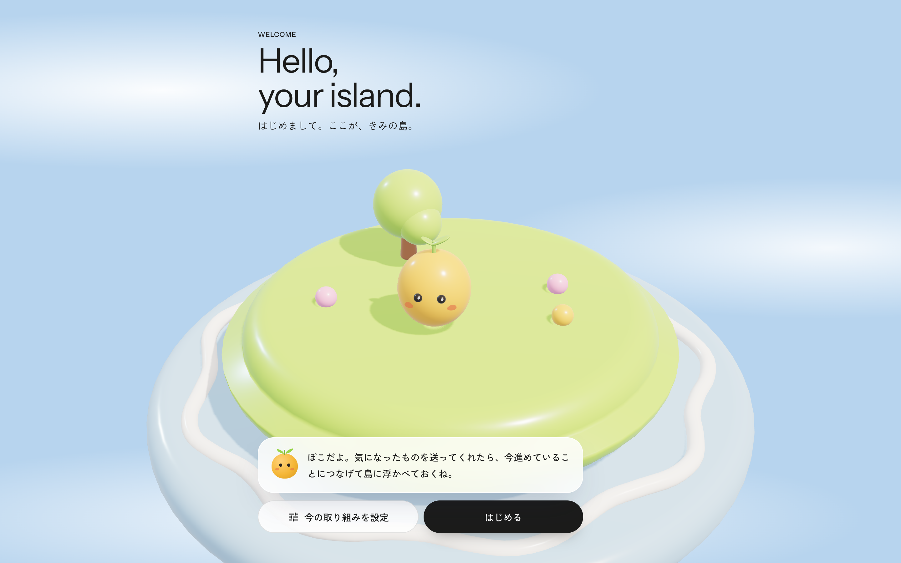 | 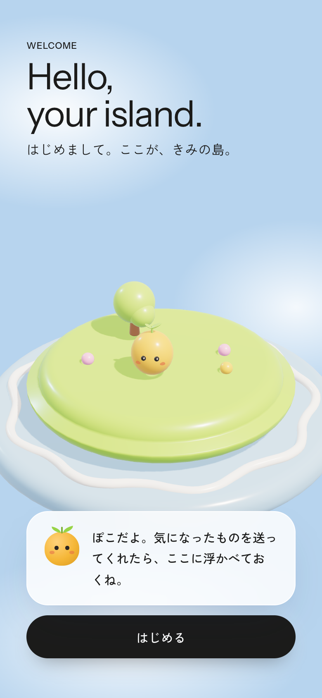 |

#### Step 1b & 1c: `S1` 初回アンケート（F01: カード型 4 問・任意・全スキップ可）
- **Q1（今進めていること Project）**: ジャンル（「アプリ制作」「作品・ポートフォリオ」など）を選ぶと具体的な取り組み名の入力欄が表示され、複数の Project を追加できる。ジャンル名だけで勝手に Project を作らず、具体的な取り組み名を確認して作成する。
- **Q2（日々大切にしたいこと Area）**: 「食事・料理」「暮らし」「健康」などをタップして Area として登録できる。
- **Q3（よく保存するもの）・Q4（しまに期待すること）**: 関心の補助情報として記録する。どの設問からも右上の「スキップして島へ →」でいつでも抜けられる。

| PC 画面（Q1: Project 入力） | スマホ画面（Q1: Project 入力） |
|---|---|
| 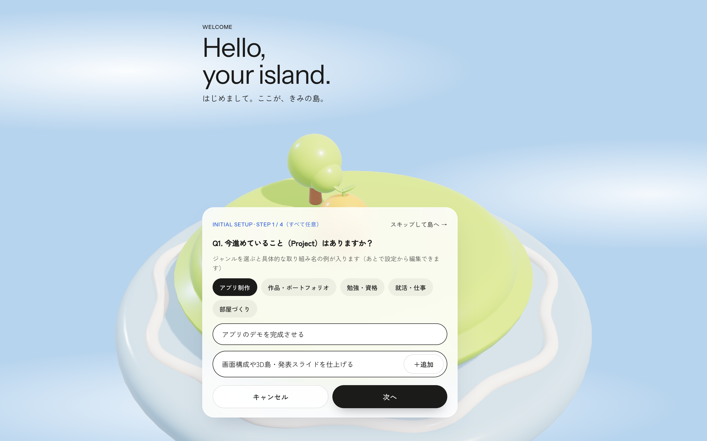 | 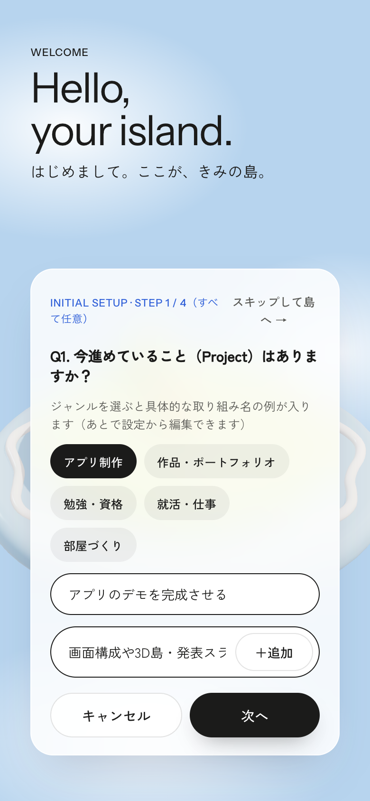 |

| PC 画面（Q2: Area 選択） | スマホ画面（Q2: Area 選択） |
|---|---|
| 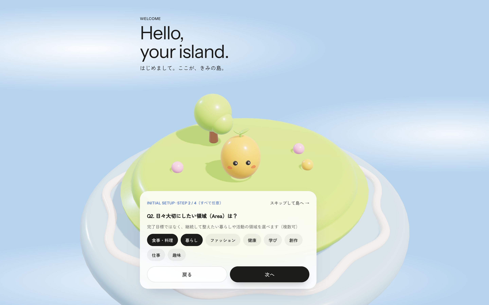 | 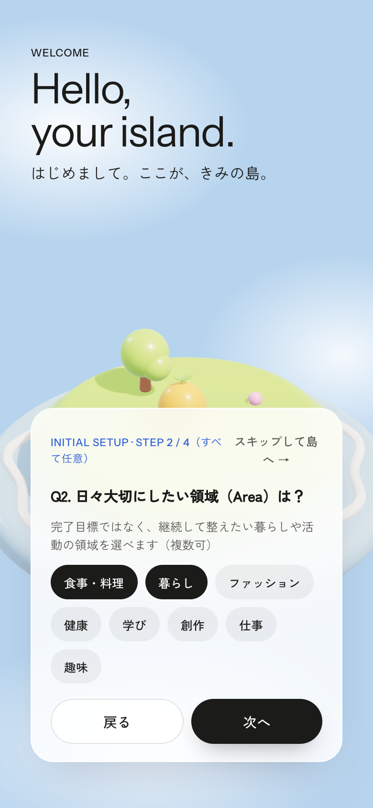 |

#### Step 2: `S2` 島（ホーム・初回設定完了直後）
アンケートを完了（またはスキップ）すると `S2` ホーム画面へ遷移する。アンケートで登録した Project は島の初期スポットとして配置され、すぐに保存物を紐づけられる状態になる。

| PC 画面 (`1440×900`) | スマホ画面 (`390×844`) |
|---|---|
| 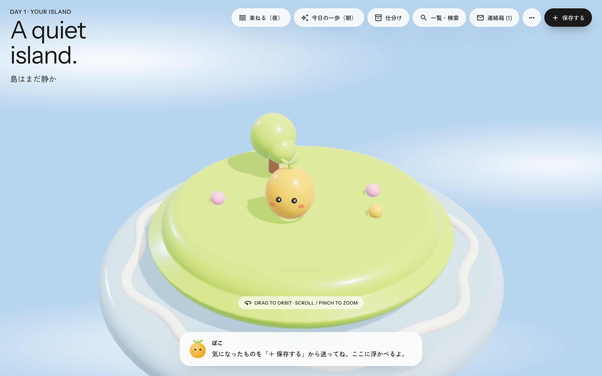 | 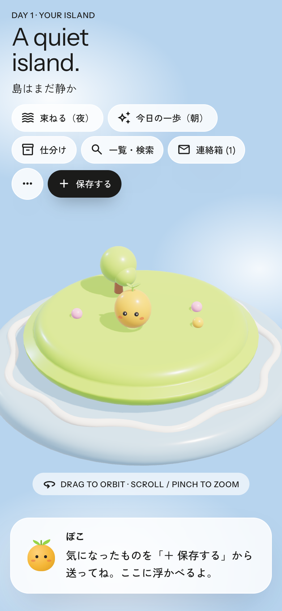 |

---

### UC1 & UC2: 保存・AI 同意・誠実な URL 判定・即時 Project/Area 紐づけ（F02 / F03 / R01 / R02 / R04）

#### Step 3: `S3` 保存シート Step 1（画像検証・URL・メモ入力・AI 送信同意トグル）
右上の **「＋ 保存する」** ボタンを押す（または PC 画面へ画像を直接ドラッグ＆ドロップする）と保存シートが開く。
- **画像バリデーション（F02/R01）**: PNG / JPEG / WebP（上限 10MB）を受け付け、超過時や HEIC 非対応時は理由を明示する。
- **AI 送信同意チェックボックス（R02）**: 「Gemini AI に入力内容を送信して意図候補を提案してもらう（オフ時は手動保存）」を切り替えられる。オフにした場合は AI へ送信せず、そのまま手動入力・分類で保存できる。

| PC 画面（右サイドドロワー） | スマホ画面（ボトムシート） |
|---|---|
| 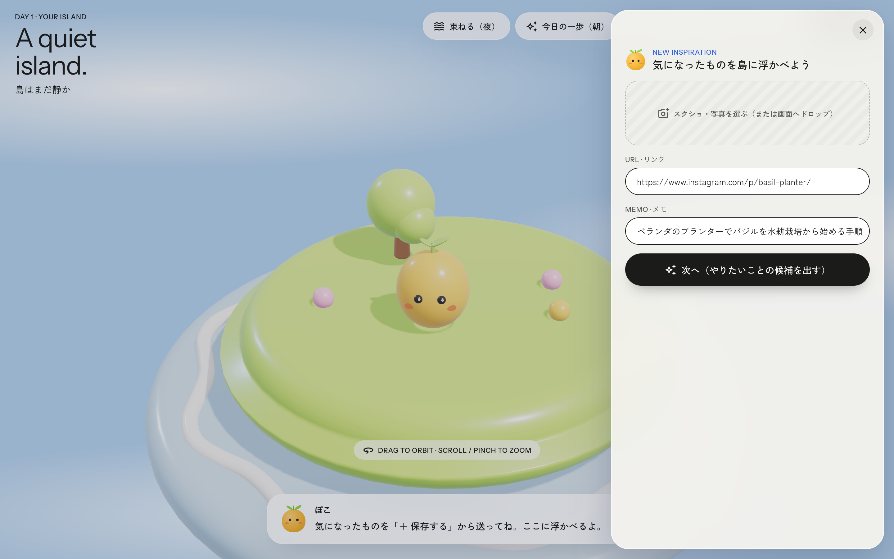 | 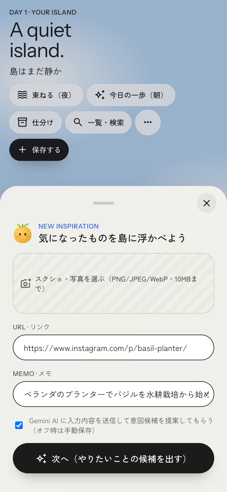 |

#### Step 4: `S3` 保存シート Step 2（誠実な URL 未取得通知・Project/Area 即時紐づけ・見るだけ／あとで）
「次へ」を押すと `analyzeItem` フローが実行され、Step 2 の確認画面が表示される。
1. **誠実な URL 判定（R04）**: Instagram 等でログイン壁により本文を取得できなかった場合は読めたふりをせず、**「※リンク先の本文は自動取得できなかったため、URLのみ記録します」** と明示し、スクショやメモの補足を案内する。
2. **保存先の即時紐づけ（F03）**: `LINK TO PROJECT / AREA` のチップから、登録済みの Project（例：`Project: ベランダでバジル栽培を始める`）や Area をワンタップで指定できる。「AI で自動照合 / 保留」を選んだ場合は、確定した意図が既存の Project / Area に明確に一致するときだけ自動紐づけし、曖昧な場合は `Someday`（いつか箱）へ保留する。
3. **意図の選択・見るだけ・あとで（F03）**:
   - AI が提示した 3 つの意図候補から 1 つをタップ（または自由書き直し）して確定
   - **「見るだけ・参考」**: 行動提案の対象にしない参考資料として `Resources` へ保存
   - **「あとで」**: 未確定の「？」カードとして `Someday` に保留

| PC 画面（右サイドドロワー） | スマホ画面（ボトムシート） |
|---|---|
| 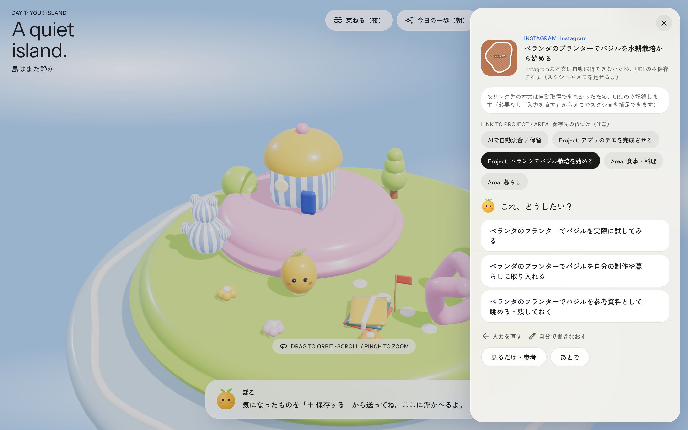 | 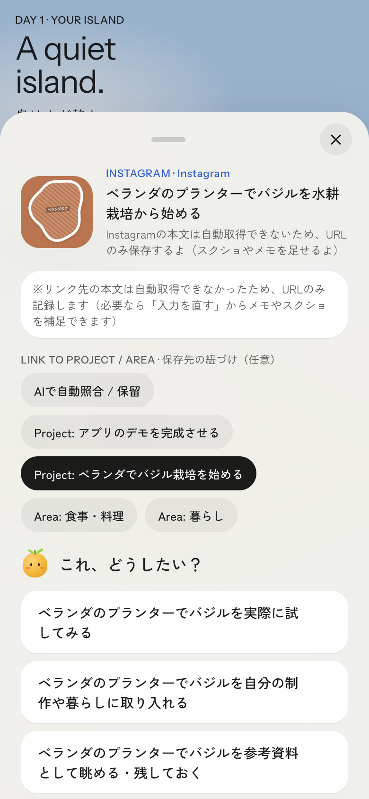 |

#### Step 5: `S2` 保存したカードが 3D の島に浮かぶ（F4）
保存を確定すると、Project に紐づいたカードや「見るだけ・参考」のカードが 3D の島の上空にぷかぷかと浮かぶ。

| PC 画面 (`1440×900`) | スマホ画面 (`390×844`) |
|---|---|
| 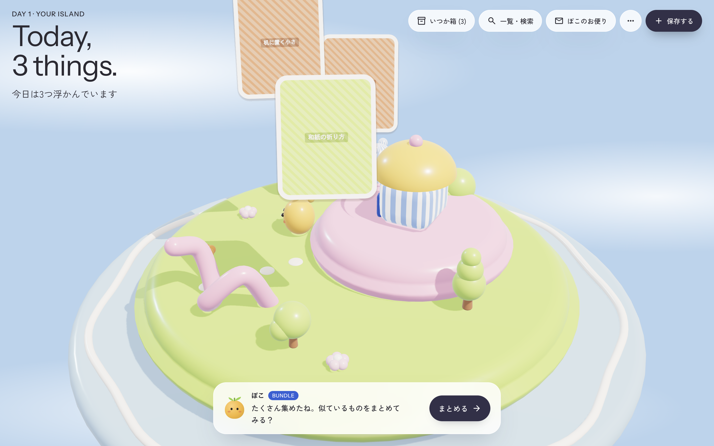 | 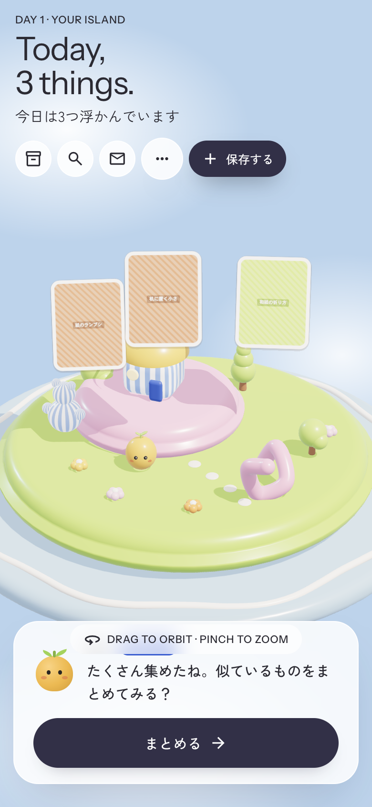 |

---

### UC4 & UC5: 提案・承認型の夜の整理（F5）と現地日付 1 日 1 件の「今日の一歩」（F05 / `S4` ↔ `S5`）

#### Step 6: `S2` 夜の整理 — 登録 Project/Area と照合した束ね提案（`F5: nightOrganize`）
上部ヘッダーの **「束ねる（夜）」** ボタン（または 23:00 定時バッチ）を押すと、未整理の確定済みアイテムがクラスタリングされ、ユーザーの登録済み Project / Area と照合された **束ね提案（`approvalStatus: 'pending'`）** として島の地面に着地する（「見るだけ・参考」の保存物は勝手に実行束へ混ぜない）。

| PC 画面 (`1440×900`) | スマホ画面 (`390×844`) |
|---|---|
| 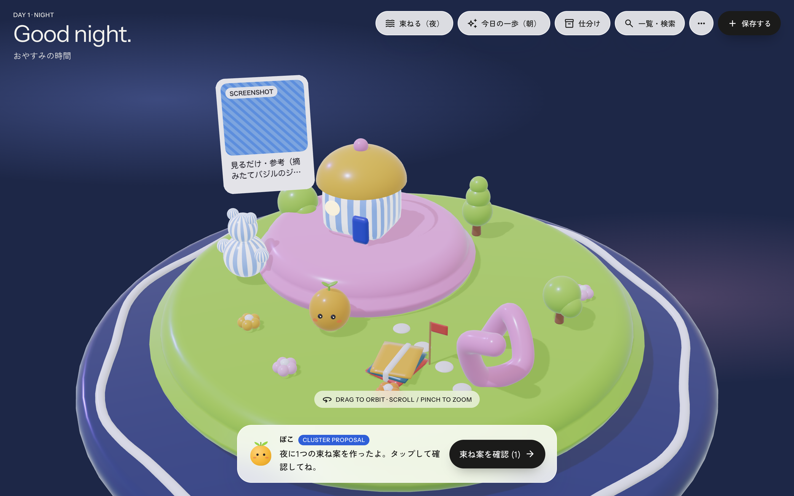 | 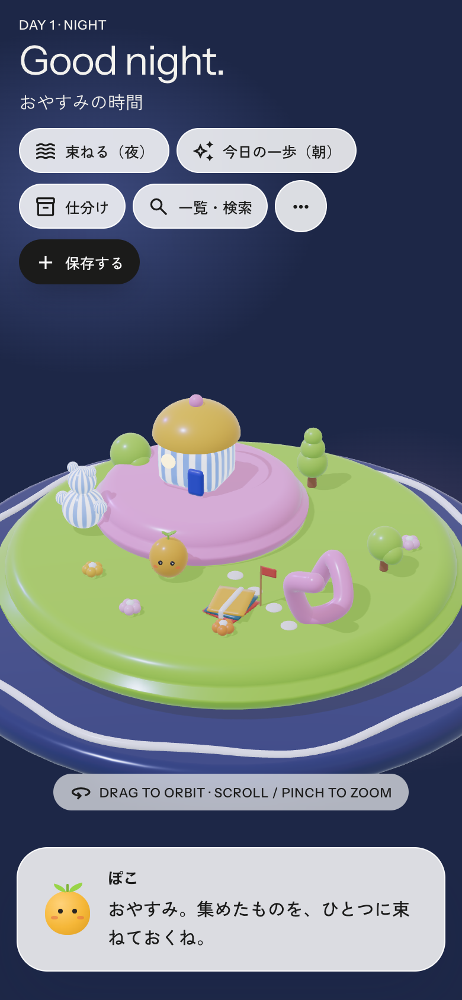 |

#### Step 7: `S4` 今日の一歩（F05: ホーム表示時の現地日付 1 日 1 件自動生成 ＋ 朝ボタン）
ホーム（`S2Home`）を開いた際、ユーザーの現地タイムゾーン日付（`localDate: YYYY-MM-DD`、初期値 `Asia/Tokyo`）に対する提案がまだ無ければ、実行可能なアイテムを持つアクティブな Project から自動的に最大 1 件の提案を生成する（ヘッダーの「今日の一歩（朝）」ボタンからも確認・再生成可能）。
ぽこから **「今日は、ベランダで鉢を置く場所だけ 15 分測ってみない？」** という小さな一歩が提示され、根拠となる束へ 1 タップで遷移できる。

| PC 画面（右サイドドロワー） | スマホ画面（ボトムシート） |
|---|---|
| 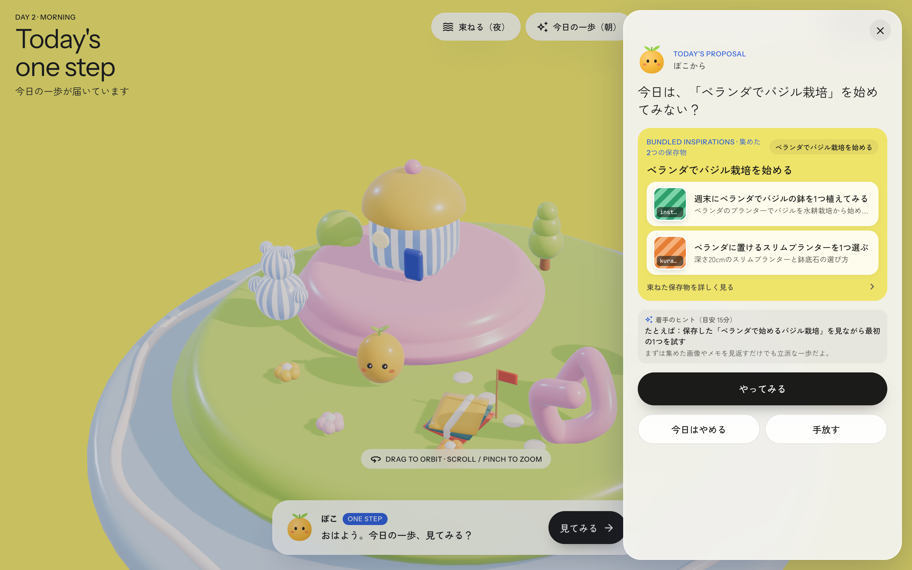 | 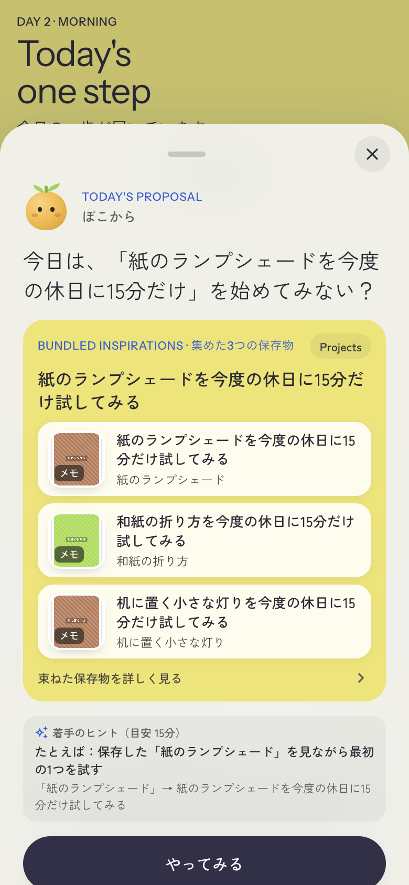 |

#### Step 8: `S5` 束・Project の詳細と「夜の束ね提案」の 1 タップ承認（F5 / F04）
`S5` 束の詳細シートでは、以下の操作が行える：
- **夜の束ね提案の承認（`NIGHT CLUSTERING PROPOSAL`）**: AI が自動でまとめた束ね案（`承認待ち`）に対し、紐づける Project / Area チップを確認・変更した上で **「この束ね案を承認する」** を 1 タップで確定できる。
- **AI 要点 3 つ（`KEY POINTS`）と所属する保存物一覧（`SAVED PIECES`）** の閲覧・意図編集。
- 手放した束（`Archives`）の場合は **「元の置き場（Projects）へ復元する」** ボタンから 1 タップで戻せる（P1）。

| PC 画面（右サイドドロワー） | スマホ画面（ボトムシート） |
|---|---|
| 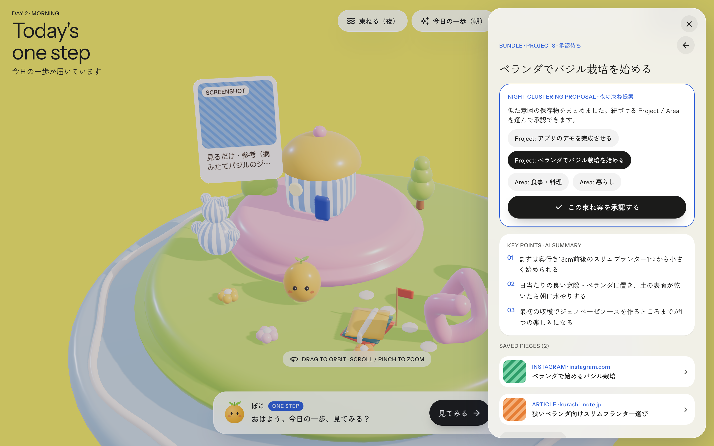 | 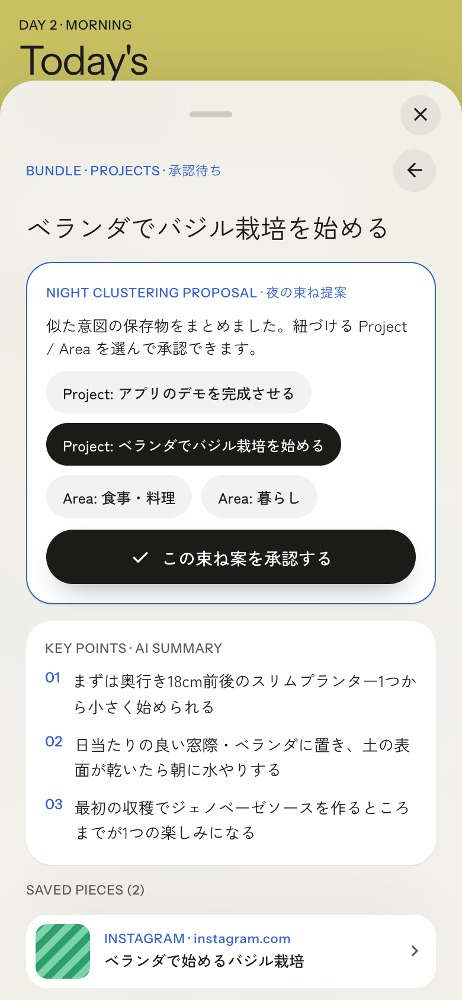 |

---

### UC6: 振り返りと冪等な島の成長（F05 / F8: `S6` → `S2`）

#### Step 9: `S6` 振り返りシート（「できた」「まだ」「もういい」）
提案で「やってみる」を選んだあと、下部ドックの **「できた？」** から `S6` 振り返りシートを開く。
- **「できた」**: ひとことチップや写真を添えて **「島にもどる（建物を建てる）」** を押す。
- **「まだ」**: 次回の提案時に 5 分で終わるさらに小さな一歩へ自動調整する。
- **「もういい」**: 手放して `Archives` へ移動する。

| PC 画面（右サイドドロワー） | スマホ画面（ボトムシート） |
|---|---|
| 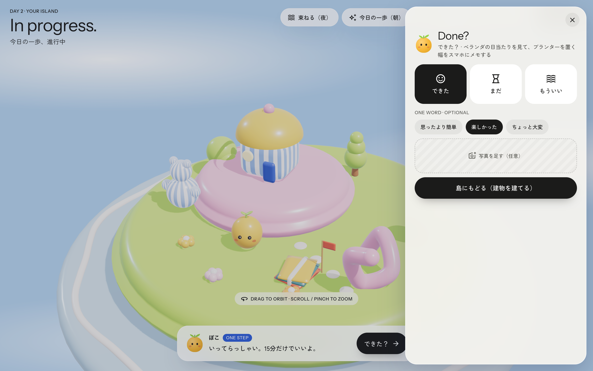 | 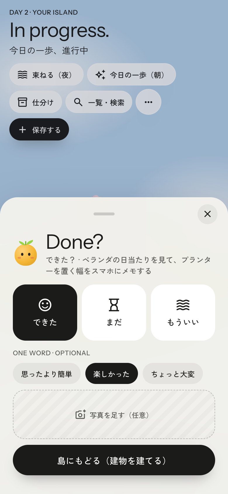 |

#### Step 10: `S2` 島に新しい建物が建つ（冪等な成長反映）
「できた」を記録すると、同一提案での二重加算を防ぎながら `buildingLevel` が +1 され、島に **完成した建物（ドーム屋根のアトリエ）** が建つ（`It's built.`）。

| PC 画面 (`1440×900`) | スマホ画面 (`390×844`) |
|---|---|
| 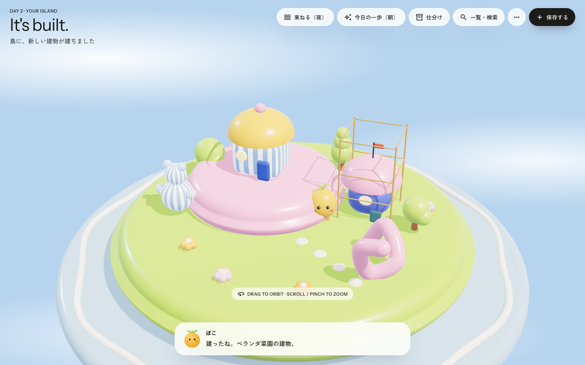 | 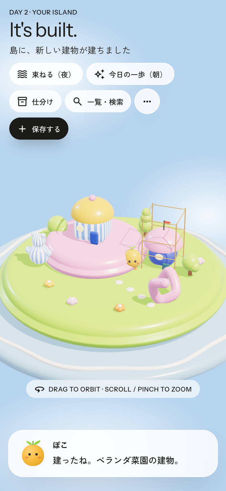 |

---

### UC7〜UC9: いつか箱の仕分け（`S7`）・Project/Area 一覧検索（`S8`）・保存物の詳細/復元/削除（`S9`）・設定

#### Step 11: `S7` いつか箱（Someday/Maybe）の週 1 スワイプ仕分け
未確定・保留のまま `Someday` に入っている保存物は、ヘッダーの **「仕分け」** から左右スワイプ（「作る → `Projects`」「作らない → `Resources`」）で整理できる。

| PC 画面（中央モーダルカード） | スマホ画面（全画面カード） |
|---|---|
| 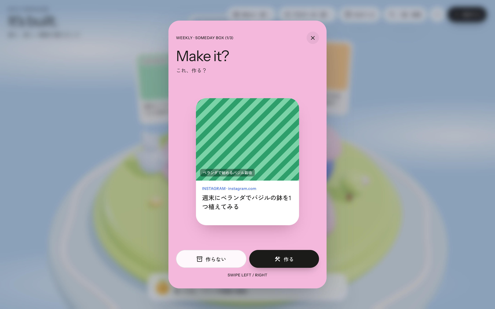 | 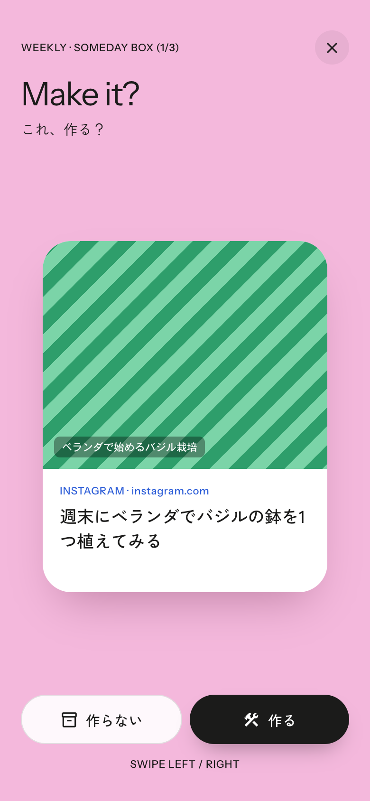 |

#### Step 12: `S8` 一覧・検索（Project / Area の直接追加 ＋ PARA 5 タブ横断検索）
ヘッダーの **「一覧・検索」** を押すと、`Projects` / `Areas` / `Resources` / `Archives` / `いつか` の 5 タブと検索バーが開く。
`Projects` タブでは **「＋ 新しい Project（取り組み）を追加」**、`Areas` タブでは **「＋ 新しい Area（領域）を追加」** からその場で新しい取り組みや領域を新設できる。

| PC 画面（右サイドドロワー） | スマホ画面（ボトムシート） |
|---|---|
| 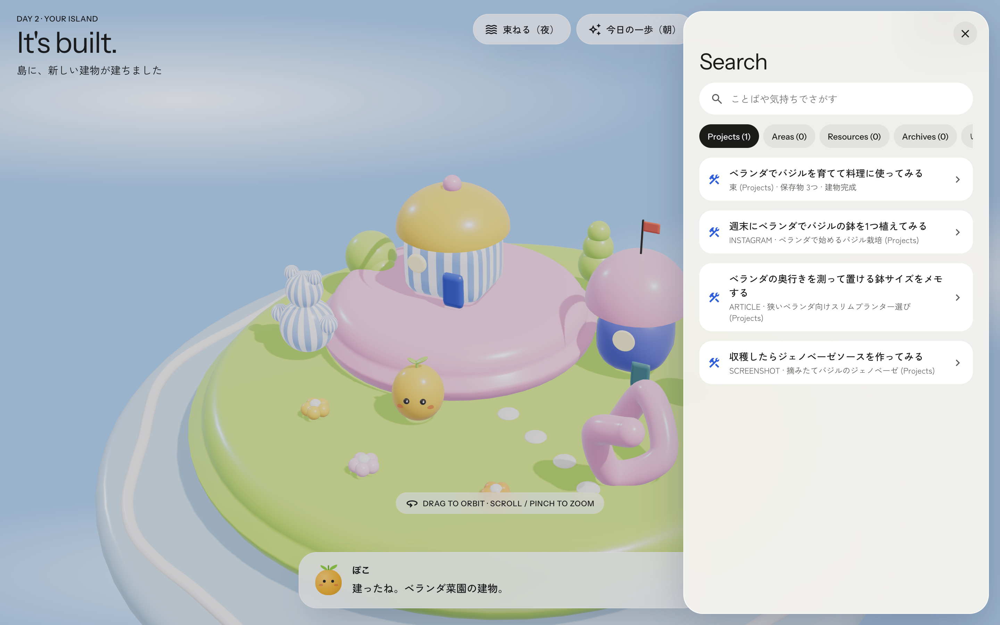 | 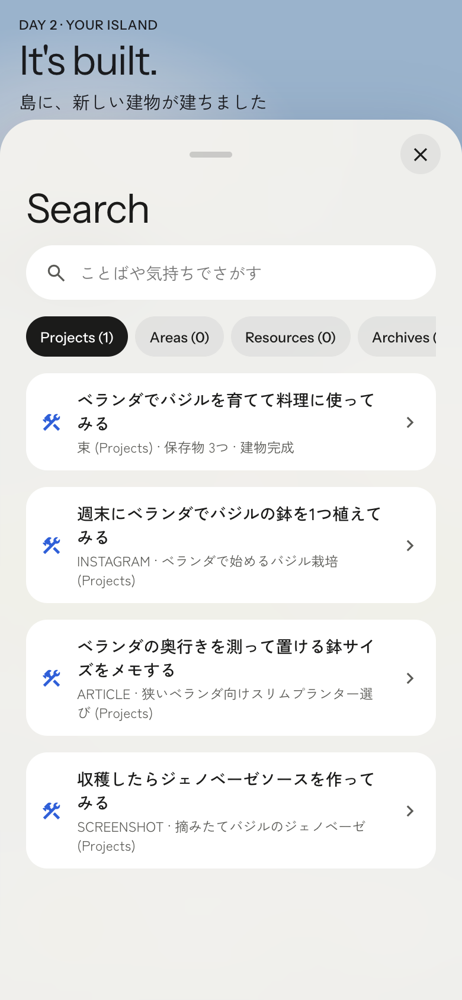 |

#### Step 13: `S9` 保存物の詳細（Project/Area 紐づけ変更・アーカイブ復元・完全削除 R03）
保存物をタップすると `S9` 詳細シートが開き、すべての属性を後から変更できる：
- **やりたいこと（`INTENT`）の編集**
- **PARA カテゴリ（置き場所）の変更**（`Resources`＝見るだけ・参考、`Archives`＝アーカイブ等）
- **具体的な Project / Area 紐づけ先の変更チップ**（`PROJECT / AREA · 具体的な紐づけ先を変更`）
- `Archives` にある場合は **「元の置き場へ復元する」** ボタン（削除とアーカイブを明確に区別）
- 最下部の **「保存物を削除する」** ボタン：Firestore ドキュメントと Cloud Storage 画像の双方から完全削除する（R03）

| PC 画面（右サイドドロワー） | スマホ画面（ボトムシート） |
|---|---|
| 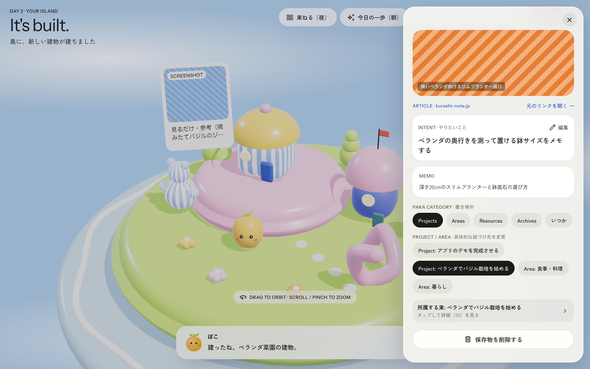 | 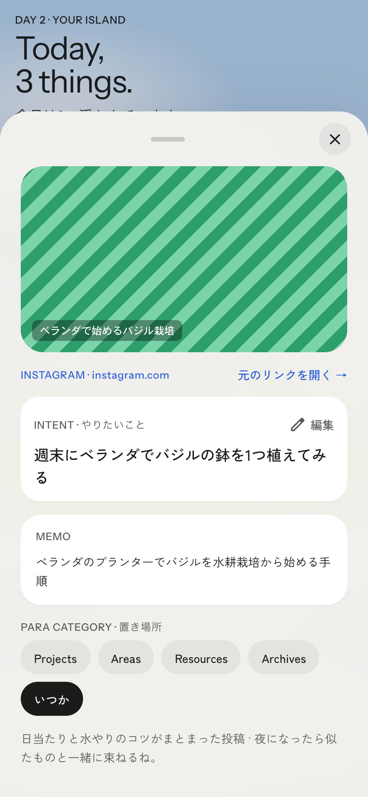 |

#### Step 14: 設定シート（Project / Area 管理・初回アンケート再実行・タイムゾーン・AI 送信同意）
ヘッダー右上の **「…」** ボタンから開く設定シート（`Island Settings`）では、今回の仕様（F01 / F05 / R02）に対応するすべての設定を管理できる：
- **登録済み Project / Area の一覧と新規追加フォーム**（タップで該当 Project / Area の詳細 `S5` を開く）
- **タイムゾーン設定**（現地日付 `YYYY-MM-DD` による 1 日 1 提案の基準タイムゾーン、初期値 `Asia/Tokyo`）
- **Gemini AI への送信同意トグル**
- **「初回アンケート（4問）をやり直す」** ボタン
- 住んでいるキャラクター（ぽこ／ともり／ふみ）・島の 3D 質感（ぷっくり／クレイ／ジオラマ）・データ初期化

| PC 画面（右サイドドロワー） | スマホ画面（ボトムシート） |
|---|---|
| 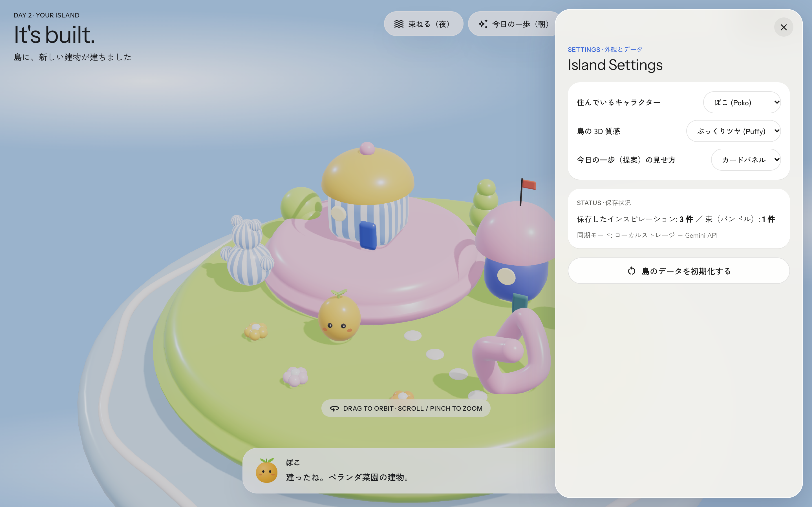 | 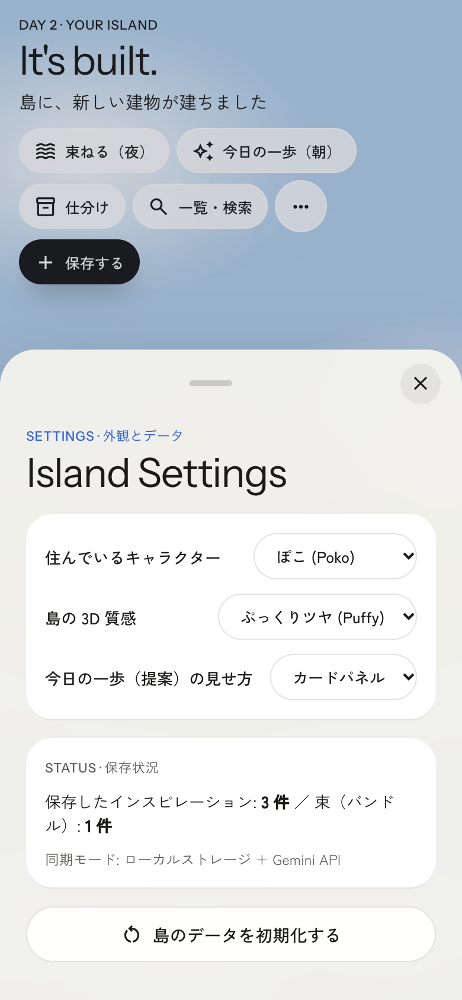 |

---

## 4. 複数ユースケース（全6分野・48パターン）対応とDBを用いた多角的評価

「しま」のユースケース案（1〜6の6分野・48ケース、7. アプリ内で起きるユースケース、8. 特にデモに向く3例、9. PARAに沿ったカテゴリー分けパターン）に対して、DB（`PersistedState`：Firestore `users/{uid}/island_state/current` ＋ `localStorage`）と自動検証スイート（[`src/__tests__/useCaseEvaluation.test.ts`](../src/__tests__/useCaseEvaluation.test.ts)）を用いて多角的に評価・実装した。

### 4.1 6分野・48ユースケースと3つのデモパターンの対応マトリクス

| 分野 | 対象ケース | 意図候補の3角度生成 (`buildContextualIntents`) | Resource トピック自動付与 (`inferResourceTopic`) | DB プリセット（設定画面から1タップ切替） |
|---|---|---|---|---|
| **1. デザイン・ものづくり** | `#1〜#10`（UI・カード・配色・文字組み・キャラ・3D島・アニメ・ポートフォリオ） | ① 進行中Projectの制作に試す ② 自分の制作で1パーツだけ描く ③ 資料集（`Resources`）として残す | `UI/UXデザイン` / `配色・カラーパレット` / `タイポグラフィ・文字組み` / `キャラクターデザイン` / `3D・ジオラマ・アニメーション` / `ポートフォリオの参考` | **`design_maker`** （デモ①：アプリUIの参考→自分で1つ描く） |
| **2. 料理・食べもの** | `#11〜#16`（朝食・余り野菜・レンジおやつ・お弁当・カフェ風ドリンク・作り置き） | ① 今週のイベント/Projectで作る ② 日常の食生活（`Areas`）で1品試す ③ レシピ帳（`Resources`）として残す | `料理・おやつのレシピ` / `おうちカフェ・盛りつけ` | **`cooking_living`** （デモ②：レシピ→今日の一品を試す） |
| **3. ファッション・美容** | `#17〜#22`（色合わせコーデ・小物・髪型・ネイル・メイク・リップ見比べ） | ① 次の予定/撮影Projectで試す ② 手持ちの服や見比べ（`Areas`）に使う ③ ルックブック（`Resources`）に残す | `ファッション・コーデの参考` / `ヘア・メイク・ネイル` | **`fashion_hobby`** （境界線 `#22`：保存物を見比べる体験に特化し、口コミ収集や購買判断代行は行わない） |
| **4. ツール・学び・仕事** | `#23〜#32`（Obsidian/Second Brain・AIツール・Figma・ノート整理・勉強法・面接・スライド・Tips・考え方・統計） | ① 進行中Project（フォルダ作成・面接対策等）で試す ② 学習・仕事の習慣（`Areas`）に取り入れる ③ 知識ノート（`Resources`）として残す | `情報整理・Second Brain` / `気になるアプリ・AIツール` / `勉強法・ノート術` / `就活・面接の参考` / `スライド・プレゼンデザイン` / `プログラミングTips` / `考え方・心に残った言葉` / `統計・調査資料` | **`second_brain_study`** （デモ③：情報整理ツール→最初のフォルダを作る） |
| **5. 日常・暮らし** | `#33〜#40`（机まわり・収納・模様替え・季節の花・日記・デジタルデトックス・行きたい場所・週末案） | ① 模様替え・週末お出かけProjectで実行 ② 暮らし・睡眠・部屋づくり（`Areas`）で整える ③ 暮らしのアイデア帳（`Resources`）に残す | `収納・インテリアのアイデア` / `生活のTips` / `行きたい場所・イベント` | **`cooking_living`** ＆ **`fashion_hobby`** に横断収録 |
| **6. 趣味・創作・思い出** | `#41〜#48`（スマホ写真・ポーズ集・イラスト・手作りアクセ・音楽・展示・読書・筋トレ） | ① 記念撮影・作品制作Projectで試す ② 趣味・運動習慣（`Areas`）のきっかけにする ③ 創作・趣味コレクション（`Resources`）に残す | `写真・ポーズ・構図` / `イラスト・ハンドメイド` / `本・音楽・アート` / `運動・ストレッチ` | **`fashion_hobby`** に横断収録 |

---

### 4.2 多角的評価：このアプリが多様なユーザーに適合しているかの5つの検証軸

1. **軸①：同じ保存物でも「ユーザーの状況 × 選んだ意図」で PARA 分類が変わるか（ユースケース案 `9.5`）**
   - **検証内容**:
     - `#1 かわいいホーム画面のスクショ`：ハッカソン制作中（`Projects`）×「自分のアプリに取り入れたい」→ **`Projects`** ／ アプリは作っていない ×「かわいいUI集として眺めたい」→ **`Resources`（トピック：`UI/UXデザイン`）**
     - `#11 簡単な朝食レシピ`：「来週のホームパーティーのメニュー」→ **`Projects`** ／「毎朝の食事レパートリーを増やしたい」→ **`Areas`** ／「おいしそうだからレシピ帳に残す」→ **`Resources`（トピック：`料理・おやつのレシピ`）**
     - `#23 Obsidianの紹介投稿`：「今週中にObsidianで最初のフォルダを作る」→ **`Projects`** ／「日頃のメモ習慣を見直す」→ **`Areas`** ／「情報整理の考え方として読んでおく」→ **`Resources`（トピック：`情報整理・Second Brain`）**
   - **結果**: [`matchIntentToTargets`](../functions/src/application/aiUseCases.ts) が保存物のテキストだけでなく **確定した意図（3倍重み）** と **ユーザーの登録済み Project / Area** を照合し、参照目的の意図（「参考にしたい」「見比べたい」「残したい」等）は自動的に `Resources` ＋ `resourceTopic` へ振り分けることをテストで実証。
2. **軸②：同じ題材でも「意図が違えば別のまとまり」に分かれるか（ユースケース案 `7. まとまり・仕分け`）**
   - **検証内容**: 同じ「カフェの写真・記事」を2件保存し、1件目を「今度の休日に友達と**行ってみたい**」、2件目を「カフェの照明や配色を**UIデザインの参考にしたい**」とした場合、同じ束（Bundle）に混ざらないか。
   - **結果**: [`areIntentsConflicting`](../functions/src/domain/clustering.ts) により目的カテゴリ（`visit_outing` vs `design_making`）の衝突を検知し、タイトルや題材が近くても別々の束・置き場に分かれることをテストで実証。
3. **軸③：「今は決められない（あとで）」と「行動を強制しない（Resources）」の尊重**
   - **検証内容**: 電車内で急いで保存して「あとで（`Someday`）」を選んだ保存物や、「見るだけ・参考資料（`Resources`）」として残した保存物に対して、的外れな「今日の一歩」を強制しないか。
   - **結果**: 朝の提案（`runGenerateMorningProposal`）はアクティブな `Projects` / `Areas` のみを優先候補とし、`Someday` や `Resources` の保存物を行動提案で急かさない設計になっている。また Project 完了時には `S5` シートの **「達成・完了して Archives に残す」** ボタンから `Archives` へ移せる。
4. **軸④：境界線 `#22`（複数のリップ・コーデ投稿の見比べ）の遵守**
   - **検証内容**: `#22 複数のリップの投稿` で「似た色を見比べたい」を選んだ際、ECサイトの口コミ収集や購入判断の代行に踏み込まず、「自分が保存した候補を1つの画面で見比べる体験」として成立しているか。
   - **結果**: `fashion_hobby` プリセットおよび `S5` / `S8` シートにて、トピックタグ `ヘア・メイク・ネイル` / `ファッション・コーデの参考` で自分の保存物を並べて比較でき、提案も「保存した候補を並べて次の予定で試す1色を選ぶ」という自己決定サポートに留めている。
5. **軸⑤：DB（`localStorage` ＋ Firestore スキーマ）への永続化と4ペルソナ切替の完全性**
   - **検証内容**: 4種類のペルソナプリセット（`design_maker`, `cooking_living`, `second_brain_study`, `fashion_hobby`）を DB に保存・復元した際、`targets`（Project/Area）、`items`（`resourceTopic` 含む）、`bundles`、`proposal`、`buildingLevel` が欠損なくラウンドトリップするか。
   - **結果**: [`src/__tests__/useCaseEvaluation.test.ts`](../src/__tests__/useCaseEvaluation.test.ts) の全テストケースがパス。

---

### 4.3 4つのマルチユースケース DB プリセット画面（PC / スマホ）

設定シート（`Island Settings`）内の **「USE CASE SCENARIOS · 複数ユースケース検証（DBプリセット切替）」** から、4つの異なるユーザー像の DB 状態をワンタップで切り替えられる。

#### ① デザイン・ものづくり（しまのデモ制作 `#1, #2, #8`）
| PC 画面 (`1440×900`) | スマホ画面 (`390×844`) |
|---|---|
| 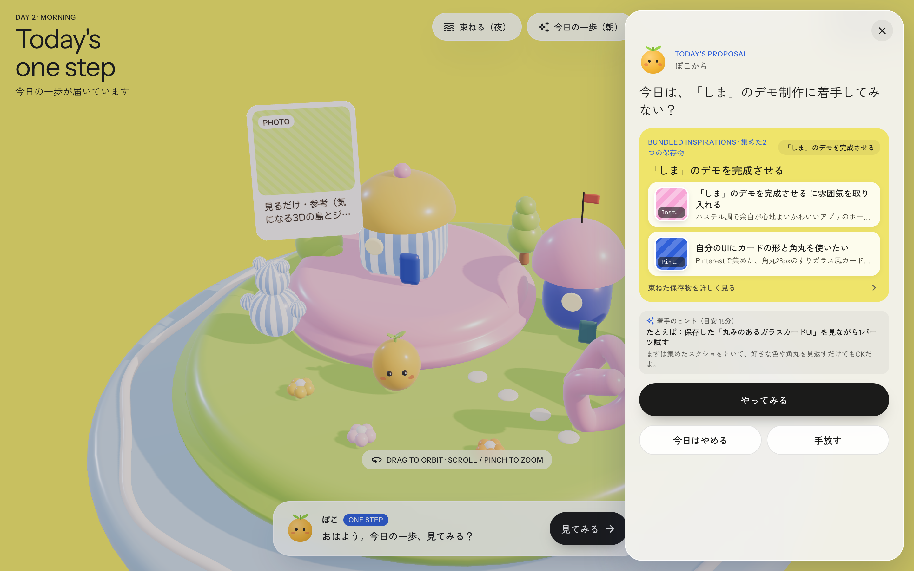 | 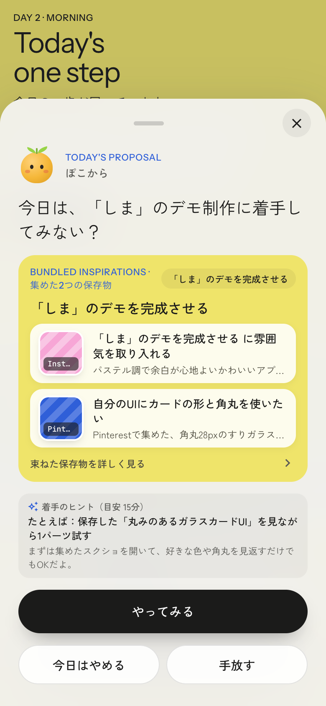 |

#### ② 料理・食べもの・暮らし（おやつ＆朝食・ベランダ菜園 `#11, #13, #14`）
| PC 画面 (`1440×900`) | スマホ画面 (`390×844`) |
|---|---|
| 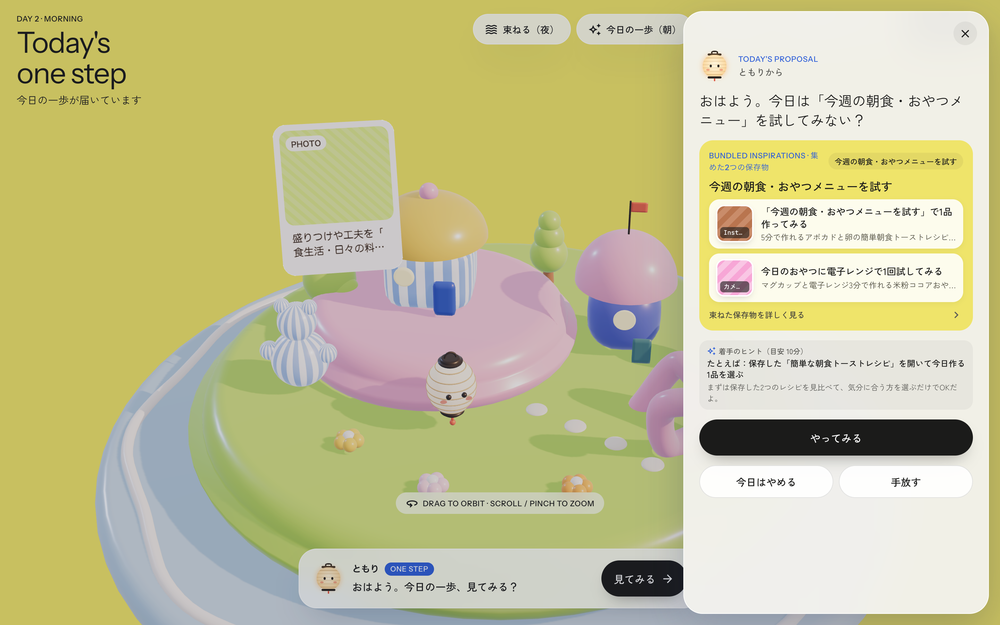 | 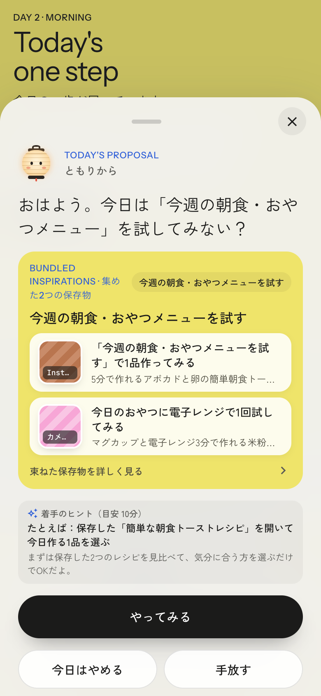 |

#### ③ ツール・学び・仕事（ObsidianでSecond Brain構築＆就活 `#23, #26, #32`）
| PC 画面 (`1440×900`) | スマホ画面 (`390×844`) |
|---|---|
| 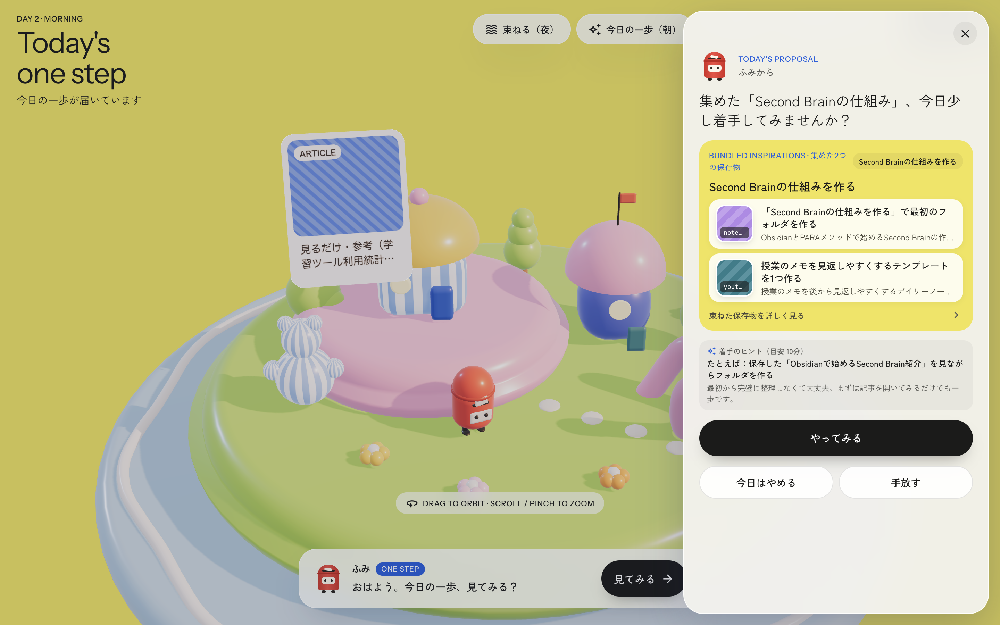 | 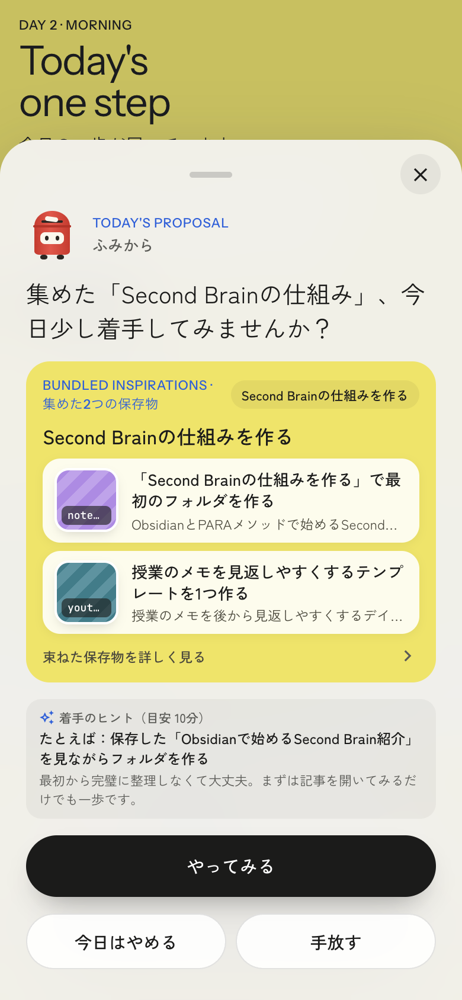 |

#### ④ ファッション・趣味・思い出（色合わせ・リップ見比べ `#17, #22` ＆ 記念撮影 `#42`・トピック付き一覧 `S8`）
| PC 画面 (`1440×900`) | スマホ画面 (`390×844`) |
|---|---|
| 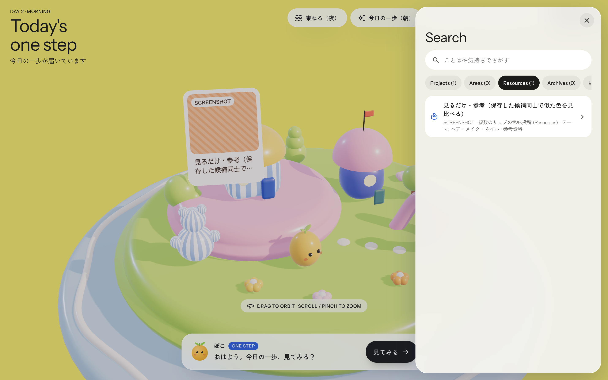 | 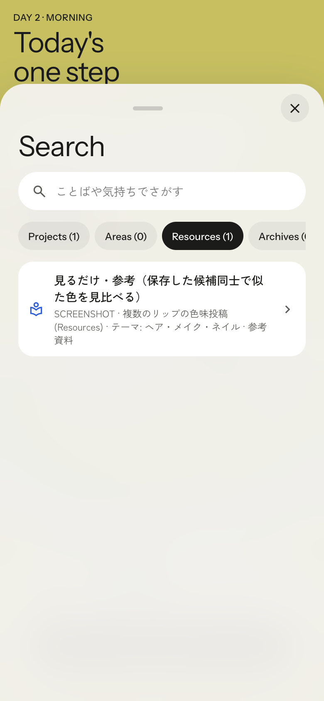 |

---

## 5. 能動発見・連絡箱のユーザーフロー（A01〜A04 / S01〜S04・PC版 / スマホ版）

「しま」がユーザーの「好き」を少しずつ知り、本人が確認したアーティスト・作家や編集媒体のキュレーションを起点に、気になる公演や展示をそっと届ける **能動発見・連絡箱（`DiscoveryInboxSheet`）** のユーザーフローと画面推移を以下に示す。

### 5.1 設計方針と安全ガードレール
1. **タスク化や購入を促さない**: 発見カードは「眺めるだけ」で完結し、Googleカレンダー登録や予約・購入を自動実行しない。
2. **3つの個別同意（デフォルトOFF）**:
   - **① AI送信の許可 (`aiConsentGranted`)**: 保存物の意図候補やスクショ文字からの名前候補抽出。
   - **② 外部検索の許可 (`searchConsentGranted`, デフォルトOFF)**: 明示的にONにし、かつ対象Projectを選択した場合のみ最小限の検索語を送信。OFF時は外部プロバイダー呼び出しが **0回** であることを保証。
   - **③ 端末通知の許可 (`notificationEnabled`, デフォルトOFF)**: 汎用文面（「しまからお知らせがあるよ」）のみとし、ロック画面にProject名や回答内容を出さない。また「通知サービス受付」と「実機到達」を区別して表示する。
3. **本人回答（確認済み）とAI仮説（未確認）の分離**:
   - スクショ文字からの候補や同名人物（例：「蓮」など）は「未確認／特定待ち」として扱い、本人が `［聴く］［たまに聴く］` で確認するまで外部検索の対象にしない。本人が削除・拒否した人物は自動再登録しない。

---

### 5.2 ユーザーフロー Step 1〜2: 連絡箱を開く（外部検索OFF・選択式質問・本人確認と検索語プレビュー）
- ホーム上部ナビゲーションの **`連絡箱 (1)`**（または設定シートの「連絡箱・能動発見設定を開く」）をタップすると連絡箱ドロワー／シートが開く。
- **初期状態（外部検索OFF）**: 外部検索呼び出しは **0回** のまま、未確認候補（例：スクショから抽出した「カネコアヤノ」）に対する選択式の質問カード（1日最大1件・スキップ可）が表示される。
- 下部の **「本人確認済みの好きなアーティスト・作家」** セクションでは、「本人回答（確認済み）」と「AI仮説・スクショ候補（未確認）」がバッジで明確に区別され、さらに下部の **「個別同意と検索語プレビュー」** で外部送信される最小限の検索語を事前確認できる。

| PC 画面 (`1440×900`) | スマホ画面 (`390×844`) |
|---|---|
| 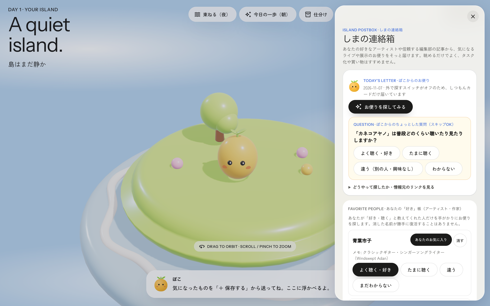 | 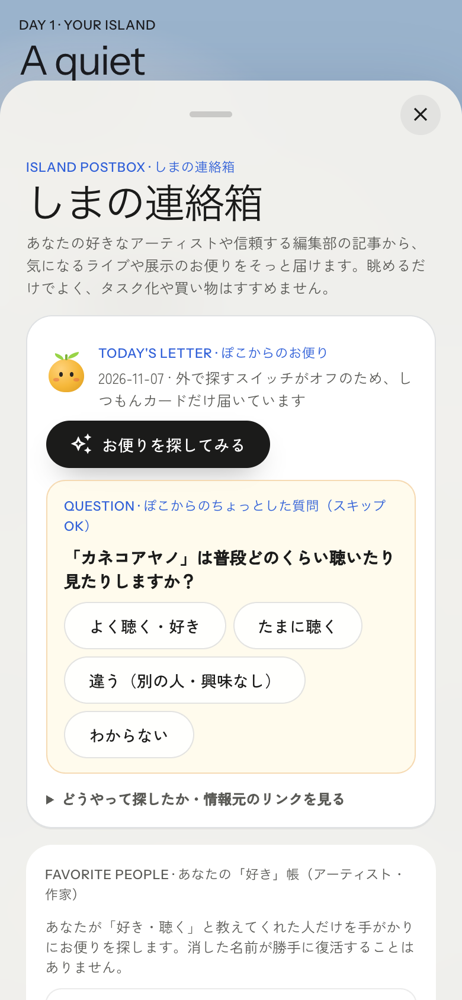 |

---

### 5.3 ユーザーフロー Step 3〜4: 個別同意ON → 公式照合済みの発見カード＆調査メモの確認
- ユーザーが質問に回答（または手入力でアーティストを確認）し、**「② 外部検索の許可」** をONにして発見サイクルを実行すると、本人確認済みアーティスト（例：蒼井ことね／検証用の架空アーティスト）と希望地域（例：東京・関東）・期間のみで検索と公式照合が行われる。
- 公式情報と照合できた候補のみが **発見カード（最大1件）** として届き、以下の情報が明示される：
  - **公演名・開催日・開演時間・会場・地域**（同日昼夜公演は開演時刻で別枠管理）
  - **誰が発表・推薦したか**（公式インフォメーション / 編集媒体キュレーション）
  - **なぜ見つけたか**（対象Projectと本人確認済みアーティスト・地域の接点）
  - **確認日時と公式出典リンク**（非公式ブログの噂や架空URL、中止・過去公演は自動除外）
- さらに **「調査メモ・出典URL・通知検証ステータスを見る」** を開くと、実際に使用した検索語、受け取った出典一覧（公式確認済み／未確認除外の区別）、および検証用参照データ（モック）である旨の注記を確認できる。

| PC 画面 (`1440×900`) | スマホ画面 (`390×844`) |
|---|---|
| 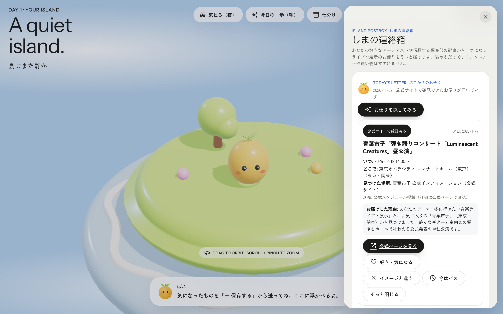 | 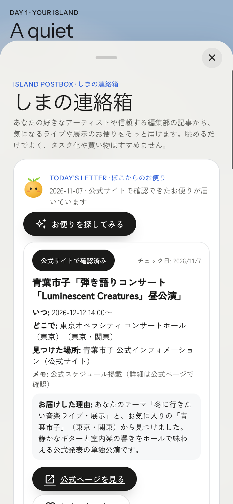 |

---

### 5.4 ユーザーフロー Step 5: 発見カードへの反応（好き / 違う / 今は不要 / 閉じる）と次回への反映
- ユーザーは発見カードに対して **5つの反応** を選べる（何も選ばず閉じてもよく、無回答は肯定・否定に数えない）：
  1. **`［詳細を見る（公式出典）］`**: 公式ページを別タブで開く。
  2. **`［好き］`**: 次回以降の候補順位付けの参考にする。
  3. **`［違う］`**: 任意の理由（同名の別人・地域が遠い・興味が変わった等）を記録し、次回から対象・種類を見直す。
  4. **`［今は不要］`**: 好みの否定とは扱わず、設定された抑制期間（初期案14日間）だけ一時的にお休みする。
  5. **`［閉じる］`**: 眺めるだけで完結して閉じる。

| PC 画面 (`1440×900`) | スマホ画面 (`390×844`) |
|---|---|
| 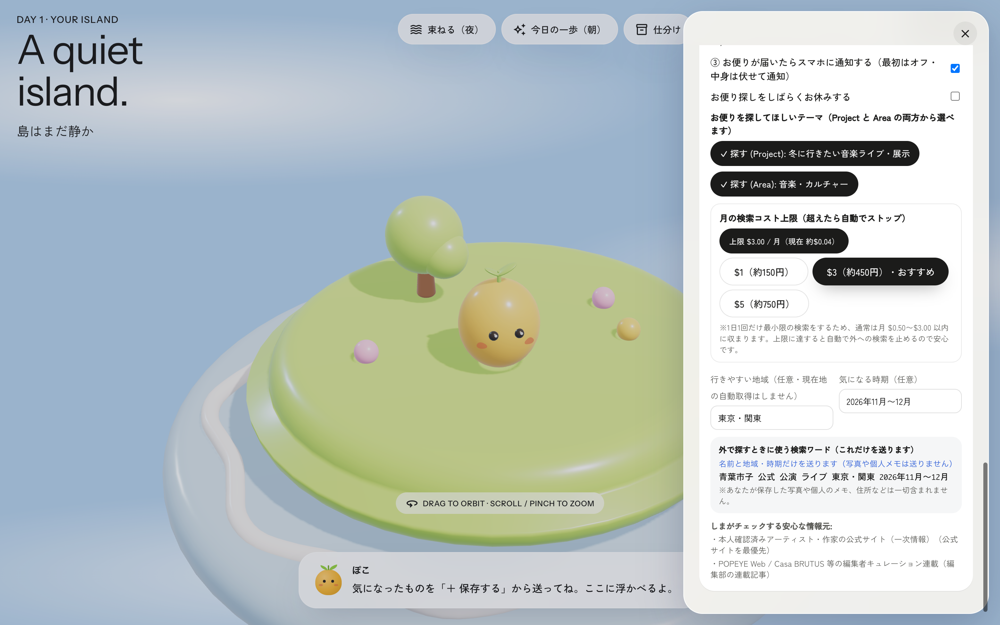 | 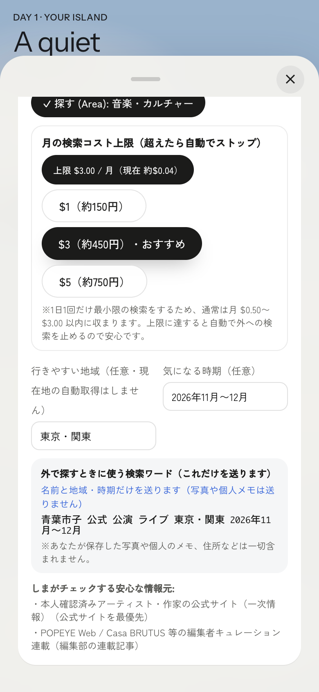 |

