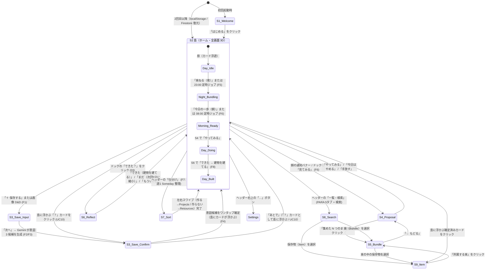

# 画面遷移・ユースケース解説（PC版 / スマホ版）

本書では、デモ用の擬似端末フレームを撤去して実用 Web アプリ（PWA）として刷新した **PC 画面（デスクトップ・ノート PC）** と **スマホ画面（モバイル縦画面）** のレスポンシブ UI 構造、画面遷移図、および主要ユースケース（UC1〜UC9）ごとの実際のスクリーンショットを解説する。

- 関連ドキュメント:
  - 要件定義: [`requirements.md`](requirements.md)
  - アーキテクチャ・ディレクトリ構成: [`architecture.md`](architecture.md)
  - 技術判断記録: [`decisions/002-web-stack.md`](decisions/002-web-stack.md) / [`decisions/003-backend-and-data-model.md`](decisions/003-backend-and-data-model.md)

---

## 1. PC 版とスマホ版のレスポンシブ UI 原則

「9 つの画面（S1〜S9）は 9 つの別ページではなく、**常に全画面（`100vw × 100dvh`）の背景に自分の 3D の島が存在し、その上にガラスパネルが重なる**」という設計原則を採っている。

| 要素 | PC 画面（`>= 768px`） | スマホ画面（`< 768px`） |
|---|---|---|
| **3D の島 (`IslandCanvas`)** | 画面全体（`100vw × 100dvh`）に広がる。マウスドラッグで回転、ホイールでズーム、**画像ファイルを画面へ直接ドラッグ＆ドロップして即座に保存可能** | 画面全体（`100vw × 100dvh`）に広がる。指のドラッグで回転、ピンチでズーム |
| **上部ヘッダー (`S2Home`)** | 左上に現在の `DAY` と英語・日本語見出し、右上に `束ねる（夜）` `今日の一歩（朝）` `仕分け` `一覧・検索` `設定` `＋ 保存する` のピルボタンを横並び配置 | 左上に `DAY` と見出し、その下に折り返しピルボタンをコンパクトに配置 |
| **下部キャラクタードック (`S2Home`)** | 画面下部中央（最大幅 `560px`）にすりガラス風ドックとしてフロート配置 | 画面下部に横幅いっぱいのガラスドックとして配置 |
| **各操作画面（S3 / S4 / S5 / S6 / S8 / S9 / 設定）** | **右端にフロートするすりガラス風サイドドロワー（幅 `440px`）** として開く。左側の 3D の島を眺めたまま作業できる | **下からスライドアップするボトムシート（最大高さ `88dvh`）** として開く。片手親指で操作しやすい |
| **フルモーダル（S4 手紙版 / S7 週 1 仕分け）** | 画面中央のモーダルカード（最大幅 `480px`、背景ブラー） | 全画面モーダル |

---

## 2. 画面遷移図（S1〜S9 ＋ 設定）

---

## 3. ユースケース別の画面推移とスクリーンショット

以下、**「ベランダでバジル栽培とジェノベーゼ作りを始めたいユーザー」** の具体的なユースケースに沿って、PC 画面（`1440×900`）とスマホ画面（`390×844`）の推移を示す。

---

### UC0: 初回起動からホーム（島）への着陸（`S1` → `S2`）

#### Step 1: `S1` はじめて（ウェルカム画面）
アプリを初めて開くと、海からぷっくりした 3D の島と案内役キャラクター「ぽこ」が現れる。Firebase Authentication の匿名認証（`signInAnonymously`）が裏側で自動実行されるため、面倒な会員登録フォームなしで即座に自分の島が始まる。

| PC 画面 (`1440×900`) | スマホ画面 (`390×844`) |
|---|---|
|  |  |

#### Step 2: `S2` 島（ホーム・初期状態）
「はじめる」を押すと `S2` ホーム画面へ遷移する。最初はまだ何も浮かんでいない静かな島（`A quiet island.`）が表示され、下部ドックでぽこが「気になったものを『＋ 保存する』から送ってね。ここに浮かべるよ。」と案内する。

| PC 画面 (`1440×900`) | スマホ画面 (`390×844`) |
|---|---|
|  |  |

---

### UC1 & UC2: インスピレーションの保存と AI による「やりたいことの 1 文」化（`S2` → `S3` → `S2`）

#### Step 3: `S3` 保存シート（Step 1: スクショ・URL・メモの入力）
右上の **「＋ 保存する」** ボタンを押す（または PC 画面へスクショ画像を直接ドラッグ＆ドロップする）と、PC では**右サイドドロワー**、スマホでは**ボトムシート**として保存フォームが開く。
写真を添付すると `window.Island.makeSticker` により背景を切り抜いた 3D カード用ステッカーが自動生成される。

| PC 画面（右サイドドロワー） | スマホ画面（ボトムシート） |
|---|---|
|  |  |

#### Step 4: `S3` 保存シート（Step 2: Gemini による「やりたいことの 1 文」3 候補の提示）
「次へ（やりたいことの候補を出す）」を押すと、バックエンドの `analyzeItem` フロー（Gemini `gemini-2.5-flash`）が URL の OGP・本文または画像を解析し、**「これ、どうしたい？」** とともに **3 つの意図候補** を提示する。
- ユーザーは文字入力を強いられることなく、一番しっくりくる 1 文をタップするだけで確定できる。
- 今すぐ決められないときは「あとで」を押せば、「？」付きカードとして島に浮かべておける（UC10）。

| PC 画面（右サイドドロワー） | スマホ画面（ボトムシート） |
|---|---|
|  |  |

#### Step 5: `S2` 保存したカードが 3D の島に浮かぶ（F4）
意図を確定すると、`confirmItemIntent` フローで Gemini Embedding（`text-embedding-004`）が計算され、最初はすべて **「いつか箱（Someday/Maybe）」** に入る。
3 件保存すると（① Instagram のバジル栽培投稿、② スリムプランター比較記事、③ ジェノベーゼのレシピスクショ）、島の周りに 3 枚の立体カードがぷかぷかと浮かぶ。

| PC 画面 (`1440×900`) | スマホ画面 (`390×844`) |
|---|---|
|  |  |

---

### UC4: 夜の整理 — 似た保存物を AI が自動で束ねる（`F5: nightOrganize`）

#### Step 6: `S2` 夜の島でカードが地面に降りて「束（スポット）」になる
夜の定時バッチ（毎日 23:00）または上部ヘッダーの **「束ねる（夜）」** ボタンを押すと、`nightOrganize` フローが実行される。
1. 確定済みアイテム同士の埋め込みベクトルのコサイン類似度を計算し、意味が近い保存物（バジル栽培・プランター選び・ジェノベーゼレシピの 3 件）を 1 つのクラスタに束ねる。
2. Gemini が束の代表意図（**「ベランダでバジルを育てて料理に使ってみる」**）と要点 3 つを生成する。
3. 3D の島が夜のライティング（`Good night.`）に切り替わり、空に浮かんでいたカードが島の地面へ降りて、赤い旗が立った **束のスポット** に変わる。

| PC 画面 (`1440×900`) | スマホ画面 (`390×844`) |
|---|---|
|  |  |

---

### UC5: 朝の 1 日 1 提案 — 束から 15 分の「今日の一歩」を受け取る（`F6` → `S4` → `S5`）

#### Step 7: `S4` 今日の 1 提案（15 分でできる最初の一歩）
翌朝 8:00 の定時バッチ、または上部ヘッダーの **「今日の一歩（朝）」** ボタンを押すと、`morningPropose` フローが実行される。
島がやわらかな朝の光（`DAY 2 · MORNING / Today's one step`）になり、ぽこから **「今日は、ベランダで鉢を置く場所だけ 15 分測ってみない？」** という具体的な最初の一歩（`15 min`）が届く。
ユーザーは **「やってみる」「今日はやめる」「手放す」** の 3 択から選ぶだけでよい。

| PC 画面（右サイドドロワー） | スマホ画面（ボトムシート） |
|---|---|
|  |  |

#### Step 8: `S5` 束の詳細（AI 要点 3 つと元の保存物リスト）
提案シート内の **「集めた 3 つのまとめ」** をクリックすると、`S5` 束の詳細画面へ遷移する。
AI がまとめた 3 つの要点（`KEY POINTS · AI SUMMARY`）と、束の元になった 3 件の保存物（`SAVED PIECES`）を確認でき、束の意図の書き直しや「束ごと手放す（Archives へ移動）」も行える。

| PC 画面（右サイドドロワー） | スマホ画面（ボトムシート） |
|---|---|
|  |  |

---

### UC6: 振り返りと島の成長 — 「できた！」で島に建物が建つ（`S6` → `S2`）

#### Step 9: `S6` 振り返りシート（「できた」「まだ」「もういい」）
提案で「やってみる」を選んだあと、下部ドックの **「できた？」** ボタンを押すと `S6` 振り返りシートが開く。
- **「できた」**: 任意のひとことチップ（`思ったより簡単` / `楽しかった` / `ちょっと大変`）や記録写真を添えて **「島にもどる（建物を建てる）」** を押せる。
- **「まだ」**: 次回の提案時に Gemini が粒度をさらに小さく（5 分で終わる入り口のステップに）自動調整する。
- **「もういい」**: 罪悪感なく手放し、海に流して `Archives` へ移す。

| PC 画面（右サイドドロワー） | スマホ画面（ボトムシート） |
|---|---|
|  |  |

#### Step 10: `S2` 島に新しい建物が建つ（F8）
振り返りを完了して島に戻ると、束のスポットだった場所に **完成した建物（ピンクのドーム屋根のアトリエ）** が建ち（`It's built. / 島に、新しい建物が建ちました`）、自分の行動の積み重ねによって島が視覚的に豊かになる。

| PC 画面 (`1440×900`) | スマホ画面 (`390×844`) |
|---|---|
|  |  |

---

### UC7: 週 1 の仕分け — いつか箱（Someday/Maybe）のスワイプ整理（`S7`）

#### Step 11: `S7` 仕分けモーダル（Make it? これ、作る？）
保存したアイテムはまずすべて「いつか箱（Someday）」に入るため、保存時にフォルダ分けで悩む必要がない。
週 1 回の通知、またはヘッダーの **「仕分け」** ボタンから `S7` を開くと、カードを左右にスワイプ（または「作らない」「作る」ボタンをクリック）するだけで、**「作る → `Projects`」「作らない → `Resources`（参考資料）」** へ軽快に仕分けられる。

| PC 画面（中央モーダルカード） | スマホ画面（全画面カード） |
|---|---|
|  |  |

---

### UC8 & UC9: PARA 一覧・検索と保存物の詳細・編集（`S8` / `S9` / `Settings`）

#### Step 12: `S8` 一覧・検索（PARA 5 タブ ＋ キーワード検索）
ヘッダーの **「一覧・検索」** を押すと、`Projects` / `Areas` / `Resources` / `Archives` / `いつか (Someday)` の 5 タブとキーワード検索バーを備えた `S8` が開く。束（Bundle）と個別の保存物（Item）の両方を横断検索できる。

| PC 画面（右サイドドロワー） | スマホ画面（ボトムシート） |
|---|---|
|  |  |

#### Step 13: `S9` 保存物の詳細（意図の編集・PARA 置き場所変更・元リンク遷移）
島に浮かぶカード、または `S5` / `S8` のリストから保存物をクリックすると `S9` 保存物の詳細が開く。
- 元リンク（Instagram や Web 記事）を新しいタブで開く
- 「やりたいこと（INTENT）」の 1 文を編集して Embedding を再計算する
- PARA の置き場所チップをタップで変更する

| PC 画面（右サイドドロワー） | スマホ画面（ボトムシート） |
|---|---|
|  |  |

#### Step 14: 設定シート（キャラクター・島の 3D 質感・提案スタイル・データ初期化）
ヘッダー右上の **「…」** ボタンから開く設定シートでは、以下をいつでも切り替えられる：
- **住んでいるキャラクター**: `ぽこ (Poko)` / `ともり (Tomori)` / `ふみ (Fumi)`
- **島の 3D 質感**: `ぷっくりツヤ (Puffy)` / `クレイ (Clay)` / `ジオラマ (Diorama)`
- **今日の一歩（提案）の見せ方**: `カードパネル` / `全画面の手紙`
- **保存状況の確認とデータ初期化**

| PC 画面（右サイドドロワー） | スマホ画面（ボトムシート） |
|---|---|
|  |  |
